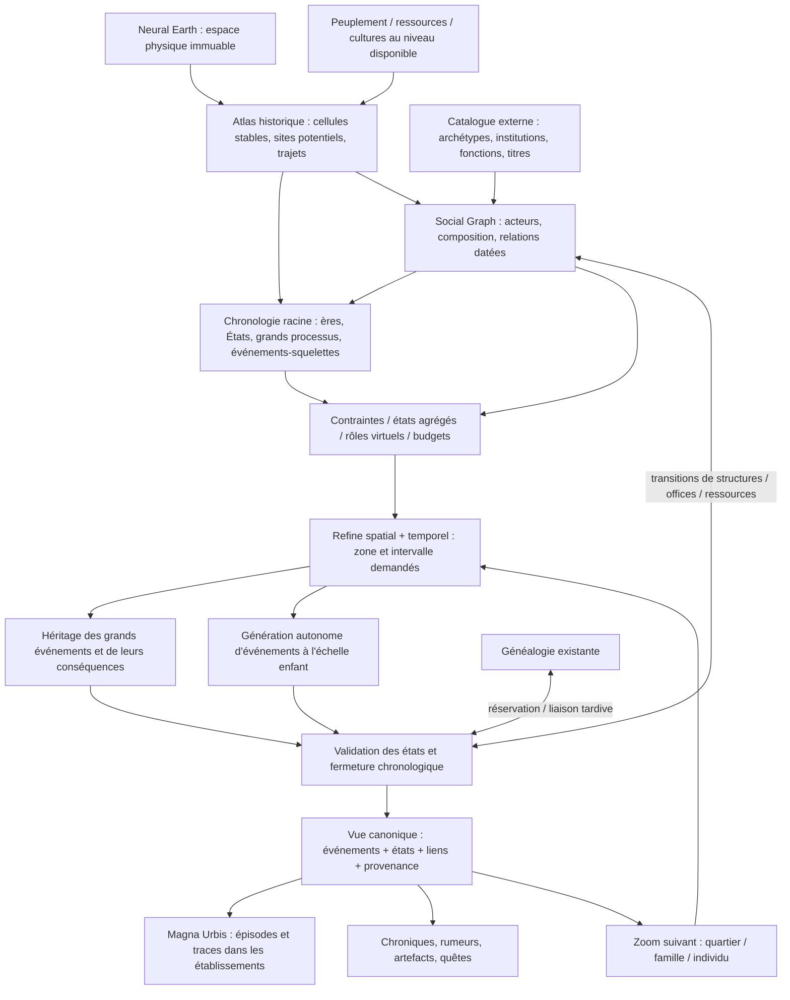
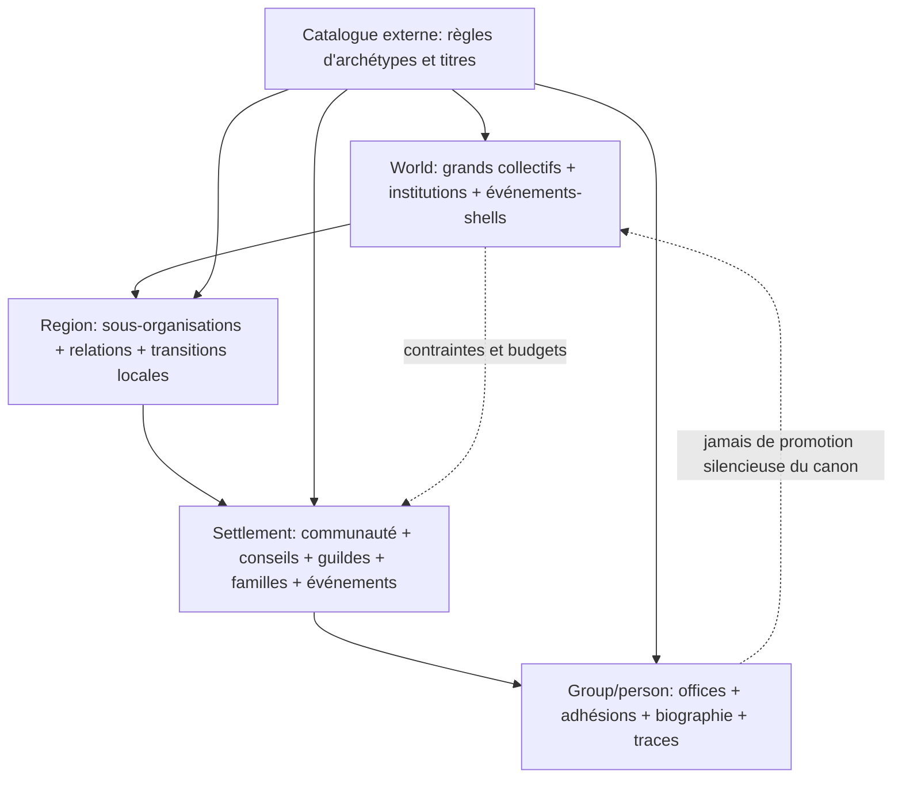

# Génération d’histoire procédurale multiscalaire — architecture v3 : écosystème d’entités sociales

**Étape 2 — conception consolidée et revue critique**  
**Projet :** Neural Earth · Magna Urbis · peuplement · cultures · noms · généalogie · catalogue futur des organisations  
**Cadrage :** 21 octobre 2026 — **Révision v3 :** histoire événementielle portée par des entités sociales multiscales  
**Statut :** proposition d'architecture ; algorithmes et budgets non implémentés ni benchmarkés.

> **Principe central.** Lors de la génération du monde, définir **les grandes entités sociales et obligations historiques** (communautés, pouvoirs, institutions, organisations, périodes, événements, effets, causes et rôles virtuels) avec seulement l'état agrégé nécessaire. Quand on zoome **dans l'espace ou dans le temps**, chaque niveau **hérite, concrétise et complète** cette histoire, en générant aussi des événements qui lui sont propres. Les choix d'identité, de date et de localisation sont tardifs quand c'est possible, **mais déterministes et indépendants de l'ordre d'exploration**.

**Ce qui change réellement par rapport à la v1 et la v2 :** le système n'est plus conçu autour d'un simulateur macro produisant un journal essentiellement détaillé en aval, ni d'une chronologie dont les acteurs sociaux ne seraient que des étiquettes ajoutées ensuite. C'est une **coévolution à résolution progressive d'entités sociales et d'événements** : l'histoire canonique est event-first pour la sélection narrative des faits, mais le graphe social et les règles institutionnelles sont des contraintes de premier ordre pour expliquer et valider ces faits. Chaque échelle possède sa propre dynamique. On peut créer « une ville subit une épidémie –30 % en 1356 » sans construire ses rues ; « un héros d'un petit village sauve le roi » sans connaître son village ni sa lignée ; puis résoudre les effets et les identités aux échelles nécessaires.

## Sommaire

1. [Cahier des charges, vision et axiomes](#1-cahier-des-charges-vision-et-axiomes)
2. [Littérature scientifique et projets existants](#2-ce-quapportent-réellement-la-littérature-et-les-projets-existants)
3. [Architectures comparées](#3-architectures-comparées-et-choix-révisé)
4. [Architecture recommandée](#4-architecture-recommandée--générateur-dhistoire-fractale-sous-contraintes)
   - [4A. Modèle générique d'entités sociales, organisations, titres et institutions](#4a-modèle-générique-des-entités-sociales--nouveau-cœur-du-moteur)
5. [Support géographique, peuplements et ressources](#5-représentation-spatiale-populations-états-et-ressources)
6. [Entités concrètes, virtuelles et événements](#6-ontologie--entités-concrètes-entités-virtuelles-et-événements-à-raffiner)
7. [Familles de processus et d'événements](#7-catalogue-des-processus-et-des-événements)
8. [Génération initiale et événements à la demande](#8-génération--chronologie-mondiale-précoce-et-événements-à-la-demande)
9. [Causalité rétrospective](#9-causalité--événement-dabord-explication-ensuite-sans-falsifier-les-états)
10. [Raffinement procédural spatio-temporel](#10-raffinement-procédural-spatio-temporel--cœur-du-moteur)
11. [Histoire libre et présent imposé](#11-deux-modes-de-génération--passé-libre-ou-présent-imposé)
12. [Raccordement généalogique](#12-généalogie--personnes-parentés-dynasties-offices-et-acteurs-sociaux)
13. [Démonstrations détaillées](#13-démonstrations--du-monde-aux-organisations-et-villages)
14. [Interfaces Rust](#14-architecture-rust--api-dhistoire-à-résolution-progressive)
15. [Déterminisme et édition](#15-déterminisme-spatio-temporel-cache-édition-et-persistance)
16. [Performances](#16-performances--compter-les-acteurs-pertinents-obligations-et-requêtes)
17. [Tests de validation](#17-validation--histoire-cohérente-mais-également-invariante-au-zoom)
18. [Plan de réalisation](#18-plan-de-développement-v3--prouver-le-zoom-social-avant-les-centaines-de-types-dorganisations)
19. [Décisions et risques](#19-décisions-de-conception-limites-et-contre-propositions-maintenues)
20. [Références commentées](#20-références-commentées-et-sources-complémentaires)

---

## 1. Cahier des charges, vision et axiomes

### 1.1 Vision mise à jour : l'histoire existe avant son détail

**Le moteur possède deux primitives complémentaires : une entité sociale réifiée mais partiellement abstraite, et une obligation historique structurée qui relie et transforme ces entités.** Au niveau mondial, un événement peut être vrai tout en ayant des acteurs non nommés, un lieu défini par une région plutôt qu'une coordonnée, et des manifestations locales encore inconnues. À mesure qu'on zoome, ses obligations sont spécialisées et de **nouveaux événements propres à l'échelle consultée** apparaissent. Les identités se résolvent à la dernière échelle utile.

Exemple volontairement schématique :

```text
MONDE, 1200–1500 : un empire décline ; deux religions se divisent ; une pandémie traverse un continent.
  ↓ zoom, royaume 4, 1300–1400
ROYAUME : 1356, la troisième grande ville de cette époque perd 30 % de ses habitants ;
          un conflit de succession implique une maison dirigeante encore partiellement virtuelle.
  ↓ zoom, vallée de l'est, 1350–1370
RÉGION : l'épidémie arrive par un marché fluvial ; les villages des routes commerciales sont exposés ;
         un convoi royal est attaqué sur une route déterminée.
  ↓ zoom, village de la vallée, 1354–1362
VILLAGE : quarantaine, disparition d'une famille, foire annulée, conflit sur un héritage ;
          le futur sauveur d'un roi pourrait être originaire d'ici si un rôle historique l'y réserve.
  ↓ zoom, famille / bâtiment
PERSONNES ET TRACES : actes d'état civil, morts compatibles avec la généalogie, chapelle,
                      pont reconstruit, récit incomplet d'un témoin.
```

Trois mécanismes **complémentaires** sont donc nécessaires :

- **raffinement du graphe social** : matérialiser les organisations, sous-organisations, affiliations, fonctions et règles institutionnelles seulement au niveau requis ;
- **décomposition descendante** : rendre concret ce qui était déjà obligé ou rendu probable par un événement plus global ;
- **génération autonome locale** : inventer l'histoire ordinaire ou remarquable d'un lieu sans qu'elle ait été explicitement annoncée à l'échelle du monde, en respectant néanmoins les contraintes héritées.

L'échelle temporelle est également progressive : une période de 100 ans peut contenir une crise dont on fixe le début et la fin ; au zoom temporel, on précise les phases, saisons, actions et conséquences. **Zoomer n'est pas rejouer une histoire différente.**

### 1.2 Contraintes du projet

- Planète de taille terrestre, avec potentiellement des centaines de millions d'habitants ; histoire plafonnée à **2 000 ans**.
- Monde fantasy à technologie stable ou peu évolutive ; cultures, religions, institutions, économies, armées et organisations continuent de changer.
- Relief, hydrographie et climat de référence stables ; événements ponctuels possibles (sécheresse, peste, séisme), sans reconstruction rétroactive de l'atlas climatologique actuel.
- Générateur de généalogie **déjà existant** : environ 5 % des personnes peuvent être détaillées, mais la chronologie n'a pas à les simuler toutes. Les individus ordinaires créés à la demande n'influencent pas silencieusement le canon macro.
- Deux directions : création du passé vers un présent résultant **ou** reconstitution d'une histoire compatible avec un présent déjà peuplé.
- Rust (avec exposition WASM possible), entrée et sortie progressives, objectif de génération initiale en **quelques dizaines de secondes**, sans promesse de performance non vérifiée.
- Entités sociales **génériques et récursives**, du personnage au peuple / empire, avec composition, affiliations multiples, ressources, objectifs, institutions, fonctions, titres et influences spatio-temporelles. Le catalogue culturel des types et noms d’organisations sera un **projet indépendant**, consommé par une interface versionnée.
- Déterminisme : même seed, mêmes versions, mêmes entrées et mêmes paramètres → même histoire, quel que soit l'ordre des zooms, des années consultées et des tuiles visitées.
- Une édition d'auteur peut provoquer un **rejeu intégral** : la stabilité est exigée *à l'intérieur d'une version de canon*, pas à travers des éditions contradictoires.

### 1.3 Huit axiomes structurants

1. **Canonicalité partielle :** un fait peut être définitif sans que ses participants, coordonnées exactes ou détails matériels le soient.
2. **Raffinement monotone :** un niveau enfant ajoute des informations et des événements, mais ne contredit pas les vérités, bilans et contraintes de son parent. « Monotone » vaut au sein d'un canon fixé ; une édition crée un nouveau canon.
3. **Histoire propre à chaque échelle :** chaque niveau peut créer ses propres événements. Ils ne sont pas tous des sous-événements directs d'une guerre ou d'une catastrophe mondiale.
4. **Portée de causalité bornée :** un événement dont l'effet dépasse un territoire ou une échelle doit avoir été décidé ou réservé à un ancêtre capable de couvrir cette portée, indépendamment du premier enfant consulté.
5. **Identités à résolution tardive :** villes, héros, familles, artefacts et lieux peuvent être des rôles virtuels jusqu'à leur affectation déterministe à une identité compatible.
6. **Séparation entre faits, événements et récits :** une chronique mensongère est permise ; une contradiction dans l'état effectif de la ville ne l'est pas.
7. **Acteurs sociaux de premier ordre :** les événements sont rendus possibles, déclenchés, subis ou interprétés par des entités sociales dont les capacités, ressources, buts, relations et institutions ont une histoire.
8. **Réification sans confusion des relations :** une entité composée, ses membres, les autorités qui la gouvernent, sa population et les territoires qu'elle influence sont des notions distinctes ; elles peuvent se chevaucher et varier indépendamment dans le temps.

### 1.4 Trois objets distincts de vérité

- **État** `S(zone, t)` et **état social** `S(entity, t)` : population, contrôle, stocks, organisations, compositions, affiliations, institutions, objectifs, titulaire des fonctions, influence et occupation d’un site.
- **Événement** `E` : ce qui se passe, quand et dans quelle portée, avec préconditions, effets, causes, **acteurs sociaux, fonctions/mandats et conséquences institutionnelles**, et éventuellement identités virtuelles. Le fait peut être fixé au monde et détaillé au village.
- **Récit** `R(E, source, t)` : la connaissance, la représentation ou le mensonge produit par un témoin, un temple ou un historien.

Les mêmes faits alimentent la carte temporelle, les généalogies, la morphologie urbaine et le contenu RPG ; les descriptions textuelles ne constituent jamais une deuxième source de vérité.

### 1.5 Exemple qui tranche la philosophie

« **En 1356, la ville 3 du royaume 4 perd 30 % de sa population dans une maladie.** »

C'est un événement parfaitement valide **sans génération préalable des rues, des familles ou de tous les quartiers**. Si les grandes villes disposent d'un registre d'ancrages léger, il peut référencer `SiteId=...` dès ce niveau ; sinon, `third_major_city(polity_4, at=1356)` est une référence virtuelle dont la résolution doit se fonder sur un classement temporel **stable**, pas sur la troisième ville visitée par la caméra. Les 30 % sont une contrainte sur la population de la ville **en 1356**, non sur celle d'aujourd'hui. À la visite de la ville, on crée les quartiers abandonnés, morts compatibles, cimetières, réformes, reconstructions et récits propres au lieu.

Autre exemple : « **Un héros venu d'un petit village du royaume 5 sauve le roi** ». Le fait du sauvetage est fixé ; le village et l'identité généalogique du héros peuvent demeurer des **slots**. Le moteur les résout déterministement et sous contraintes à une échelle ultérieure, sans choisir opportunément le premier candidat exploré.

---

## 2. Ce qu'apportent réellement la littérature et les projets existants

La conception proposée est une **synthèse d'approches** ; aucun des travaux suivants ne livre à lui seul un générateur historique planétaire, paresseux, causal et reproductible. Les analogies sont signalées comme telles. Les capacités de jeux citées sont documentées ; aucun benchmark comparatif n'a été réalisé ici.

### 2.1 Travaux les plus déterminants pour cette version

| Source | Résultat / principe documenté | Transfert proposé | Limite à ne pas oublier |
|---|---|---|---|
| **Grinblat & Bucklew, 2017 — *Caves of Qud*** [[R21]](#r21) | Génère d'abord des événements des biographies de sultans, puis **rationalise a posteriori** leurs raisons à partir d'un état partagé ; génère des traces tangibles au cours du jeu. | Excellent précédent pour l'approche **event-first** et les motifs trouvés après la proposition d'événement. | Les auteurs ne cherchent pas une simulation physiquement et géopolitiquement exhaustive : il faut ajouter contrôles de faisabilité, bilans et causalité canonique distincte des récits. |
| **Riedl & Young, 2010 — narrative planning** [[R3]](#r3) | Plans qui relient événements, conditions et intentions des personnages. | Valider la logique des acteurs, intentions et dépendances des événements remarquables. | Pas de planification globale exhaustive sur 2 000 ans ; utiliser des schémas bornés. |
| **Erol, Hendler & Nau, 1994 — HTN** [[R22]](#r22) | Décomposition hiérarchique d'une tâche abstraite en sous-tâches sous contraintes. | Analogie technique pour « guerre → campagnes → sièges → actions locales ». | **Une histoire n'est pas uniquement un plan** : il faut aussi générer des événements locaux autonomes et synchroniser les états. |
| **Smith & Mateas, 2011 — PCG par contraintes** [[R23]](#r23) | Décrire explicitement un espace de solutions, puis en extraire des instances valides. | Modéliser les slots d'identités, obligations et relations temporelles par contraintes typées ; ASP/solveur en option ciblée. | Résoudre globalement toutes les combinaisons serait trop coûteux au runtime. |
| **Cousot & Cousot, 1977 — interprétation abstraite** [[R24]](#r24) | États abstraits synthétisant des propriétés d'états concrets. | **Inspiration formelle**, non application directe : le parent maintient des propriétés que les enfants doivent respecter. | Les propriétés exactes doivent être distinguées des simples bornes approximatives ; pas de preuve générale sans formalisation. |
| **Mathieu, Morvan & Picault, 2018 — simulation multiniveau** [[R2]](#r2) | Patrons de couplage d'abstractions et de granularités différentes. | Concevoir états agrégés, sous-modèles locaux et interfaces de passage. | Interdire la remontée spontanée d'effets non réservés si l'indépendance à l'ordre du zoom est obligatoire. |
| **Salmon et al., 2011 — RNG à compteur** [[R5]](#r5) | Tirages adressables par clé et compteur, indépendants d'un flux pseudo-aléatoire global. | Chaque fait local est indexé par monde, événement parent, cellule, temps et slot sémantique. | Le RNG ne résout **ni la concurrence entre slots ni les contraintes d'état**. |

### 2.2 Autres sources utiles conservées

| Source | Apport dans le projet |
|---|---|
| **Turchin et al., 2013** [[R1]](#r1) | Géographie, voisinage, pression politico-militaire et évolution macrosociale : des *facteurs* pour sélectionner les événements mondiaux/régionaux, pas une loi historique universelle. |
| **Ye et al., 2022 — Neural Story Planning** [[R4]](#r4) | Chaînage arrière et recherche de supports causaux ; l'emploi d'un réseau n'est pas nécessaire à l'exécution du moteur proposé. |
| **Allen, 1983 — intervalles** [[R6]](#r6) | Représenter les durées, chevauchements, antériorités et contraintes entre événements et règnes. |
| **Gillespie, 1977** [[R7]](#r7) | Idée de déclenchement stochastique événementiel à risques plutôt qu'un tick fin universel ; la simulation chimique n'est pas une théorie de l'histoire. |
| **Seshat / Turchin et al., 2018** [[R8]](#r8) | Variables comparatives et variations institutionnelles ; calibration prudente pour fantasy. |
| **Event Sourcing (Fowler)** [[R9]](#r9) | Journal canonique, snapshots, rejouement et éditions auteur. |

### 2.3 Projets et jeux : transposer leurs bonnes idées, pas leur architecture complète

| Projet | Ce qui est utile | En quoi ta proposition diffère |
|---|---|---|
| **Dwarf Fortress** [[R10]](#r10) | États, civilisations, sites, figures historiques minoritaires, journaux de légendes. | Son historique est très largement généré lors de la création du monde. Ici, la richesse des événements est produite **à tous les zooms**, tandis que le canon global demeure léger. |
| **Caves of Qud** [[R11]](#r11), [[R21]](#r21) | Événement → justification après coup → artifactisation : sanctuaire, livre, objet, site. | Étendre des biographies de quelques souverains à un **réseau spatial et temporel** d'événements, relié aux bilans et à la généalogie. |
| **Neighborly** [[R12]](#r12) | Histoires émergentes à petite échelle, liens sociaux et dynamiques de communauté. | À activer **dans un établissement sélectionné**, pas sur 100 millions d'habitants. |
| **Talk of the Town / Bad News** [[R13]](#r13) | Une histoire familiale/sociale cohérente peut alimenter des récits RPG riches. | Ton grand graphe historique reste la contrainte externe ; le simulateur social ne choisit pas rétrospectivement les guerres continentales. |
| **Azgaar Fantasy Map Generator** [[R14]](#r14) | Couches de populations, cultures, États et routes utilisables comme support d'histoire. | Il manque le contrat strict de génération temporelle par zoom que tu vises. |
| **Sovereign** [[R15]](#r15) | Exemple de partition des préoccupations géopolitiques. | Un précédent à explorer sans le prendre pour un moteur mature démontré. |
| **Neural Earth** [[R16]](#r16) | Atlas physique/climatique, tuiles et LOD géographiques ; architecture Rust/WASM. | La chronologie est une **couche de conditions historiques**, au-dessus des champs physiques immuables. |
| **Magna Urbis** [[R17]](#r17) | Génération d'implantations et morphologie urbaine (noyaux, quartiers, rues, parcelles, bâti). | Les générations locales doivent intégrer des **épisodes morphologiques datés**, pas seulement un style ou un drapeau `ruined`. |

### 2.4 Conséquence conceptuelle de la revue

On peut distinguer trois traditions :

1. **Simulation historique** (Dwarf Fortress, cliodynamique) : des états et interactions produisent les événements.
2. **Génération événementielle narrativisée** (*Caves of Qud*) : des événements intéressants sont choisis, puis justifiés et matérialisés.
3. **Décomposition/constrainte** (HTN, PCG déclarative, simulation multiniveau) : un événement ou état abstrait autorise plusieurs concrétisations, mais celles-ci doivent respecter ses propriétés.

**Ta vision combine (2) + (3), avec un (1) léger.** Le moteur est **piloté par les événements** ; il conserve assez d'état agrégé pour interdire l'impossible et pour garantir les transitions. Il n'est pas un « Dwarf Fortress accéléré », ni un arbre de fiction déconnecté du monde.

---

## 3. Architectures comparées et choix révisé

| Approche | Principe | Avantages | Limites | Décision |
|---|---|---|---|---|
| **A. Simulation exhaustive globale** | Toutes les entités et tous les événements sont précalculés. | Continuité émergente. | Volume et coût incompatibles avec planète + 2 000 ans + quasi-runtime. | Non. |
| **B. Événements globaux puis décoration indépendante** | On génère guerres et pestes, chaque village tire ses propres anecdotes. | Simple, rapide. | Incohérences, résultats dépendant du zoom, bilans non conservés, lieux virtuels non résolus. | Non comme architecture complète. |
| **C. Histoire locale entièrement indépendante** | Chaque cellule possède une fonction pure `history(seed, cell, date)`. | Lazy et déterministe. | Un événement traversant deux cellules risque d'être représenté deux fois ou contradictoirement ; aucune causalité régionale partagée. | Seulement pour événements véritablement locaux. |
| **D. Simulateur macro d'abord, effets locaux ensuite** | Simulation dense du monde, puis détails à la demande. | Modèle relativement facile à raisonner. | Les niveaux intermédiaires risquent de rester de simples *développements de conséquences* ; laisse trop peu de place à l'histoire autonome du village. | Conserver comme composant, **plus comme philosophie centrale**. |
| **E. Chronologie récursive d'acteurs sociaux et d’événements, sous contraintes d'état** | Le monde instancie les **entités sociales importantes et obligations majeures**, comme ancrages partiels. Chaque enfant raffine les organisations et événements hérités **et** génère des événements propres ; identités liées tardivement. | Correspond à la navigation spatiale/temporale, au RPG, au déterminisme et à la diversité des échelles. | Nécessite contrats de raffinement, règles d'ownership et index d'ancrages virtuels. | **Architecture recommandée v3.** |

### Pourquoi ne pas tout déclarer « virtuel » ?

Certaines informations doivent être suffisamment définies tôt pour produire des interactions globales plausibles : qui contrôle quels territoires, quelles régions peuvent se joindre, où sont les corridors, quelle est la masse de population disponible et quelle ville est la capitale. **Définir tôt une identité minimale ou une contrainte n'implique pas instancier sa représentation détaillée.**

### Pourquoi ne pas tout figer au niveau mondial ?

Parce que le village d'un petit hameau peut connaître un incendie, une élection communautaire, un mariage, une légende, une migration familiale ou un conflit foncier qui n'a jamais été mentionné dans une chronologie continentale. Ces faits apparaîtront **au bon niveau**, sans casser les invariants et sans devoir être autorisés un à un par le monde.

### Principe de compromis

**Canon précoce sur les acteurs, institutions et conséquences qui franchissent les frontières d’échelle ; canon tardif mais déterministe sur les sous-organisations, titulaires, événements et détails qui peuvent attendre.**

Ce compromis n'est pas identique à la simple règle « les gros événements sont globaux ». Une action minuscule peut être importante mondialement (une lettre déclenchant une guerre), et une catastrophe immense peut rester confinée à une grande région. C'est la **portée causale et la visibilité nécessaire** qui déterminent l'étage de décision, pas seulement la taille spectaculaire de l'événement.

---

## 4. Architecture recommandée : générateur d'histoire fractale sous contraintes

### 4.1 Vue d'ensemble



Il s'agit d'un **graphe de dépendances logique**, pas d'un pipeline entièrement synchrone. On n'exécute pas tous les étages à la création du monde.

### 4.2 Les deux axes du zoom

L'espace et le temps sont indépendants :

| Spatial | Unités typiques | Temporel typique | Ce qui est généré |
|---|---|---|---|
| Planète/continent | grands ensembles et routes majeures | siècles/décennies | émergence/disparition d'États, grandes guerres, pandémies, migrations, schismes, événements climatiques exceptionnels |
| Royaumes/provinces | territoires, corridors, villes structurantes | décennies/années | successions, campagnes, réformes, crises régionales, faits de grands sites |
| Région/vallée | routes, ports, bourgs, campagnes | années/mois/saisons | épidémies locales, marchés, raids, combats, migration, changements de propriété |
| Village/ville | site, quartiers, institutions | années/jours | incendies, famines, fondations de rues, querelles, décisions d'un conseil, actions de figures locales |
| Famille/bâtiment | personnes, objets, parcelles | jours/événements | vies, transmissions, traces et témoignages, microhistoire |

**Ce tableau est indicatif** : une guerre continentale a parfois une date précise connue dès la racine ; un changement lent de pratique agricole peut demeurer flou même au zoom local. La résolution spatiale ne doit pas forcer mécaniquement une résolution temporelle donnée.

### 4.3 Ce qui est fixé à chaque niveau

Un nœud `(cellule_historique, intervalle_historique, politique_de_résolution)` possède une *enveloppe canonique* :

1. `inherited` : événements des ancêtres qui recoupent le nœud, et contraintes imposées par eux ;
2. `anchors` : états et identités minimales déjà connues (site, capitale, territoire, famille nommée, route), **acteurs sociaux importants, fonctions requises et institutions actives à la période** ;
3. `obligations` : slots à résoudre, budgets à allouer et faits significatifs à respecter ;
4. `native_events` : événements dont **l'étage de décision** est ce nœud ;
5. `derived_effects` : impacts et sous-événements issus d'événements supérieurs ;
6. `states` : snapshots ou bornes qui permettent de vérifier le passé et le présent local, y compris **les états et relations du graphe social**.
7. `social_refinements` : sous-collectifs, offices, adhésions, sous-structures, influences et objectifs matérialisés à ce niveau.

Un événement local n'a donc **pas besoin d'être fils d'un événement mondial**. Il peut être `native_event` d'une cellule, mais il est toujours conditionné par son environnement historique hérité.

### 4.4 Trois catégories d'événements — distinctes de leur importance

| Catégorie | Exemple | Ce qui est fixé tôt | Ce qui reste libre au zoom |
|---|---|---|---|
| **Identité connue, détail incomplet** | 1356, ville `city_3` du royaume `polity_4`, maladie, population –30 %. | site stable, an 1356, effet démographique, contexte ; éventuellement agent pathogène | quartiers touchés, malades, religieux, politique sanitaire, chapelles, séquelles |
| **Identités virtuelles / slots** | Un héros d'un petit village de `polity_5` sauve le roi en 1398. | existence de l'événement, contraintes sur rôle/origine/vie du héros | quel village, quelle lignée, circonstances exactes, lieux commémoratifs |
| **Processus distribué / contrat d'impacts** | Épidémie de 1354–1360, mortalité par région et propagation dans les ports. | enveloppe géographique/temporelle, totals/bornes démographiques, routes de propagation | vagues villageoises, traitements, quarantaine, victimes, ruines |

**Rappel :** `native_event` désigne un **mode de création**, pas une quatrième catégorie d'identité. Une foire villageoise peut avoir une identité connue mais être créée uniquement au village.

### 4.5 La « propriété » d'un événement ne dépend pas du zoom affiché

Chaque événement possède un *niveau propriétaire* (`owner_scope`), c'est-à-dire le plus petit domaine canonique suffisamment large pour englober son **effet causal externe**. Une bataille touchant deux régions appartient à un domaine parent commun, même si sa géométrie chevauche une frontière. Un conflit entre deux villages voisins peut appartenir à leur région englobante. Un incendie sans conséquence extérieure peut appartenir au village.

**Règle d'ownership :** un événement est engendré **une seule fois**, par sa fonction générative canonique liée au propriétaire, à une période et à un slot sémantique ; les autres cellules n'en contiennent que des références/projections. Ainsi une épidémie ou un siège n'est jamais tiré séparément de chaque côté d'une frontière.

Pour des États aux frontières mouvantes, on utilise un support **géographique stable** et des relations politiques datées, jamais une partition définie par les frontières actuelles.

### 4.6 Une chronologie est à la fois un DAG et une hiérarchie

Ne pas confondre les deux relations :

- **Décomposition** `PART_OF` : épidémie continentale → vague régionale → quarantaine de ville → événement de famille. C'est un graphe de composition, pouvant suivre l'axe spatial et temporel.
- **Causalité** `CAUSES / ENABLES / MOTIVATES` : sécheresse → pénurie → émeute ; mariage dynastique → revendication → guerre. Ces arêtes peuvent traverser les niveaux et ne sont pas nécessairement des liens parent-enfant.

Exemple : une querelle familiale **cause** une révolte déjà réservée au niveau provincial. La querelle peut n'être *décrite* qu'au zoom village, mais son existence comme **rôle causal déclencheur** a été réservée au niveau provincial : il ne faut pas la découvrir par hasard puis créer la révolte après coup.

### 4.7 Formulation conceptuelle

Pour une zone `z`, une fenêtre temporelle `I` et un niveau de détail `ℓ` :

\[
\mathcal H(z,I,\ell) = \operatorname{Refine}\bigl(\operatorname{Ancestors}(z,I),\, \operatorname{LocalContext}(z,I),\,\operatorname{Key}(z,I,\ell)\bigr).
\]

L'objectif est que la projection d'une histoire fine vers les **observables de l'échelle parent** respecte les faits et bilans établis :

\[
\pi_{\mathrm{parent}}(\mathcal H_{\mathrm{child}})\models\mathcal C_{\mathrm{parent}}.
\]

Il ne s'agit **pas** d'exiger que la liste d'événements du parent soit exactement l'union des listes enfants : des événements autonomes peuvent apparaître au zoom ; ils doivent seulement ne pas contredire les contraintes parentales. Pour une grandeur conservée (morts, migrés, stocks), le contrat peut imposer une égalité d'agrégation, et non une simple compatibilité logique.

---

## 4A. Modèle générique des entités sociales — nouveau cœur du moteur

> **Décision d'architecture v3 :** la chronologie et le moteur social ne sont pas deux couches indépendantes à relier après génération. Une histoire canonique est une **succession de transitions sur un graphe d'entités sociales évolutif**, enrichie d'événements exogènes (climat exceptionnel, séisme, épidémie) et d'événements narratifs dont la résolution demeure partielle. Les entités ne doivent pas pour autant être détaillées ni simulées individuellement dès leur apparition.

### 4A.1 Entité sociale, acteur intentionnel, population et lieu : quatre notions différentes

Une **entité sociale** est une identité durable ou relativement durable, qui peut être un individu, une parenté, un foyer, une bande, une guilde, une communauté villageoise, un ordre religieux, une institution politique, une alliance, un État, une confédération, un groupe d'appartenance culturelle ou une catégorie collective. Un **acteur** est une entité à laquelle on peut attribuer un choix ou une action cohérente à une résolution donnée. Une **population** est un ensemble d'individus agrégé à des fins statistiques ; ce n'est pas automatiquement une organisation. Un **lieu** est un support physique ; l'occupation, la communauté, l'administration et la propriété de ce lieu sont des entités ou des relations sociales **distinctes**.

| Élément | Exemple | Peut-il vouloir / décider ? | État conservé |
|---|---|---|---|
| `Person` | artisan, roi, prêtre | oui, avec compétences et contraintes | vie + références généalogiques + offices tenus |
| `SocialCollective` | famille, bande, guilde, monastère, gouvernement | oui si mécanisme de décision ou représentant | membres, organisation, ressources, buts, règles |
| `PopulationCohort` | habitants du val, minorité, espèce, peuple au sens démographique | pas par défaut ; agrégation de comportements ou via représentants | effectifs, distribution, réseaux, territoires |
| `Place / Site` | village, port, château, vallée | non | géométrie, habitat, infrastructures |
| `Institution / Office` | conseil, abbatiat, prévôté, charge de margrave | ce sont des dispositifs de décision / d'autorité, non des personnes | compétences, règles, détenteurs, périodes |
| `ExternalProcess` | peste, volcan, sécheresse | non | contraintes physiques et impacts |

Une espèce (« race » au sens des taxonomies fantasy) peut être un **groupe identitaire ou démographique** sans constituer une personne morale dotée d'une volonté commune. Les chefs, ambassadeurs, ordres ou coalitions qui prétendent la représenter sont, eux, des acteurs concrets ou virtuels. Éviter d'attribuer une guerre à « tous les Elfes » sans organisation ou mécanisme de représentation identifié.

### 4A.2 Une entité est une réification : shell canonique + état daté + détail paresseux

On conserve un `SocialEntityId` stable, des intervalles d'existence, un archétype potentiel (`archetype_id`) et un **état social partiellement connu** :

```text
SocialEntity(entity_id)
 ├─ nature                  individu | collectif | population-agrégat | autre
 ├─ lifespan                fondation / apparition → transformations → dissolution
 ├─ form                    type d'organisation + version de ses institutions
 ├─ structure               sous-entités + modes de composition et coordination
 ├─ membership              affiliations et populations observées ou agrégées
 ├─ resources               actifs, stocks, flux, droits, dettes, accès, savoirs
 ├─ goals                   intentions / préférences / objectifs contradictoires
 ├─ governance              règles de décision, succession, recrutement, sanction
 ├─ offices                 fonctions, titres, autorités, titulaires éventuels
 ├─ influence               distributions spatiales et sociales, variables avec le temps
 ├─ relations               graphes multiplexes vers autres entités, datés
 └─ canonical_obligations   faits/slots réservés à matérialiser lors des zooms
```

À la racine du monde, un empire peut n'avoir que : `existence=[620,1432)`, régime, superficie/contrôle approximatif, recettes estimées, rivaux, objectifs dominants et deux transitions majeures. Un village peut n'être représenté que par `SiteId`, un `VillageCommunitySlot` et ses contraintes démographiques. Au zoom, ces enveloppes se spécialisent sans que l'identité historique de l'empire ou du village change.

**Forme conceptuelle :** `S_e(t) = (M_e, I_e, O_e, R_e, G_e, F_e, L_e)_t`, où `M` = composition/adhésions, `I` = institutions, `O` = offices, `R` = ressources, `G` = buts, `F` = influences, `L` = liens. Chaque événement applique une transition vérifiable `S(t−) --E--> S(t+)`. Les composants peuvent être des intervalles, des quotas ou des slots tant qu'ils ne sont pas nécessaires au détail.

### 4A.3 Composition, appartenance, représentation et pouvoir : ne surtout pas fusionner les arêtes

Un même individu peut appartenir **simultanément** à une famille, un métier, une religion, une administration, une milice et une communauté villageoise. Ces collectifs ne s'emboîtent donc pas dans un arbre unique. Prévoir un **graphe orienté, typé, temporel**, avec au moins :

- `COMPONENT_OF` : unité constitutive explicitement définie (ex. compagnie dans une armée) ; acyclique quand il s'agit de composition stricte ;
- `MEMBER_OF` / `AFFILIATED_WITH` : appartenances et identités multiples ; souvent chevauchantes ;
- `HOLDS_OFFICE` / `REPRESENTS` / `DELEGATES_TO` : rôles, porte-parolat, mandats, pouvoir d'agir ;
- `GOVERNS` / `COMMANDS` / `SUBJECT_TO` / `JURISDICTION_OVER` : rapports d'autorité, non synonymes d'appartenance ;
- `OWNS` / `CONTROLS` / `USES` / `CLAIMS` / `OWES` : droits, exploitation et ressources ;
- `ALLIED_WITH` / `RIVALS` / `TRADES_WITH` / `PATRON_OF` / `IN_CONFLICT_WITH` : relations sociales et économiques multiplexes ;
- `DESCENDS_FROM` : référence vers le moteur généalogique, pas copie du graphe familial.

Les relations sont **datées et typées**, souvent pondérées et directionnelles : l'alliance A→B peut ne pas impliquer une réciprocité effective ; une autorité politique peut se superposer à une institution religieuse. On peut utiliser un graphe typé multi-couches comme index compact sans imposer Neo4j ou un graphe global dense [[R27]](#r27).

**Invariants :** la population d'une ville ne doit pas être la somme des effectifs de ses guildes, familles et congrégations, puisque les appartenances se chevauchent. L'agrégation démographique doit partir de **cohortes disjointes ou de comptages dédoublonnés** ; le nombre de membres de l'ordre n'est pas un nouveau stock de personnes.

### 4A.4 Influences spatiale, temporelle et sociale

Une entité peut posséder plusieurs empreintes, **toutes variables avec la date** :

- `presence(e, z, t)` : personnes, sièges et établissements implantés ;
- `jurisdiction(e, z, t)` : règles/lois applicables, potentiellement contestées ;
- `control(e, z, t)` : contrôle administratif ou militaire de fait ;
- `economic_reach(e, z, t)` : flux, marché, monopole, dette ;
- `cultural_reach(e, z, t)` : diffusion d'une foi, d'une langue, d'un symbole ;
- `recruitment_reach(e, z, t)` : lieux où un groupe peut recruter ;
- `social_influence(e, e2, layer, t)` : influence sur des *acteurs*, pas sur des mètres carrés.

Le siège d'une religion peut être dans une seule ville, ses membres sur plusieurs continents et sa juridiction limitée à certains temples ; un marchand peut disposer de droits dans trois ports étrangers sans exercer de souveraineté. Un groupe nomade a une empreinte mobile. Une famille noble possède des terres disjointes. Ne jamais convertir automatiquement « aire d'influence » en frontière politique ou en population.

La **propriété canonique d'un événement** reste déterminée par son rayon causal, parfois supérieur à l'enveloppe spatiale d'un acteur : deux guildes rivales appartenant à plusieurs États peuvent déclencher un conflit transfrontalier, même si leurs sièges sont voisins.

### 4A.5 Règles, institutions, fonctions, titres et compétences

Une organisation n'est **pas** réduite à `hierarchy | democracy | despotism`. Ces valeurs peuvent servir de propriétés générales de gouvernance, mais ne disent pas *qui* peut élire, nommer, légiférer, sanctionner, recruter, emprunter ou déclarer une guerre. Séparer :

1. `OrganizationArchetype` : archétype descriptif externe (guilde artisanale, clan, monarchie, ordre monastique…), indépendant du nom culturel ;
2. `InstitutionSet` : règles à une époque (adhésion, admission, héritage, votes, mandats, contrôle, tabous, obligations, transfert de pouvoir) ;
3. `OfficeDefinition` : **fonction abstraite** dotée de prérogatives (`taxation`, `command`, `judgment`, `appointment`, `religious_authority`…), prérequis de compétences, durée et méthode de nomination ;
4. `TitleForm` : nom culturel et temporel associé à une fonction (roi, margrave, pape, chef, maître, boss) ; un titre ne suffit **pas** à déterminer les pouvoirs ;
5. `OfficeTenure` : occupation datée par une personne, plusieurs personnes, un collectif ou un slot virtuel ;
6. `Skill / Capability` : savoir-faire et capacité effective du titulaire, de son office et de son organisation ;
7. `DecisionProcedure` : conditions et modes d'adoption d'une action de l'organisation (ordre, vote, consensus, clientélisme, autonomie, délégation).

Les règles constitutives (création des fonctions, autorités, membres légitimes) et régulatives (ce qui est permis/interdit/obligatoire) sont différenciées ; cela rejoint l'esprit de *Institutional Grammar 2.0* et le cadre IAD [[R25]](#r25), [[R26]](#r26). **Ce n'est pas une implémentation revendiquée de cette grammaire scientifique**, mais une transposition en DSL procédural.

Exemple : `OfficeDefinition=frontier_governor` peut se nommer « margrave » dans une culture et « gardien des marches » dans une autre. Sous une monarchie A, le roi nomme ce détenteur ; sous une ligue B, les chefs de cités l'élisent. Les prérogatives, la limite du mandat et la légitimité changent donc **même si le rôle militaire paraît équivalent**.

### 4A.6 Objectifs et capacités : comment une organisation devient un acteur historique

Une entité décisionnelle possède un jeu **borné, évolutif et parfois contradictoire** de buts (`survive`, `expand_territory`, `secure_food`, `control_resource`, `gain_legitimacy`, `enforce_faith`, `protect_members`, `increase_trade`, `seek_revenge`, etc.), avec préférences et priorités. Le moteur peut évaluer :

```text
pressure(entity, t) = contexte économique + social + environnemental
feasible_actions = rules(entity,t) ∩ capabilities(entity,t) ∩ resource_budget(entity,t)
possible_intents = prioritize(goals(entity,t), pressure, social_relations)
event_proposals = actions_or_external_shocks(possible_intents, scale, canonical_seed)
validated_event = event + causal_witness + institutional_and_resource_checks
```

Une organisation composite ne partage pas nécessairement un but unique : rivalités entre conseillers et familles, prêtres modérés contre radicaux, guildes concurrentes dans une ville. Une décision de l'État peut ainsi être issue d'un vote, d'une négociation, d'une coercition ou d'un coup d'État **sans avoir à simuler chaque membre** : on matérialise seulement les sous-groupes, mandats et conflits requis par la cause et le résultat.

Dans le paradigme **event-first**, l'événement macro est éventuellement proposé avant son déclencheur. L'algorithme de rationalisation doit alors chercher un `initiator` institutionnellement autorisé, des opposants, des bénéficiaires, des ressources et un mécanisme de décision. Il peut réserver une intrigue familiale ou une faction virtuelle pour expliquer le choix, **mais ne peut pas modifier silencieusement un état antérieur canonique**.

### 4A.7 Cycle de vie des collectifs : l'histoire crée et transforme sa propre structure sociale

Les transitions historiques de premier ordre incluent :

| Transition | Effet sur l'état social | Descente possible au zoom |
|---|---|---|
| Fondation / recrutement | nouvelle identité et composition, seuil de capacité | membres fondateurs, assemblée, siège |
| Croissance / déclin | ressources, membres, influence, puissance | création/déclin de métiers, départs |
| Succession / élection | nouvelle occupation d'office, parfois légitimité contestée | scrutin, héritier, coup de palais |
| Réforme / changement de régime | version des institutions et prérogatives | nouvelle justice, charte, liturgie |
| Scission / schisme | création de collectifs descendants, transferts droits et membres | temple dissident, guilde rivale |
| Fusion / union / fédération | nouvelle relation de composition ou nouvelle personne collective | traités, alliances locales |
| Dissolution / conquête | fin de l'organisation ou du gouvernement, **pas disparition des membres** | administrations remplacées, fuite d'archives |
| Colonisation / changement de contrôle | influence et juridictions modifiées, pas nécessairement identité culturelle | nouvelle garnison, péages |
| Usurpation / clandestinité | discordance de légitimité et contrôle effectif | sociétés secrètes, prétendants |

**Modélisation :** garder les `SocialEntityId` historiques et une chaîne de successeurs (`SUCCESSOR_OF`, `SPLIT_FROM`, `MERGED_INTO`) plutôt que réécrire le passé. Une religion peut survivre à son administration ; un royaume disparaître en laissant ses lignées, ses villes et ses normes.

### 4A.8 Corpus d'archétypes externe, noyau sémantique stable

Le futur projet d'inventaire des organisations doit être un **catalogue de données versionné** — pas un énorme `enum` Rust de tous les types possibles. Le moteur historique définit les **concepts invariants** (`SocialEntity`, `Membership`, `Office`, `InstitutionRule`, `Asset`, `Goal`, `Action`, `Relation`, `InfluenceFootprint`) et un interpréteur de règles. Le catalogue fournit les **profils culturels** : composition attendue, tailles et âges, modes de gouvernance, recrutement, fonctions/titres, prérogatives, ressources typiques, transitions historiques permises/probables, relations, ressources symboliques, contraintes d'espèce, fréquences et traces.

```text
history engine                                  organization catalog (projet indépendant)
---------------------                           --------------------------------------
SocialEntity + SocialGraph  <------------------  archetypes, names, hierarchy templates
Institution/Office Engine  <------------------  rule sets, appointment/succession models
Goal/Action Engine        <------------------  goals, affordances, skills, capabilities
Event Engine + Refiner    <------------------  transitions, frequency, local refinements
Spatial/Temporal Query   <------------------  footprints, memberships, regional weights
```

**Décision de déploiement :** les règles applicables au moment `t` proviennent de la `catalog_version` et de la version historique de l'institution du collectif. La résolution des noms d’organisations et de titres est une opération distincte des identités : les identifiants et archétypes sont stables, tandis que les formes lexicales (culture, langue, époque, exonyme, changement de nom) proviennent du catalogue et du générateur de noms. Un changement de nom ne fonde pas automatiquement une nouvelle organisation. La seed **et les versions du catalogue** doivent entrer dans l'empreinte canonique.

### 4A.9 Ce qui existe déjà dans `dunkean/AI_RPG_Generator` et ce qu'il faut généraliser

Audit ciblé, effectué sur le dépôt public `dunkean/AI_RPG_Generator` (branche principale, 21/10/2026). La source centrale est [`worldbuilder_social_engine_study.md`](https://github.com/dunkean/AI_RPG_Generator/blob/main/worldbuilder_social_engine_study.md), complétée par [`archive/template.py`](https://github.com/dunkean/AI_RPG_Generator/blob/main/archive/template.py), [`src/models/content.py`](https://github.com/dunkean/AI_RPG_Generator/blob/main/src/models/content.py), [`src/prompts/bootstrap.py`](https://github.com/dunkean/AI_RPG_Generator/blob/main/src/prompts/bootstrap.py), [`src/prompts/workplaces.py`](https://github.com/dunkean/AI_RPG_Generator/blob/main/src/prompts/workplaces.py) et [`docs/revue_generation.md`](https://github.com/dunkean/AI_RPG_Generator/blob/main/docs/revue_generation.md).

| Dans le prototype / étude | Reprise dans le nouveau modèle | Précaution |
|---|---|---|
| `Entity`, `Group`, `Person`, `parents`, `sub_groups` | `SocialEntityId`, relations datées de composition et d'adhésion | `parents` d'organisation ≠ `parent_of` généalogique |
| `scale`, `influence_areas`, `external_influences` | empreintes d'influence multiples, relations sociales temporelles | influence ≠ souveraineté, résidence ≠ membership |
| `structure`, `member_bonds`, `common_bonds` | règles de gouvernance, graphes d'appartenance / affinité | typologies de structure insuffisantes pour succession ou vote |
| `goals`, `resources`, `prosperity` | objectifs pondérés, comptes de ressources et droits | « riche » n'est pas un stock historique |
| `role`, `rank`, `job`, `skill_level`, `key_figure` | office, titre, titulaire, compétence, personnage saillant | métier, fonction et titre sont distincts |
| `timeline`, `history`, `anecdotes` | événements canoniques + récits projetés | texte narratif non souverain sur les faits |
| Étude : règles institutionnelles, réseaux multiplexes, event sourcing | cœur de la simulation sociale historisée | adapter du snapshot/LLM au déterministe lazy Rust |

Le code existant témoigne d'une **exploration de génération sociale et de documentation conceptuelle** ; il ne constitue **pas** déjà un moteur historique multiscale déterministe. La revue `docs/revue_generation.md` documente précisément des risques de doublons d'identités, d'emplois multiples non représentés, de quotas de population non conservés et de seeds partielles. Ces défauts doivent être traités comme des **tests de conception obligatoires**, pas comme des choix architecturaux à répliquer.

### 4A.10 Principe de fonctionnement commun aux échelles



**Formule de design v3 :** « Les événements racontent ce qui arrive ; les entités sociales déterminent à qui cela arrive, pourquoi cela devient possible, qui peut agir, et ce que cet événement transforme. Le zoom résout conjointement les événements et les acteurs. »

---

## 5. Représentation spatiale, populations, États et ressources

### 5.1 Ne pas confondre quatre géographies

1. **Géographie physique** : relief, passages, bassins versants, littoraux, biomes ; relativement immuable.
2. **Géographie fonctionnelle** : coûts de voyage, corridors fluviaux et maritimes, routes, marchés, zones d'influence ; évolue quand un pont, un port ou une route apparaît ou disparaît.
3. **Géographie humaine** : population, cultures, langues, religions, réseaux de voisinage et flux de migrants ; évolue continûment.
4. **Géographie politique** : souveraineté, revendications, provinces, confédérations, protectorats, possessions non contiguës ; change beaucoup plus vite et ne doit **pas** constituer la partition spatiale fondamentale.

La principale erreur serait de définir l'histoire sur les **frontières actuelles** : elles sont un **résultat historique**, pas un support immuable.

### 5.2 Maillage canonique + graphe de mobilité

Proposition :

- construire un **maillage géographique stable**, indépendant des frontières et du zoom (cellules géodésiques ou tuiles existantes) ;
- associer à chaque cellule ou agrégat un résumé de population, de capacité agricole, de présence de ressources, de diversité culturelle et d'accès aux réseaux ;
- construire un **graphe de mobilité** : nœuds = ports, cols, passages, capitales, confluences, marchés majeurs, régions ; arêtes = coûts de déplacement et capacités logistiques ;
- représenter les territoires politiques par des **ensembles de cellules datés** et des graphes de vassalité, pas uniquement des polygones colorés.

**Rust :** `h3o` peut servir de grille géodésique hiérarchique [[R18]](#r18) ; `petgraph` convient au graphe de mobilité [[R19]](#r19). Mais si Neural Earth possède déjà des identifiants hiérarchiques pérennes, la meilleure option peut être de **réutiliser son pavage** et de stocker une correspondance vers les cellules historiques. Éviter deux sources de vérité pour les positions.

Une maille de 25–100 km de largeur caractéristique peut être un **point de départ à tester**, pas une résolution universelle. Adapter le détail aux densités, corridors et discontinuités : une région densément peuplée ou un détroit est plus riche historiquement qu'une zone inhabitée de superficie égale.

### 5.3 Population : masses, non individus

Chaque cellule conserve au minimum :

```text
population_total(t)
population_par_culture(t) [sparse]
population_urbaine/rurale(t)
capacité_de_support(t)
production_alimentaire(t)
risques_sanitaires(t)
flux_entrants/sortants(t)
```

Pour l'évolution démographique agrégée :

\[
P_i(t+\Delta t)=\max\{0,\ P_i(t)+B_i-D_i+I_i-O_i\}\,.
\]

Les taux sont modifiés par conflits, famines, épidémies, organisation politique et culture. Ils restent des **modèles stylisés**, pas des équations historiques universelles. Les flux inter-cellules doivent être équilibrés : un groupe migrant compté à l'arrivée est soustrait au départ. Les décès causés par une épidémie et ceux causés par une famine ne peuvent pas compter deux fois les mêmes victimes.

Pour un monde de 100 millions d'habitants, il ne faut **aucune boucle macro par habitant**. Les personnes individualisées sont un service de détail et de références, pas la principale boucle de simulation.

### 5.4 Ressources : quatre régimes différents

| Type | État historique | Exemples | Événements associés |
|---|---|---|---|
| **Renouvelable** | stock, régénération, prélèvement | bois, poisson, gibier | surexploitation, fermeture des forêts, disette |
| **Extractible fini** | gisement fixe, stock restant, coût croissant d'accès | fer, sel, pierre rare, cristal magique | mine découverte, épuisée, conquise |
| **Flux productif** | dépend du lieu, de l'infrastructure et des anomalies ponctuelles | céréales, élevage, énergie hydraulique | récolte désastreuse, irrigation, abandon de champs |
| **Ressource de réseau** | dépend des corridors et du contrôle, non d'un gisement local | commerce, péages, accès au port, eau canalisée | blocus, ouverture de route, destruction d'un pont |

Formule indicative pour un stock local :

\[
R_{t+1}=\max(0, R_t+G(R_t,\text{biome})-E_t-L_t).
\]

`G=0` pour un gisement non renouvelable ; `E` = extraction ; `L` = perte exceptionnelle. **Le stock historique ne modifie pas le relief/climat actuel de Neural Earth.** Il peut en revanche changer l'usage du sol, la répartition des activités et les ruines visibles.

### 5.5 États, pouvoirs et souveraineté

Le moteur doit distinguer : **civilisation/culture**, **État**, **dynastie**, **régime**, **institution**, **titre**, **personne titulaire**, **province**, **territoire contrôlé**, **territoire revendiqué**. Un peuple peut survivre à son État ; une dynastie peut gouverner plusieurs États ; un territoire peut être disputé ; une ville peut changer de nom et de souverain sans être démolie.

Pour éviter l'anachronisme, prévoir plusieurs structures : royaumes, cités-États, empires, confédérations, clans, chefferies, ligues de villes, principautés, théocraties, fédérations, empires tributaires, marches frontalières, pouvoirs nomades. Le « pays » moderne n'est qu'un cas parmi d'autres.

---


### 5.6 Registre d'ancrages historique : ce qui peut être « virtuel » à coût faible

La géographie et le placement de population fournissent un **support de candidats** : cellules, flux, bourgs plausibles, sites existant à telle date, masses d'habitat rural. Il n'est pas nécessaire de générer le plan de chaque ville pour lui attribuer un `SiteId`. Plusieurs options coexistent :

- **site réel léger** : coordonnées/aire et période d'occupation approximative ; nécessaire lorsqu'un événement dépend d'une ville précise ou d'un passage stratégique ;
- **site réservé** : une sous-cellule doit contenir `n` implantations, dont un village satisfaisant des contraintes ; leur géométrie est différée ;
- **rôle sans site précis** : « village d'origine du héros », dont le lieu est lié tardivement à l'un des candidats du registre ;
- **toponyme narratif** : le nom peut être généré encore plus tard, indépendamment de l'existence et de la continuité temporelle du site.

En régime historique, un classement `third_major_city(polity_4, 1356)` doit être fondé sur **l'appartenance politique à l'année 1356** et sur un ordre canonique stable (population estimée en 1356, puis bris d'égalité par ID), pas sur les villes actuellement explorées ni leur puissance actuelle.

Le support spatial est ainsi **un espace de possibilités historiques**, pas une instanciation complète du monde urbain.

---

### 5.7 Nouvelle carte historique : empreintes d'entités sociales et réseaux d'affiliation

La couche des États ne suffit pas. Le domaine géographique reçoit des **superpositions sociales datées** : ordre religieux, aire de recrutement d'une guilde, lignage propriétaire, routes de contrebande, clientèle d'une famille, réseau commercial, corporation de village, peuple diasporique et autorité juridictionnelle. Chaque empreinte doit pouvoir être interrogée par `(area, t, relation_kind, threshold)`, sans parcourir tous les membres ni matérialiser les territoires complets.

Représentation efficace : tuiles stables + index d'intervalles + listes d'organisations **par pertinence**, avec encodage épars pour les organisations globales ; les vastes réseaux sont des champs agrégés ou des graphes routiers, pas une relation par habitant. Une seule cellule peut appartenir à plusieurs juridictions effectives : `effective_control` (arbitrage, contestation), `nominal_suzerain`, `religious_jurisdiction` sont trois requêtes différentes. Lors d'un zoom, le moteur récupère toutes les entités dont la portée croise la fenêtre, qu'elles soient ou non localement domiciliées.

### 5.8 Ressources et droits des acteurs sociaux : séparer stock physique, propriété et contrôle

La conservation des ressources de la section 5.4 s'applique à leur **stock réel**, pas à la somme de leurs revendications. Un gisement peut être **possédé** par une maison noble, **exploité** par une guilde, **taxé** par le royaume et **revendiqué** par une abbaye. Stocker `AssetId` + `resource_amount / flow / location / period` et des relations de droit datées (`OWNS`, `LEASES`, `EXTRACTS`, `TAXES`, `CLAIMS`, `GUARDS`). Pour argent, réserves, dette, grain ou personnes déplacées, les transferts physiques doivent rester comptablement cohérents ; pour prestige, influence, connaissance ou réputation, employer d'autres grandeurs non conservées mécaniquement.

Les droits et accès créent des **capacités d'action** et des conflits historiques. Une guilde peut vouloir obtenir une concession sans posséder la mine ; une famille peut déclencher une révolte parce qu'une réforme retire son droit de péage. Le moteur de causalité exploite ces distinctions.

## 6. Ontologie : entités concrètes, entités virtuelles et événements à raffiner

### 6.1 Identité canonique ≠ instanciation complète

| Objet | Ce qui peut exister très tôt | Ce qui peut attendre | Notes |
|---|---|---|---|
| **Cellule géographique** | identifiant, voisinage, climat, relief, accessibilité | détail sous-maille | Ancre physique stable. |
| **État / polity** | `SocialEntityId`, existence datée, domaine d’autorité, institutions et offices minimaux, relations | cour, bureaucratie, lignées secondaires, titulaires d’offices, postes-frontières | Un État est une entité sociale institutionnelle, pas un simple polygone constant. |
| **Site potentiel** | ID ou **réservation spatiale**, capacité, rang, existence par époque | rues, maisons, noms, incidents ordinaires | Site physique différent de l'établissement et de sa phase d'occupation. |
| **Établissement** | épisodes de fondation/occupation/abandon, fonction/importance estimée | morphologie, propriétaires, vie municipale | Son nom peut changer ; `site_id` demeure. |
| **Famille dirigeante** | `SocialEntityId` de maison/dynastie, droits de succession, offices revendiqués, relations matrimoniales prévues | attribution aux branches individuelles et entourage | La généalogie demeure l’autorité sur les liens de parenté. |
| **Personnage historique** | slot avec âge, rôle, culture/origine, période de vie | PersonId, apparence, proches non essentiels | Son existence historique peut être fixée avant son identité. |
| **Ressource** | aire de présence, stock/potentiel, contrôle stratégique | détails de filons, galeries, acteurs individuels | Ne jamais dépasser stocks et régénération disponibles. |
| **Événement** | type, temps/intervalle, scope, **organisations participantes**, causes, effets agrégés et institutionnels, slots | lieux exacts, initiateurs/mandataires, offices occupés, détails et traces | Les acteurs collectifs ne sont pas de simples libellés. |

Deux niveaux d'instanciation distincts :

- **Ancre canonique légère** : un ID stable et quelques propriétés nécessaires pour raisonner (ex. « ville majeure présente en 1356, rang 3 dans `polity_4` »). Peu coûteuse.
- **Matérialisation** : des objets richement définis (quartiers, PersonId, inventaires, monuments) qui peuvent attendre des requêtes.

En pratique, de nombreux lieux essentiels devraient avoir une ancre dès la construction de l'atlas historique, mais **cela ne contraint pas leur histoire complète** à être calculée.

### 6.2 Formes de références historiques

```rust
// Schéma conceptuel : formes possibles, pas code de production.
enum EntityRef {
    Concrete(EntityId),
    Virtual { slot: SlotId, constraints: Vec<BindingConstraint> },
    Aggregate { selector: SelectorId, at_year: i32 },
}
```

- `Concrete` : ID déjà connu ; peut n'être qu'un `SiteAnchor`, pas une ville générée.
- `Virtual` : événement canonique exigeant un acteur/lieu à choisir plus tard (« sauveur du roi, originaire d'un hameau du royaume 5 »).
- `Aggregate` : « la troisième plus grande ville du royaume 4 en 1356 » ; **un sélecteur temporel stable**, pas le troisième élément d'une `HashMap`, ni le troisième établissement découvert.

**Recommandation :** privilégier un ID de site léger dès qu'un lieu a un effet démographique, économique ou militaire important. Réserver le véritable *late binding* pour les rôles dont l'identité précise n'est pas nécessaire à la simulation à cette échelle. Une référence virtuelle ne doit jamais masquer l'absence d'un domaine de candidats.

### 6.3 Cycle de vie des événements et des identités

Pour un même `EventId` :

1. `Planned` : type et période candidats, pas encore canonique.
2. `CommittedSkeleton` : événement fixé, préconditions et grandes conséquences validées ; slots et détails éventuellement libres.
3. `RefinementContract` : obligations et enveloppes transmises aux régions/époques filles.
4. `MaterializedView(LOD)` : projection calculée pour une requête ; pas forcément persistée.

Un événement **ne change pas d'ID** quand il passe du niveau royaume au niveau village. Ses sous-événements reçoivent leurs propres IDs, dérivés d'un parent et d'un slot sémantique ; ses effets visibles dans plusieurs zones peuvent référencer le **même impact canonique**.

Les slots suivent indépendamment `Unbound → ReservedCandidateSet → Bound`, selon un solveur déterministe. Un résultat `Bound` peut être recalculé sans sauvegarde grâce aux entrées et règles versionnées.

### 6.4 Exemple d'événement avec une ville existante mais non construite

```yaml
id: event:epidemic:polity4:1356:city3
kind: epidemic_outbreak
owner: historical_region_of_city3
valid_time: { start: 1356, end: 1357 }
subject:
  kind: known_site_anchor
  site: site_0309
  political_membership_at_year: { polity: polity_4, year: 1356 }
state_effects:
  population:
    reference: population_at_event_start
    relative_loss: 0.30
    rounding: deterministic
  local_recovery_allowed: true
causes:
  - { event: epidemic_wave:1354, relation: part_of }
  - { event: trade_corridor_active:1355, relation: enables }
refinement:
  temporal: seasonal_or_monthly_wave
  affected_quarters: constrained_allocation
  human_stories: genealogy_compatible
  material_traces: cemetery, abandoned_houses, quarantine_gate
```

Le chiffre `0.30` est un **effet sur l'état**, pas une instruction de tuer 30 % des habitants *générés à la visite*. L'effectif et le recrutement des victimes se dérivent du modèle démographique à cette date.

### 6.5 Exemple d'événement avec deux slots virtuels

```yaml
id: event:royal_rescue:1398
kind: saved_ruler
valid_time: [1398, 1399]
owner: polity_5_historical_domain
known_participants:
  king: person_or_role:king_polity5_1398
virtual_participants:
  rescuer:
    slot: hero_1398
    constraints: [alive_in_1398, adult_or_exception, genealogy_compatible]
  birthplace:
    slot: origin_village_1398
    constraints:
      - located_in_polity5_at_1398
      - small_rural_settlement
      - inhabited_before_1398
      - compatible_with_rescuer_birth_year
relations:
  - {from: rescuer, relation: born_in, to: birthplace}
  - {from: rescuer, relation: rescued, to: king}
consequences:
  - court_favor_or_title
  - commemoration_possible
  - descendants_can_retain_local_memory
```

Le village n'est pas choisi par « le premier village ouvert ». Il est déterminé sur des candidats disponibles par un **registre de sites** ou par une allocation hiérarchique dont les comptes et contraintes sont eux-mêmes stables. On peut garder son nom secret jusqu'au zoom ; le résultat potentiel reste calculable hors de toute visite de caméra.

### 6.6 Modèle d'événement complet — champs nécessaires

| Groupe | Champs conseillés |
|---|---|
| **Identité** | `event_id`, `event_kind`, `owner_scope`, `generator_rule_version`, provenance / clé RNG |
| **Temps** | date connue ou fenêtre, durée possible, relations d'ordre avec autres événements, degré de précision connu |
| **Espace** | empreinte ou domaine, trajets, support de diffusion, niveau de décision |
| **Acteurs et objets** | références concrètes ou virtuelles, relations entre slots, garanties d'éligibilité |
| **Causalité** | préconditions typées, causes structurelles/conjoncturelles, intentions, déclencheurs |
| **Effets** | deltas d'état agrégé, budgets exacts ou bornes, règles de transition, effets culturels/institutionnels |
| **Raffinement** | sous-types permis, obligations locales, poids et quotas, limites temporelles, paramètres de contexte |
| **Narration** | sources potentielles et perspectives ; pas d'autorité sur les faits |

### 6.7 Liens typés : deux graphes plutôt qu'une relation universelle

**Graphe causal :** `CAUSES`, `ENABLES`, `MOTIVATES`, `TRIGGERS`, `PREVENTS`. Les causalités strictes doivent être temporellement cohérentes et sans cycle.

**Graphe de spécialisation :** `PART_OF`, `MANIFESTS`, `REFINES`, `AFFECTS`, `MATERIALIZED_AS`, `BINDS_TO`, `RECORDED_BY`. Une « quarantaine » peut appartenir à une « vague de peste » **et** être motivée par une décision municipale : composition et causalité sont des relations distinctes.

**Graphe d'état** (liens datés) : `CONTROLS`, `CLAIMS`, `INHABITS`, `HOLDS_ROLE`, `DESCENDS_FROM`, `SUCCESSOR_OF`. Les liens de parenté sont des références vers la généalogie externe.

### 6.8 Formaliser ce qui est dur, souple ou libre

- `Fact` : une guerre a lieu dans `[1350, 1360)` ; telle ville a perdu 30 % de sa population en 1356.
- `HardConstraint` : le roi vit au moment du sauvetage ; ce village existait avant 1398 ; telle ville présente en 1500 a dû être reconstruite après une destruction en 1400.
- `SoftConstraint` : le héros provient **de préférence** d'un hameau riverain ; mortalité villageoise *tendanciellement* plus forte le long des grandes routes.
- `ImpactBudget` : `3 villages rasés`, `10 000 déplacés`, `600 tonnes de grain détruites`, avec domaine et fenêtre.
- `Reservation` : il existe un sauveur du roi originaire d'une localité encore non nommée.
- `Materialization` : la localité `site_...` est choisie ; des événements compatibles créent ruines, familles et traditions.

Un budget peut être un **total exact**, une **borne** ou une **distribution attendue**. Ne pas forcer des quantités exactes là où la modélisation n'en a pas besoin : elles impliquent une préparation plus coûteuse des possibilités d'allocation.

### 6.9 Le modèle temporel des identités

`PolityId`, `SiteId`, `SettlementEpisodeId`, `PersonId` et `RoleId` doivent être distincts. Une nation disparue peut toujours être citée ; un site peut être occupé par trois villes successives ; une dynastie peut régner sur plusieurs États ; un lieu peut appartenir à une souveraineté différente à chaque siècle. La clause `located_in_polity5_at_1398` est **une requête temporelle**, non une étiquette calculée au présent.

---

### 6.10 Trois identités à ne pas confondre : acteur, organisation et office

Ajouter aux identifiants de la section 6.9 : `SocialEntityId`, `InstitutionSetId`, `OrganizationArchetypeId`, `OfficeId`, `TitleId`, `OfficeTenureId`, `RelationId`, `AssetId` et `GoalId`. Un office est **continu** lorsque ses titulaires changent ; un titre est un nom/une désignation contextuelle ; un événement peut viser l'**office** (« assassinat du gouverneur ») alors que son `PersonId` est encore virtuel. Dans l'événement, `EventParticipantRole` (initiateur, victime, médiateur, bénéficiaire) ne doit pas être confondu avec `OfficeDefinition` (empereur, trésorier, chef de guilde).

En plus de `Concrete`, `Virtual` et `Aggregate`, les références doivent supporter des contraintes sociales et institutionnelles : `office_of(org, t)`, `representative_of(org, t)`, `member_of(org, t)`, `legitimate_heir_under(institution_version, t)`, `controls_asset(asset,t)`, `recruited_in(footprint,t)`. Elles peuvent se résoudre en **entité collective, personne, sous-organisation ou slot** selon les besoins de l'événement. La résolution au zoom *n'invente pas* rétroactivement les règles de succession en vigueur avant l'événement.

### 6.11 Événement structuré : action sociale + transition d'institutions + enveloppe d'effets

```yaml
id: event:merchant_league_reform:1356
kind: institutional_reform
owner_scope: trade_corridor_4
valid_time: { start: 1356, end: 1357 }
participants:
  initiator: { known_social_entity: league_4 }
  authorizer: { office_selector: council_of_league_4, at: 1356 }
  opponent: { virtual_social_entity: conservative_faction_7 }
  affected: { social_entity: city_guild_federation_9 }
preconditions:
  - { relation: CONTROLS, subject: league_4, object: port_tolls_12, at: 1356 }
  - { institutional_capability: charter_amendment, actor: authorizer, at: 1356 }
  - { resources_at_least: { entity: league_4, treasury: 1000 } }
intent:
  goals: [secure_trade_route, increase_toll_revenue]
  declared_motive: protect_merchants
  causal_context: event:trade_disruption:1354
social_effects:
  - { change_institution: league_4, new_ruleset: charter_v2 }
  - { relation_change: [city_guild_federation_9, league_4, allied_with] }
  - { create_role_reservation: office:league_4:customs_supervisor }
material_effects:
  - { budget: administrative_posts, count: 3, region: trade_corridor_4 }
refinement:
  - resolve_council_votes_if_viewed
  - instantiate_local_officers_if_viewed
  - produce_local_toll_conflicts
```

C'est un **format illustratif**, pas un fichier accepté tel quel par le moteur. Les clés `resources_at_least`, `institutional_capability`, `relation_change` et `change_institution` seraient normalisées en prédicats/opérations typés.

### 6.12 L'État d'une organisation est dérivé des événements, pas d'une chronologie textuelle parallèle

Pour un collectif `g` et une date `t`, son snapshot combine : `life_status`, `membership_aggregate`, `subentity_anchors`, `institution_version`, `office_tenures`, `controlled_and_owned_assets`, `current_goals`, `influence_overlays`, `relations`. Un état peut être **partiel et contraint** (`30–60 maisons affiliées`, `au moins un supérieur religieux`, `chef encore non nommé`) ; le zoom remplace les contraintes par des faits.

La chronologie des organisations doit donc comporter de **véritables événements sociaux** (`FOUND`, `RECRUIT`, `APPOINT`, `REMOVE`, `SUCCEED`, `REFORM`, `SPLIT`, `MERGE`, `ALLY`, `DISSOLVE`, `EXPEL`, `ACQUIRE`, `TRANSFER`, `CONTEST`, `CONVERT`). Des événements naturels modifient les ressources, la population et les possibilités d'action, mais ne deviennent pas eux-mêmes des acteurs politiques.

### 6.13 Réification sociale paresseuse : réservations d'organisations

Une racine peut réserver `3 guildes majeures dans le royaume en 1400`, `une lignée contestataire`, `un ordre religieux transfrontalier`, `une communauté villageoise du héros`, sans créer immédiatement les noms, la liste des membres et la structure de chaque établissement. Le solveur de binding doit toutefois garantir le **nombre, la catégorie, le domaine historique et les compatibilités** : une guilde marchande ne doit pas apparaître après sa propre dissolution ; deux slots pour un seul grand maître ne peuvent choisir simultanément des titulaires différents si l'institution impose l'unicité.

Pour les entités sociales, réserver par **capacité et réseau de candidats** : ancrages de sites + masses démographiques + arborescence d'organisation (là où elle est réellement une composition) + contraintes d'appartenance. Les graphes chevauchants restent des relations datées, non des enfants de la partition spatiale. Une entité mondiale peut être matérialisée depuis n'importe quelle région sans produire deux organisations concurrentes.

## 7. Catalogue des processus et des événements

Pour éviter une simulation uniformément coûteuse, distinguer **processus continus**, **changements de régime** et **événements ponctuels**.

| Famille | Processus de fond | Événements majeurs | Traces possibles dans Magna Urbis / RPG |
|---|---|---|---|
| **Démographie** | natalité, mortalité, urbanisation, vieillissement | effondrement, explosion, repeuplement | quartiers nouveaux, cimetières, logements vacants |
| **Migrations** | diffusion, attractivité, liens culturels | exode, diaspora, colonisation, expulsion | quartier de réfugiés, noms mixtes, villages abandonnés |
| **Fondations urbaines** | centralité, marchés, densification | fondation, transfert de capitale, ruine, refondation | plan ancien, faubourgs, murs successifs |
| **Diplomatie** | alliances, méfiance, tributs | traité, rupture, union, vassalisation | postes-frontières, anciennes douanes |
| **Guerres** | militarisation, rivalités, logistique | invasion, siège, bataille, défaite, paix | fortifications, lieux de bataille, villes pillées |
| **Dynasties** | légitimité, succession, branches | usurpation, mariage politique, régence, extinction | mausolées, palais, blasons |
| **Institutions** | fiscalité, centralisation, justice | réforme, sécession, dissolution, coup d'État | palais de justice, greniers publics, administrations |
| **Commerce** | flux, spécialisation, prix relatifs | blocus, nouveau port, déclin d'une route | halles, entrepôts, routes désaffectées |
| **Ressources** | extraction, régénération, pénurie | découverte, épuisement, monopole, ruée minière | mines, carrières, villes-champignons abandonnées |
| **Agriculture** | rendements, irrigation, occupation des terres | mauvaises récoltes, défrichements massifs | greniers, terrasses, canaux, friches |
| **Maladies** | réservoirs, contagion, mobilité, immunité | épidémie, vague endémique, quarantaine | lazarets, fosses communes, interdits rituels |
| **Catastrophes** | aléas naturels localisés | séisme, éruption, inondation, sécheresse | temples reconstruits, quartier englouti, ruines |
| **Religion** | transmission, syncrétisme, conversions | schisme, conversion d'État, persécution, réforme | sanctuaires, iconoclasme, toponymes |
| **Cultures et langues** | diffusion, métissage, assimilation | renaissance, rupture, adoption de langue | styles hybrides, inscriptions, renommages |
| **Groupes non étatiques** | clans, guildes, ordres, pirates | rébellion, siège d'une ligue marchande, vendetta | sièges de guildes, repaires, places d'exécution |
| **Infrastructures** | investissement et entretien | construction de pont, effondrement de route | ponts rompus, chaussées anciennes, citadelles |
| **Écologie** | déforestation, pâturage, faune | invasion biologique, désertification locale de sols | terres stériles, bosquets sacrés, digues |
| **Savoirs et magie** | transmission et monopole de connaissances, technologie stable | perte d'archives, interdiction, rituel, anomalie | bibliothèques, académies, zones interdites |
| **Criminalité et insécurité** | banditisme, contrebande, insécurité des routes | soulèvement, piraterie majeure, effondrement local de l'ordre | forts de passage, repaires, routes évitées |
| **Mémoire historique** | oubli, réinterprétation, propagande | damnatio memoriae, canonisation, création d'une légende | statues mutilées, chroniques biaisées, fêtes locales |
| **Déplacements de capital** | changement de centralité politique | nouvelle capitale, cour itinérante | palais abandonné, ville monumentale |
| **Systèmes de propriété** | héritage, tenure, redistribution | confiscation, réforme agraire, partage féodal | taille des parcelles, domaines, grands enclos |

Il n'est **pas** nécessaire d'implémenter cette ontologie entière au premier jalon. Elle doit être prévue dans les *types*, les domaines de plugins et les requêtes, afin que l'ajout de religion ou de fiscalité ne nécessite pas de réécrire tous les événements existants.


### Échelle propriétaire et forme d'apparition par domaine

Chaque famille d'événements déclare une **portée causale** et des règles par niveau : une pandémie majeure peut être `CommittedSkeleton` mondial puis « vague régionale » puis « quarantaine » ; un incendie de grange peut n'exister qu'à l'échelle du village ; une religion possède des transformations mondiales, mais aussi des traditions régionales et des pratiques domestiques **autonomes**. Un domaine ne doit donc pas définir un seul générateur « macro » suivi uniquement de décorations locales.

L'architecture proposée n'exige pas que toute l'histoire locale soit déduite des événements supérieurs. Au contraire, les systèmes qui donnent de l'épaisseur aux régions (droit local, propriétés, guildes, mémoire, religion, artisans, fêtes, conflits civils, échanges, désastres ordinaires) ont un **générateur natif au LOD approprié**, alimenté par les contraintes et événements hérités.

### Priorité de mise en œuvre recommandée

**Noyau interdépendant** : atlas et contraintes spatiales → états agrégés essentiels → événements structurants → contrats d'impacts → événements natifs de région/village → rôles virtuels et traces. Le développement peut démarrer avec **guerre + épidémie + deux familles d'événements villageois**, avant d'ajouter tous les autres domaines. Les cultures, religions, institutions et infrastructures interviennent **dès le départ comme attributs et causes** ; leurs simulateurs riches peuvent être ajoutés ensuite. Sans eux, la simulation tend à produire une histoire réduite à « expansion et guerres pour les mines ».

---

### 7.1 Familles d'événements sociaux génériques à brancher sur le catalogue d'organisations

Les lignes « dynasties, États, guildes, religion, crime » du tableau précédent ne doivent pas constituer des simulateurs séparés et incompatibles. Elles instancient des **transitions communes sur les entités sociales** selon des institutions différentes. Événements typés de base :

- **cycle de vie** : `founding`, `dissolution`, `secession`, `schism`, `merger`, `subordination`, `reconstitution` ;
- **gouvernance** : `appointment`, `succession`, `election`, `coup`, `reform`, `charter`, `law`, `heresy_trial`, `banishment` ;
- **relations** : `alliance`, `vassalage`, `patronage`, `feud`, `trade_treaty`, `embargo`, `conversion`, `membership_change` ;
- **actifs** : `resource_discovery`, `asset_transfer`, `grant`, `tax`, `monopoly`, `debt`, `theft`, `tribute`, `confiscation` ;
- **collectifs et territoire** : `migration`, `expulsion`, `colonization`, `settlement_foundation`, `territorial_control_shift` ;
- **mémoire** : `canonization`, `commemoration`, `damnatio_memoriae`, `institutional_foundation_myth`.

Ces primitives peuvent former des **macro-événements**. Par exemple, une guerre produit alliances, réquisitions, promotions, captures, déplacements et changements de juridiction. Les sous-événements utilisent des slots sociaux, pas uniquement des slots de personnes.

**Ne pas pré-coder un « type d'organisation = une liste d'événements fermée » :** une même institution peut inventer une charte atypique ; une milice peut servir de force de police, de bande armée ou d'ordre sacré. L'archétype définit capacités, taux, contraintes et pondérations ; le moteur garde les règles et transitions génériques.

## 8. Génération : chronologie mondiale précoce et événements à la demande

### 8.1 Démarrage du monde : quelques faits nécessaires, pas l'histoire entière

Au lancement :

1. Reprendre Neural Earth et les couches géographiques immuables (physique, biomes, voies navigables, cols, ressources possibles).
2. Construire une représentation **compacte et stable** de l'occupation humaine : masses démographiques, potentiels de sites, corridors, cultures, systèmes politiques candidats ; pas les bâtiments.
3. Définir les **principales entités sociales et leurs enveloppes historiques** : États, coalitions, communautés, institutions religieuses et réseaux commerciaux structurants, avec identités et règles de gouvernance minimales, offices et influences datées ; définir aussi pôles stratégiques, grands tournants et phases de peuplement. Selon le mode « présent imposé », certaines ancres sont déjà données.
4. Proposer une histoire événementielle majeure **entre ces acteurs ou affectant ces acteurs** : guerres, sécessions, pandémies, migrations, réformes, changements de titulaires, scissions de guildes, découvertes/épuisements de ressources, transformations de routes, dynasties, etc.
5. Attribuer des **causes compatibles**, des **initiatrices et cibles sociales** (concrètes ou virtuelles), les offices habilités, des buts, fenêtres temporelles, effets agrégés et transformations de relations/institutions ; valider par un moteur d’état social et physique compact.
6. Émettre les **contrats de raffinement** (souvent de façon implicite / calculable) et les index qui permettent le zoom ; ne pas générer toutes les provinces ni tous les villages.

Il est inutile d'avoir détaillé les 2 000 ans *jour par jour* : la racine connaît suffisamment d'épisodes et de transitions pour guider tout zoom. Les événements d'importance régionale peuvent être **créés seulement au moment où cette région ou ses descendants sont interrogés**, dès lors qu'ils ne créent pas une conséquence globale non prévue.

### 8.2 L'ordonnancement du canon global

L'approche purement narrative créerait des guerres gratuites. La simulation exhaustive traiterait tous les villages. Le compromis est une **chronologie de propositions + évaluateur d'état** :

```text
state_at(t) + social_graph_at(t) + institutions_at(t) + historical_context
   ├─ propose relevant events (guerre / crise / réforme / ...)
   ├─ explain and bind necessary upper-level social actors / authorized offices
   ├─ check spatial, institutional, social-relational, resource, demographic and temporal preconditions
   ├─ apply aggregate effects to macrostate + social graph (roles/relations/rules/assets)
   ├─ reserve downstream slots and impact budgets
   └─ commit event shell (or reject and resample)
```

Exemple de fonctions utiles dans le noyau :

```text
pressure(Polity, Period)
logistics(PolityA, PolityB, Period)
food_supply(Region, Period)
resource_exposure(Polity, Resource, Period)
expected_events(Region, Period, Context)
validate(Event, State, AncestralConstraints)
transition(State, Event)
```

Les poids sont **paramétrables par type de société** ; ne pas faire de l'histoire européenne une règle universelle. Un modèle de risque (hazard) permet d'ordonnancer des propositions rares, mais il n'est pas indispensable à chaque type d'événement.

### 8.3 Différentes fréquences selon le processus

| Processus | Échelle d'évaluation indicative | Raffinement éventuel |
|---|---|---|
| Démographie rurale / production | tranches de 5–10 ans par agrégat | crise annuelle localisée, famille au zoom |
| Géopolitique / institutions | 1–5 ans ou événementiel | succession au jour près si nécessaire |
| Commerce, réseaux, migration | agrégats multiannuels / événements | convoi, fermeture de marché, fuite d'une famille |
| Guerre | phases annuelles / campagnes | siège d'une ville, pillage d'un hameau |
| Pandémie | vague régionale et liens de mobilité | contagion urbaine / saison, disparition de proches |
| Histoire culturelle et mémoire | décennies ou générations | rite local, texte, culte, monument, récit |

**Décision importante :** le « taux de renouvellement » de l'histoire ne correspond pas à une grille régulière unique. Les modes événementiels et les pas agrégés coexistent.

### 8.4 Le niveau régional peut engendrer son histoire propre

Lorsqu'une région de frontière est consultée vers 1350–1450, le moteur :

- récupère les guerres, passages d'armée, famines et migrations déjà décidés mondialement ;
- reconstruit les **états régionaux bornés** par les réservations globales (population, pouvoirs, impôts, ressources, coexistence culturelle) ;
- crée, avec sa propre clé RNG, des marchés, révoltes locales, conflits entre abbayes et seigneuries, fondations secondaires, épidémies régionales ou innovations institutionnelles, si leurs effets ne changent pas silencieusement le canon mondial ;
- **répartit** les obligations reçues entre ses sous-régions et établissements ;
- réserve des personnages ou sites qui deviendront nécessaires aux futurs zooms.

Les événements locaux autonomes ne sont pas juste un « habillage » d'un événement parent. Ils ont leurs propres causes locales et leur état temporel ; certains effets peuvent coïncider avec des événements mondiaux sans en être directement causés.

### 8.5 Importance, visibilité, portée et chronologie : quatre critères distincts

Il faut éviter un unique score `importance` :

- `causal_reach` : les systèmes et territoires dont l'état peut être modifié ;
- `visibility_scale` : où l'événement mérite de figurer dans une chronologie ou sur une carte ;
- `narrative_salience` : intérêt RPG / mémorabilité ;
- `commit_necessity` : doit-il être décidé tôt pour garantir une contrainte future ?

Un héros de village sauvant le roi a **faible étendue géographique initiale**, mais haute portée institutionnelle. Son acte doit être réservé au niveau du roi ou du conflit ; la naissance, l'identité familiale et le village précis peuvent attendre.

### 8.6 Deux types de décisions temporelles

- **Date rigide** : « l'épidémie frappe la ville en 1356 » ; tous les raffinements utilisent 1356 comme fait.
- **Fenêtre réservée** : « un convoi royal est attaqué entre 1392 et 1400, avant le traité de 1401 » ; la date exacte est déterminée par une fonction de raffinage stable et validée par l'ordre causal.

Une requête sur le siècle peut rester vague dans son *affichage*, même si la fonction sous-jacente est capable de calculer la date fine plus tard. Il ne faut pas afficher une année approximative comme un fait exact puis la déplacer lors d'un zoom.

### 8.7 La fermeture historique

Si `S_region(1300)` et `S_region(1400)` sont canoniques, les événements locaux ajoutés entre les deux doivent mener à un état compatible avec ces bornes. La génération de l'histoire locale peut donc être formulée comme un **pont conditionné** entre états connus, pas comme une marche aléatoire sans cible.

Exemple : `population(1355)=10 000`, choc `–30 % en 1356`, population projetée `8 800` en 1380 : la restauration, l'immigration et les autres mortalités sont réparties **sous contraintes**, pas inventées indépendamment. Pour des grandeurs souples, on tolère des intervalles ; pour des comptes conservés, on vérifie exactement l'égalité selon les conventions de l'agrégat.

---

### 8.8 Boucle historique sociale événementielle (sans simulation individuelle globale)

La racine maintient pour les **collectifs saillants** des résumés temporels : ressources utilisables, capacité coercitive/économique, stabilité, légitimité, gouvernance, objectifs, alliances/rivalités, taille/membres agrégés, empreintes. Sur chaque épisode de quelques années ou événement de rupture : (1) actualiser chocs exogènes et ressources ; (2) calculer pressions et objectifs admissibles ; (3) générer des propositions narratives ou stochastiques ; (4) vérifier office autorisé, règles, capacités, budgets et interactions ; (5) produire l'événement ; (6) appliquer les transitions institutionnelles, sociales, spatiales et économiques ; (7) réserver les sous-événements et le détail local.

Cette boucle n'est **pas** une boucle sur toutes les personnes ni toutes les associations : elle traite les ancrages sociaux suffisamment saillants pour affecter le canon parent. Les métiers et associations secondaires peuvent apparaître au zoom avec leurs propres événements et sous-organisations. Les influences **transversales** d'un groupe (ordre religieux traversant trois royaumes) sont indexées globalement, même lorsque leurs maisons locales restent virtuelles.

La **remontée causale** reste maîtrisée : si une faction villageoise doit déclencher une réforme d'empire, la racine réserve une cause locale (`TriggerSlot` et sa portée) ; au zoom on matérialise la faction, la pétition, le messager et le titulaire de l'office. En revanche, une querelle locale sans portée réservée n'engendre pas rétroactivement une guerre mondiale simplement parce qu'un joueur l'a visitée.

## 9. Causalité : événement d'abord, explication ensuite, sans falsifier les états

### 9.1 Une préférence narrative techniquement assumée

Ton exemple est : « une guerre existe ; on retrouve ensuite les raisons, la pression sur les ressources, les enjeux d’une famille régnante et les figures correspondantes dans la généalogie ». La **famille régnante doit être elle-même un acteur social**, soumis à un droit de succession et relié au royaume par des offices, pas un simple nom trouvé après coup.

L'algorithme peut donc proposer **l'événement avant d'avoir toutes ses causes**. Le précédent le plus explicite est *Caves of Qud* : Grinblat et Bucklew [[R21]](#r21) produisent un événement, puis « rationalisent » son motif à partir des propriétés des personnages. Leur objectif porte sur des biographies mythiques et des récits cohérents, pas sur une simulation historique complète.

Ici, on conserve la créativité de ce procédé, mais on distingue :

- **causalité canonique vérifiée** : des mécanismes ou événements antérieurs permettent réellement l'événement ;
- **motifs revendiqués par les acteurs** : ce qu'ils croient, disent ou utilisent comme prétexte ;
- **narrations a posteriori** : ce qu'une chronique, des descendants ou une religion racontent, éventuellement faux.

Une guerre peut donc avoir pour cause une crise de succession et être *justifiée publiquement* par un incident religieux, puis *relue* comme une vengeance divine. Ces relations ne sont pas interchangeables.

### 9.2 Chaînage abductif borné

```text
Proposition : « Guerre(A, B, 1352–1359) »
  ├─ états A et B existent / voies de contact possibles
  ├─ rechercher des causes déjà présentes : déficit vivrier, ressource, revendication,
  │                                      rivalité commerciale, vacance de pouvoir
  ├─ compléter sous contraintes : ultimatum, raid, mort d'un ambassadeur
  ├─ identifier les organisations : monarchie, maison prétendante, conseil, armée, alliés
  ├─ vérifier règles de déclaration de guerre et droits dynastiques à la date
  ├─ réserver les offices : souverain, prétendant, général, diplomate et mandat effectif
  ├─ résoudre les identités nécessaires maintenant seulement
  ├─ appliquer transitions macro : pertes, contrôle, déplacements, stocks
  └─ valider les états et enregistrer liens CAUSES / ENABLES / MOTIVATES
```

**Ne jamais inventer une famine globale inexistante pour sauver une guerre arbitraire**, sauf si l'algorithme peut l'insérer à la date compatible puis **rejouer** l'histoire et ses effets. Pour une raison locale à faible portée (rumeur, affront, incident de cour), une réservation de slot peut suffire ; sa matérialisation se fera à l'échelle de la cour ou de la région.

### 9.3 Types de causes

1. **Structurelles :** centralité commerciale, terres, accès au fer ou au sel, rivalités culturelles, fragilité institutionnelle.
2. **Conjoncturelles :** mauvaises récoltes, décès, succession, crise sanitaire, perte de revenus.
3. **Institutionnelles :** droits de succession, obligations de tribut, indépendance d'une province, juridictions religieuses.
4. **Intentionnelles :** ambition, peur, vengeance, défense d'alliés, croyance ou vision prophétique.
5. **Déclenchantes :** incident, meurtre, raid, refus de traité, insurrection.

Une cause est valide parce qu'elle est **compatible avec un état et une date**. Le récit littéraire peut la mettre en avant ou la masquer.

### 9.4 Recherche efficace

Pour chaque événement structurant :

1. Énumérer un petit jeu de schémas de causes déjà compatibles avec les états.
2. Chercher dans le journal les événements précédents appropriés.
3. Compléter seulement quelques faits secondaires qui ne violent pas la chronologie.
4. Attribuer un score de plausibilité + variété + intérêt narratif, **après élimination des contraintes dures violées**.
5. Retenir un ensemble cohérent de causes (souvent une structurelle et un déclencheur), ou rejeter/déplacer la proposition.

Un *beam search* très borné (profondeur indicative 2–4) est raisonnable ; un solveur global des 2 000 ans ne l'est pas. Le HTN est utile pour les schémas de sous-actions, ASP / CSP peut aider sur un petit sous-problème combinatoire (succession impliquant plusieurs maisons, choix d'un port et d'un itinéraire), mais pas comme moteur obligatoire sur toutes les cellules.

### 9.5 Les événements locaux peuvent expliquer des événements mondiaux

Le cas le plus subtil est : « un héros venu d'un village inconnu a sauvé le roi », ou « une querelle familiale a provoqué un attentat qui a déclenché une guerre ».

On peut représenter tôt :

```text
REGIONAL_EVENT: treaty_failure
  triggered_by: local_incident_slot_24
  incident_constraints: [year=1398, near_court, actor_from_polity5]
```

Au zoom provincial, `local_incident_slot_24` devient une embuscade sur un trajet. Au zoom village, elle acquiert ses participants et une histoire de rivalité. **La cause locale a été réservée assez tôt** ; on n'a pas créé a posteriori une guerre parce qu'un hasard local semblait intéressant.

**Important :** un événement de village autonome peut produire de nombreux effets *locaux*, mais, si aucun rôle causal régional n'était réservé, il ne doit pas affecter arbitrairement le résultat global. C'est la frontière causale indispensable au déterminisme par requêtes.

### 9.6 Édition et ajustements rétroactifs

Si un événement secondaire inséré à `t` modifie des variables déjà utilisées après `t`, deux options :

- **compatibilité sans modification d'agrégat** : le slot enrichit seulement des causes/identités et l'état régional reste invariant ; aucun rejeu global nécessaire ;
- **modification substantielle** : l'édition ou la proposition modifie un agrégat, ce qui impose un rejeu de `t` à la fin, voire depuis l'origine en v1.

Le zoom ordinaire ne déclenche jamais de modification macroscopique de la deuxième catégorie. Seule une commande explicite de **reconception du canon** peut le faire.

---

### 9.7 Causalité sociale : conflit d'objectifs, légitimité et règles opposables

Un événement narrativement choisi est **causalement admissible** si on peut exhiber un témoin minimal composé de :

1. **intention / intérêt** : au moins un acteur possède un objectif concerné (ou l'événement est un choc exogène) ;
2. **agentivité / mandat** : qui pouvait agir, directement ou par représentation, selon la version institutionnelle datée ;
3. **capacité** : ressources, mobilisation, contrôle, compétence ou alliés nécessaires ;
4. **interaction** : relation existante, conflit d'intérêts, obligations et distance/corridor compatibles ;
5. **effets** : mutations des états physiques **et** du graphe social, sans violation des budgets et règles dures ;
6. **trace** : raison de l'acceptation, slots restant virtuels, version des règles utilisées.

Dans le monde fantasy, une décision peut être irrationnelle, prophétique ou magique : on ne force pas l'optimisation économique. Elle doit cependant avoir **un auteur cohérent et une capacité d'action**, ou être explicitement un phénomène exogène / involontaire. Une institution peut également **être transgressée** : usurpation, blasphème, coup d'État ou mariage interdit sont permis lorsque l'événement produit les coûts, oppositions et changements de légitimité correspondants. Les règles normatives ne sont pas toutes des interdictions mécaniques absolues.

## 10. Raffinement procédural spatio-temporel — cœur du moteur

### 10.1 Contrat de requête

Une requête demande une **vue historique**, pas « exécuter les 2 000 années » :

```text
query_history(
    spatial_extent = valley_301,
    time_window    = [1350, 1400),
    spatial_lod    = region_or_site,
    temporal_lod   = year,
    wanted         = events | state | urban_constraints | narrative
)
```

Le moteur résout les ancêtres nécessaires en **dépendance topologique stable** : monde → continent → province → vallée → site, plus les blocs temporels pertinents. Interroger directement le village doit obtenir le même résultat qu'y parvenir par plusieurs zooms intermédiaires.

**Ce qui est caché à l'écran n'est pas une obligation d'être absent du calcul.** Le moteur est autorisé à générer des enveloppes abstraites sur des parents ou voisins non affichés pour préserver les contraintes.

### 10.2 Algorithme de raffinement d'un nœud

```text
Refine(node, [t0,t1), requested_lod):
  1. ResolveDependencies(node.ancestors, related_event_owners, temporal_blocks)
  2. CollectInheritedEvents(node, [t0,t1))
  3. BuildLocalBounds(states, demography, resources, ownership, site_anchors)
  3a. ProjectRelevantSocialActors(membership, jurisdictions, influence, offices_at_time)
  3b. ReserveOrRefineOrganizations(catalog_archetypes, social_obligations)
  4. AllocateInheritedObligations(weights, exact_or_soft_budgets)
  5. ReserveOrBindHistoricalSlots(deterministic_constraint_solver)
  6. GenerateNativeEvents(node, [t0,t1), local_state, social_graph, institutional_rules, density_rules)
  7. RefineInheritedEventsIntoChildEvents(node, [t0,t1), allocated_slots)
  8. ReconcileChronologically(inherited, native, derived)
  9. Validate(ancestor_constraints, boundaries, conserved_quantities)
 10. ReturnImmutableView(events, state_snapshots, trace_contracts)
```

La numérotation exprime une **dépendance logique**, pas forcément une séquence unique. Les générateurs de niveau régional peuvent travailler avec des synthèses du monde déjà disponibles et des modules indépendants peuvent s'exécuter en parallèle. Les étapes 6–8 sont parfois itératives et bornées pour respecter les états finaux et éviter les collisions.

### 10.3 Trois flux à fusionner dans la chronologie locale

| Flux | Origine | Exemple village | Relation à la chronologie globale |
|---|---|---|---|
| **Conséquences héritées** | événement fixé au continent / royaume | crise vivrière, circulation de peste, mobilisés, fiscalité de guerre | `MANIFESTS(parent_event)` ou `AFFECTED_BY` |
| **Sous-événements réservés** | slot parent nécessitant une localisation / identité | le relais de poste est attaqué ; village d'origine du sauveur du roi | `PART_OF(parent_event)` et `BINDS_TO(slot)` |
| **Événements autonomes** | générateur du lieu, à l'échelle demandée | incendie de grange, querelle d'héritage, nouveau marché, mariage local | causalité locale ; peut être contemporain d'un fait mondial sans en être la conséquence |

Ces trois flux **interagissent**. Une taxe de guerre héritée peut rendre une querelle villageoise plus probable. Une épidémie peut interrompre la foire. Une institution locale peut amortir les effets d'une pénurie. Tous leurs effets sont appliqués sur la même trajectoire d'état, en respectant les bornes macro.

### 10.4 Une véritable histoire locale, et pas des annotations

Un village doit avoir ses propres **trajectoires dans la durée** : taille, épisodes d'occupation, usages des terres, affiliations religieuses, clan dominant, infrastructures, marché, légendes, bâtiments réparés, archives, abandon et réoccupation. Le générateur local n'a pas à annoncer toutes ces évolutions au parent.

Une solution pragmatique est de générer d'abord quelques **fils narratifs locaux** (*threads*) :

```text
thread_village_42:
  1320: création d'une halle
  1344: rivalité entre deux lignées de propriétaires
  1356: quarantaine (dérivée de l'épidémie globale)
  1362: marchés irréguliers, émigration
  1379: réouverture de la halle et conflit sur les loyers
  1413: construction d'une nouvelle chapelle
```

Le thread ne représente pas une obligation de créer tous les commerçants : seulement des états, des rôles et des épisodes susceptibles de se matérialiser au zoom suivant.

Pour éviter le syndrome du « village le plus important du monde » à chaque zoom, la densité d'événements remarquables doit dépendre de l'importance réelle du lieu, de ses institutions, des événements hérités et d'une **limite de saillance narrative**. Une histoire longue peut contenir de longues périodes ordinaires.

### 10.5 Résolution tardive des sites et des personnes : deux stratégies

**Stratégie 1 — pré-index léger (recommandée pour les sites majeurs).** Le moteur connaît dès l'atlas ou dès le niveau royaume des `SiteAnchor` (ID, existence temporelle, zone, capacité, importance approximative), sans rues ni bâtiments. Un événement sélectionne son rôle parmi ces IDs à l'aide de scores déterministes.

**Stratégie 2 — réservation virtuelle hiérarchique.** Un événement demande « un hameau de moins de 400 habitants dans le royaume 5 en 1398 ». Le niveau supérieur distribue le slot entre des sous-cellules en fonction de leurs comptes/poids canoniques ; le choix final dans la cellule est lui-même déterministe. Un site canonique peut être *réservé* avant sa matérialisation.

Ces stratégies peuvent coexister. La réservation virtuelle exige cependant de disposer **au minimum de la capacité / du nombre de candidats par sous-cellule**, même si leurs noms et bâtiments sont inconnus. Sans support de candidats stable, il n'existe pas d'algorithme qui garantisse simultanément choix unique, exhaustivité des contraintes, aucune précomputation et indépendance parfaite de l'ordre d'exploration.

**Interdit :** `if village_is_first_valid_one_seen { assign_hero_here() }`.

**Recommandé :** classer les candidats possibles selon un score stable, par exemple

\[
\operatorname{score}(c,e) = f(\operatorname{eligibility}(c,e),\operatorname{world\_context},\operatorname{hash}(seed,e,c)).
\]

Les candidats incompatibles sont éliminés avant ce classement. Pour plusieurs slots concurrents, utiliser une affectation unique (petit *matching* déterministe), avec gestion explicite de conflits.

### 10.6 Des budgets et des impacts cohérents sans instancier tous les villages

Si une guerre canonique impose `K=9` localités lourdement touchées dans une vallée, ne pas utiliser neuf tirages réussis au fil de la visite de villages. Trois politiques :

| Politique | Garantie | Adaptée à |
|---|---|---|
| **Probabilité indépendante** | total seulement attendu | événements décoratifs ou impacts sans bilan exact |
| **`top-K` stable sur index de sites** | exactement K, si l'ensemble éligible est complet et stable | localités majeures déjà ancrées |
| **Allocation récursive sur cellules** | exactement K, si les masses et candidats sont cohérents | planète entière avec villages générés au zoom |

Pour la dernière :

```text
9 localités lourdement touchées, vallée V
  → 5 pour zone nord, 4 pour zone sud (allocation déterministe)
  → nord : 2, 1, 2 dans trois sous-cellules
  → sous-cellule : liste d'ancrages / génération contrainte du nombre de sites
  → choix du ou des sites touchés par score déterministe
```

**Invariance de conservation :** `sum(children.impact_count) = parent.impact_count`, lorsque le contrat est exact. Pour une pandémie plus diffuse, le parent peut imposer des **pertes démographiques** plutôt qu'un nombre de villages affectés : cela laisse la diversité locale libre tant que le total est respecté.

### 10.7 Temps et espace ensemble : allocation croisée

Un quota « 10 000 morts dans une province entre 1354 et 1360 » doit être réparti **à la fois dans l'espace et dans le temps**. Deux chemins produisent des erreurs si traités indépendamment :

- diviser d'abord en années et tirer séparément les villages sans vérifier les totaux ;
- diviser d'abord en villages et tirer séparément les années sans vérifier la trajectoire de diffusion.

Solution : choisir une **partition canonique des obligations** (`owner spatial` + `owner temporal`) et descendre avec des **marginales compatibles** ; par exemple répartir la mortalité entre sous-régions/années sur une grille agrégée peu coûteuse, puis la distribuer aux sites. Un événement de plusieurs années garde **un ID unique**, même s'il produit plusieurs vagues et plusieurs impacts locaux.

Ne pas imposer cette machinerie aux faits narratifs sans budget : beaucoup de petits événements peuvent être générés par des tirages adressables par `(site_id, period_id, event_type)` et validés localement.

### 10.8 Ponts temporels et bornes du présent

Le niveau parent fournit des **snapshots, bornes et engagements**. Une requête sur `[1350,1400)` peut subdiviser en `[1350,1375)` + `[1375,1400)`, mais elle doit garder des bornes communes cohérentes. Un état intermédiaire canonique ou déterminé par une fonction pure évite que des requêtes portant sur des fenêtres différentes produisent deux histoires concurrentes.

La génération des événements natifs locaux doit donc être basée sur des **blocs temporels canoniques** (années/époques fixées par un calendrier versionné) plutôt que sur le découpage arbitraire du viewport temporel. Une vue « 1340–1380 » et une vue « 1350–1360 » interrogent les mêmes blocs de base ; le zoom change seulement la profondeur des détails.

La population au fil du temps peut être représentée par une courbe agrégée/interpolée avec chocs, suivie d'une décomposition conditionnelle en événements. **Une interpolation n'est pas une biographie** : elle doit respecter l'ordre des épidémies, migrations et naissances si on demande du détail individuel.

### 10.9 Interactions entre villages, frontières et routes

Une visite au village A peut révéler une foire commune avec B ou une querelle pour un pont. Le propriétaire de cet événement partagé est le **plus petit ancêtre commun canonique** (ou un nœud de réseau explicitement partagé) ; les deux villages reçoivent le **même EventId**, sans duplication ni contradiction.

Pour une interaction de type `A↔B`, on peut produire un événement à partir d'une clé stable `hash(owner_region, min(A,B), max(A,B), epoch, kind)`, mais **seulement** après vérification qu'une capacité de relations, un effet partagé et un état régional suffisant sont disponibles. L'ordre des requêtes ne doit pas influencer l'existence de l'interaction.

### 10.10 Transmission à Magna Urbis

Le moteur urbain reçoit une **liste chronologique d'épisodes** : fondation, expansion, murailles, incendies, démolitions, occupations étrangères, repeuplement, changement de culture, âge du quartier, monument lié à un événement, vestiges enfouis.

| Fait ou sous-événement | Conséquence de morphologie possible |
|---|---|
| Ville fortifiée pour une guerre | enceintes successives, anciens bastions, chemins de ronde |
| Quartier brûlé et reconstruit en 1362 | changement d'orientation parcellaire, bâti d'âges différents, traces de mur ancien |
| Epidémie dans la ville | cimetières, maisons vacantes, lazaret, quartier reconverti |
| Afflux de migrants | faubourgs, marchés, styles architecturaux mêlés |
| Ordre religieux prospère | monastère, chapelle, terre possédée par l'ordre |
| Village d'origine d'un héros | stèle, toponyme, tombe ou maison familiale, avec possibilité d'oubli/controverse |
| Épisodes de sécheresse | réserves, citernes, canaux et changement d'assolement |

Ne pas forcer l'existence actuelle de toutes les traces : les objets peuvent disparaître par incendie, récupération des matériaux ou oubli. La chaîne `fait → impact → trace possible → survie → témoin` doit être calculable.

### 10.11 Conditions de fermeture et rejet

Un raffinement doit être **rejeté ou réparé localement** lorsqu'il :

- consomme plus de ressources ou de population que les contraintes disponibles ;
- détruit définitivement une ville qui doit être active au présent ;
- fait participer une personne avant sa naissance ;
- crée un grand changement territorial non réservé par la chronologie parentale ;
- double-compte une même vague ou un même convoi à la frontière de cellules ;
- choisit un acteur ou lieu virtuel incapable de satisfaire toutes ses relations.

Une réparation admissible peut déplacer un micro-événement dans une fenêtre, substituer un autre acteur éligible, redistribuer un budget ou retirer un détail non obligatoire. Elle **ne peut pas effacer** un grand événement canonique sans passer par une édition/rejeu.

---

### 10.12 Raffinement des entités sociales : le zoom développe aussi leurs organisations

Une requête sur une vallée en 1360 récupère un **contexte social transverse** (`SocialContext`) composé de : entités présentes ; autorités dont la juridiction s'applique ; ordres/religions/réseaux qui recrutent sur place ; familles ayant des droits ; collectifs locaux préexistants ou **réservés** ; événements majeurs susceptibles de modifier ces collectifs. Ensuite :

1. sélectionner les **organisations locales nécessaires** (réservations des événements hérités, obligations économiques et sociales des lieux, quotas de peuplements) ;
2. proposer leurs archétypes depuis le catalogue **à l'époque pertinente** et selon la culture, les espèces et les contraintes héritées ;
3. matérialiser **uniquement** les sous-organisations / offices essentiels au niveau de zoom ;
4. générer des événements *natifs* compatibles avec leurs buts, membres, institutions, ressources et relations ;
5. relier ces événements aux chocs externes et aux transitions héritées lorsque cela a un sens causal ;
6. transmettre à l'échelle suivante les sous-structures/roles encore virtuels, les budgets, règles et obligations ;
7. produire une projection à la date consultée sans altérer l'état canonique déjà établi.

**Exemple :** une guerre continentale réduit les recettes de la Ligue marchande (organisation existante au niveau monde). Au zoom régional, deux corporations affiliées divergent sur la stratégie de péage ; on réserve un vote du conseil. Au zoom villageois, l'une embauche des gardes et l'autre finance des passeurs. Ces **événements locaux** n'étaient pas tous écrits au niveau mondial, mais leur existence respecte les ressources, les prérogatives et les engagements de la Ligue.

### 10.13 Résolution sociale stable entre plusieurs axes de zoom

Le propriétaire d'une **organisation** n'est pas automatiquement son territoire : la guilde peut avoir des cellules affiliées dans plusieurs régions. Ses événements de coordination se décident au **plus petit niveau englobant leur effet causal**, puis se projettent dans chaque ville. Les adhésions locales sont résolues dans des sous-domaines territoriaux datés ; les rôles transversaux (grand maître, pontife, trésorier confédéral) doivent être **réservés de façon unique** au niveau de l'organisation globale.

Pour garantir le déterminisme, le choix d'une maison locale pour un ordre global utilise `org_id + region_id + era_id + semantic_slot + catalog_version`, une liste stable de candidats ou une partition d'allocation hiérarchique, puis une validation temporelle des affiliations. **Jamais** « première maison de l'ordre à être affichée ». Si un office est singleton à un instant, toutes les chroniques locales doivent renvoyer la même occupation du poste.

## 11. Deux modes de génération : passé libre ou présent imposé

### 11.1 Mode A : histoire prospective (passé initial → présent émergent)

1. Construire une population initiale et des noyaux culturels/étatiques anciens.
2. Simuler les grandes dynamiques sur 2 000 ans, avec événements adaptatifs.
3. Extraire à `T` les villes et populations obtenues.
4. Donner ces sorties à Magna Urbis comme contraintes présentes.

C'est le mode le plus causalement naturel et probablement le **plus simple à mettre au point en premier**. Mais il peut diverger de villes/populations déjà générées.

### 11.2 Mode B : présent contraint (établissements actuels déjà donnés)

Le problème devient une **génération conditionnelle de trajectoire** : trouver une histoire `H` dont le résultat satisfait des contraintes finales `C_T`.

\[
H^*\sim P(H\mid C_T,\text{géographie},\text{généalogie},\text{seed}).
\]

Cette notation définit un objectif de conception, **pas une distribution qu'on saurait échantillonner exactement**.

Trois techniques cumulables :

1. **Ancres du présent dures** : site/ville existant, population dans une plage, grand noyau culturel, identité d'une dynastie déjà fixée, capitale, réseau structurant. Réserver leur possibilité avant la simulation.
2. **Simulation avant avec guidage terminal** : dans le choix des événements, privilégier les propositions qui ne rendent pas les ancres finales impossibles ; utiliser une heuristique de distance à la cible (population, existence, territoire, culture) et resampler des trajectoires candidates.
3. **Construction rétrospective de quelques épisodes** : si un grand État doit exister au présent, fixer sa formation dans une fenêtre compatible ; puis simuler et valider les transitions jusqu'au présent.

**Contre-proposition rejetée :** générer au hasard 2 000 ans puis « réparer le présent » par un changement brutal des populations et des frontières. Cela produit des discontinuités invisibles dans les données mais perceptibles dans l'histoire.

### 11.3 Niveaux de contrainte terminale

| Contrainte | Exemple | Traitement conseillé |
|---|---|---|
| **Dure** | La ville `S` existe à T et appartient à une zone habitable | Jamais violée |
| **Dure** | Le roi déjà issu de la généalogie vit de 930 à 989 | Jamais violée |
| **Souple** | La population présente d'une région est ~90 000 | Tolérance et score terminal |
| **Souple** | La culture C reste dominante | Variation compatible selon migrations |
| **Libre** | L'origine du nom d'une rue | Génération à la demande |

Le résultat peut être un monde « historiquement plausible » mais **pas mathématiquement échantillonné selon la vraie loi conditionnelle**, faute de modèle probabiliste complet. Cette approximation doit être assumée.

### 11.4 L'ordre d'intégration avec ton générateur de population

Deux interfaces :

- **`PopulateFromHistory`** : le moteur historique produit une distribution cible à `T`, puis ton générateur de population réalise individus et établissements.
- **`HistoryFromPopulation`** : ton générateur fournit les masses et ancrages actuels ; le moteur construit une trajectoire compatible.

Je recommande de **partager un format d'ancrages et de contraintes**, plutôt que de fusionner les moteurs. Pour la première implémentation, construire Mode A, puis Mode B en ajoutant l'objectif terminal sans modifier les principes de simulation.

---


### 11.5 Le zoom fonctionne dans les deux modes, sans changer de philosophie

Le mode présent contraint diffère seulement dans les **ancres et bornes** imposées à la racine et aux niveaux intermédiaires ; le mécanisme `Refine(parent, local_context, key)` reste identique. Ainsi une ville connue au présent n'a pas besoin d'avoir une histoire complète précalculée. Le moteur peut définir une série d'états/événements compatible avec son existence en 1500, puis ajouter les épisodes plus fins lorsqu'on regarde 1356.

Attention : si l'on impose **toutes** les villes au présent avec des populations exactes, la reconstruction passée ressemble à un problème inverse sous contraintes potentiellement difficile. Autoriser des tolérances et des événements de reconstruction/abandon. Le générateur de peuplement peut fournir seulement des *anchors terminales* — le nom, le statut et quelques chiffres — et laisser la chronologie inférer les trajectoires plausibles.

---

### 11.6 Le présent social est aussi une contrainte terminale possible

Lorsque le présent est imposé, on peut déjà connaître non seulement des villes et des populations, mais aussi une religion majoritaire, un conseil municipal, une guilde active, un royaume vassal et le titulaire d'une charge. Le moteur doit pouvoir reconstruire **une histoire qui explique ces relations datées** : fondation, recrutement, schisme, succession, conversion, traité. Il n'a pas le droit d'inventer une abolition définitive d'une organisation qu'il doit retrouver vivante au présent, sauf s'il insère une refondation compatible. Le système garde la distinction entre organisation persistante et office / régime reconstruit.

## 12. Généalogie : personnes, parentés, dynasties, offices et acteurs sociaux

### 12.1 Propriété et frontière entre les deux systèmes

La **généalogie existante** est responsable des naissances, décès, parents, liens de famille, ascendance et éventuelles caractéristiques individuelles. Le moteur historique est responsable des **événements, positions et obligations sociales** : souverain, héritier, témoin, héros, réfugié, victime importante, fondateur, chef de guerre, artisan légendaire.

Il faut distinguer :

1. **population agrégée**, qui fournit masses et distributions ;
2. **personnes détaillables (~5 %)**, déjà gérées par ton service généalogique ou qu'il peut fournir ;
3. **acteurs canoniques historiquement importants**, très rares parmi ces personnes ;
4. **rôles encore virtuels**, présents dans la chronologie avant la sélection d'un `PersonId`.

Un événement macro ne doit pas parcourir les millions de personnes détaillables pour trouver un acteur. Le service généalogique doit exposer des **index ou générateurs conditionnels** (éligibles par intervalle, culture, maison, âge, lieu d'origine), avec résultat déterministe.

### 12.2 Rôle réservé versus personnage choisi

```text
Au niveau royaume :
  1350 : une maison dirigeante est contestée
  1352 : une branche renverse le régent
  1398 : un héros d'un petit village du royaume sauve le souverain

Contrainte généalogique :
  RoleSlot(hero_1398): alive_at(1398), birthplace_in(polity5, 1398),
                       age_rule(hero), exists_as_member_or_founder_of_lineage

Au zoom sur la province :
  village d'origine attribué / réservation dans une sous-région

Au zoom village :
  identification d'une lignée, âge et ascendance ; source locale de la légende

Au zoom famille :
  nom, dates de vie, parents et descendants compatibles avec l'événement
```

La sélection du village et de la personne peut être faite dans un seul petit problème d'affectation si les contraintes sont couplées. Il est parfois plus sûr de réserver une **branche familiale ou un bassin généalogique** que de fixer immédiatement un village incompatible avec les origines des personnes disponibles.

### 12.3 Les 95 % ne sont pas « sans histoire »

Ils possèdent potentiellement une vie, des émotions, des métiers, des déplacements et des relations, mais ces détails apparaissent à la demande. La distinction est **causale et computationnelle**, pas narrative :

- ils peuvent mourir pendant une épidémie, partir en exode, avoir un héritage ou une vendetta ;
- la probabilité de tel événement est conditionnée par les états et budgets de leur famille et communauté ;
- ils ne doivent pas déclencher **après coup** une guerre non prévue dans la chronologie globale.

Si un personnage ordinaire devient réellement un sauveur de roi, ce rôle est **déjà réservé** au niveau historiquement pertinent : il cesse d'être causalement ordinaire pour cet épisode, même s'il n'a jamais été matérialisé.

### 12.4 Contrat avec le service généalogique

```rust
// Conceptuel : préférer une recherche conditionnelle à l'énumération des 5 %.
pub struct HistoricalRoleRequest {
    pub role: RoleKind,
    pub interval: YearSpan,
    pub place: GeographicConstraint,
    pub family: Option<HouseConstraint>,
    pub eligibility: Vec<PersonConstraint>,
    pub identity_slot: SlotId,
}

pub trait GenealogyPort {
    fn candidate_summary(&self, role: &HistoricalRoleRequest) -> CandidateSummary;
    fn bind_role(&self, role: &HistoricalRoleRequest, key: StableKey)
        -> Result<PersonId, BindingError>;
    fn detail_person(&self, person: PersonId, detail: PersonDetail)
        -> Result<PersonView, BindingError>;
}
```

La décision `bind_role()` ne doit pas dépendre du nombre de fiches de personnes précédemment consultées. Si le moteur généalogique génère les individus à la demande, il lui faut une **primitive de génération conditionnelle à une réservation** (ou un index déjà fixé) ; sans cela, l'affectation tardive au hasard d'une personne peut être incompatible avec des ancêtres déjà exposés.

### 12.5 Échecs et conflits

- **Plusieurs candidats compatibles :** sélection stable sous contraintes, avec éventuelles préférences dynastiques.
- **Aucun candidat :** si autorisé, demander au service généalogique de créer un candidat *dans son propre modèle*, puis valider ; sinon changer la proposition narrative ou la fenêtre temporelle.
- **Deux rôles mutuellement exclusifs :** problème de matching / CSP sur un petit groupe de slots.
- **Une généalogie a déjà été exposée :** elle devient ancre dure pour les détails ultérieurs du même canon.
- **Édition modifiant la famille régnante :** rejeu, changement d'empreinte du canon et invalidation des matérialisations dépendantes.

### 12.6 Effets réciproques autorisés

Le chronicle module peut fournir à la généalogie des **contraintes de contexte** : mortalité régionale, migration, statut social, pratiques matrimoniales, crise dynastique, épisode de guerre. En retour, la généalogie peut fournir des figures compatibles et leur descendance. Il s'agit d'un **couplage contraint à interfaces explicites**, pas de deux simulateurs libres qui écrivent chacun sur l'état de l'autre.

---

### 12.7 Le pont entre généalogie et institutions doit gérer les **règles d'office**

Le moteur généalogique possède les personnes, leurs dates de vie, unions, ascendance, résidence et éligibilités biologiques/culturelles. Le moteur social possède les **identités collectives** (`Maison`, `Dynastie`, `Ordre`), les offices, les règles de nomination, les ressources sociales et les relations entre ces collectifs. Le moteur historique possède les réservations d'événements (le futur souverain doit survivre à la peste, le prétendant doit avoir un droit défendable), puis consulte les deux services pour attribuer des noms.

Le fait d'être enfant du roi **n'implique pas** devenir roi : l'institution de succession (primogéniture, élection, partage, nomination, usurpation) décide de l'éligibilité et le journal canonique décide de l'occupation d'office. Un individu peut occuper plusieurs fonctions si permis ; une fonction peut être vacante, contestée, collective ou occupée par régent et souverain titulaire avec **deux types de mandats**. Une famille peut conserver son identité même lorsqu'aucun membre n'est régnant.

**Contrat minimal :** `resolve_office_holder(office_id, at_time, institutional_rules, genealogy_constraints, stable_key)` ; `query_kinship` ; `query_memberships(person_id, at_time)` ; `reserve_person(slot, constraints)` ; `validate_tenure(office, tenure)`. Les ~5 % de personnages détaillables restent le plafond de **détail individuel**, pas un comptage obligatoire des membres de chaque organisation.

## 13. Démonstrations : du monde aux organisations et villages

*Tous les royaumes, noms, chiffres et dates de cette section sont fictifs. Les scénarios servent à tester les contrats, pas à prédire des processus historiques réels.*

### 13.1 Scénario A — année 1356, « ville 3 du royaume 4 : épidémie –30 % »

**À la génération initiale du monde** :

```yaml
root_event: great_continental_plague
period: [1354, 1361)
spread_support: trading_routes + regional_transport_links
outcomes:
  province_20: deaths_budget_1354_1360
  province_21: deaths_budget_1354_1360
  ...
```

La ville numéro 3, identifiée **selon son rang en 1356**, peut être un `SiteAnchor` ou un sélecteur temporel réservé :

```yaml
child_event:
  event: epidemic_at_city3
  year: 1356
  target: third_major_city(polity_4, year=1356)
  effect: population_loss_fraction(0.30)
  parent: great_continental_plague
```

**Quand on zoome sur le royaume** : le moteur précise les vagues régionales, les routes probables de propagation et éventuellement les gouverneurs/maisons concernés. Il vérifie que les morts affectés aux villes et campagnes respectent le bilan du royaume.

**Quand on zoome sur la ville en 1356** : quartiers les plus touchés, politiques de quarantaine, fosses, fermetures de marché et départs. L'état pré- et post-épidémie est calculé sans générer tous les habitants. `–30 %` est appliqué à la **population de 1356** ; une mortalité municipale peut se répartir entre quartiers selon leurs expositions.

**Quand on zoom sur une famille** : une branche peut perdre trois personnes, une autre aucun membre ; ces choix sont compatibles avec les quotas de population et la généalogie. Les personnes non nécessaires ne sont pas instanciées.

**Quand on regarde la ville en 1520** : un ancien cimetière, un quartier reconstruit, des pratiques commémoratives ou aucun vestige selon l'histoire de la conservation. Il ne s'agit pas de plaquer en 1520 des logements vacants de 1356 restés intacts par défaut.

### 13.2 Scénario B — « un héros d'un petit village du royaume 5 sauve le roi »

**Monde / royaume, 1398 :**

```text
Événement canonique : le roi est sauvé lors d'une embuscade.
Acteur 1 : roi identifié ou RoleSlot(ruler_1398).
Acteur 2 : HeroSlot_893.
Origine : VillageSlot_245 ; petit établissement habité du royaume 5 à la date pertinente.
Effets macro : survie du roi, continuité du règne, faveur / titre potentiel, échec du coup d'État.
```

Pas encore de nom de héros, de village ou de villageois. **La survie du roi est déjà canonique** et peut influencer l'histoire suivante.

**Zoom sur une province :** le générateur trouve le corridor de l'embuscade et réserve un sous-secteur d'origine pour le héros. Deux villages peuvent être éligibles, mais leur priorité et leurs contraintes sont calculables indépendamment de l'ordre de consultation.

**Zoom sur un village éligible :** si la fonction de binding retient ce site, l'histoire locale reçoit une obligation : « l'un de ses habitants ou anciens habitants a sauvé le roi ». Le générateur recherche un individu compatible dans la généalogie, puis crée si nécessaire des conséquences dans le village : privilège, rivalité locale, plaque, légende. Si le site n'est pas retenu, il peut malgré tout posséder une histoire autonome riche.

**Zoom sur une famille :** ancêtres, descendance, prétentions sociales, artefact éventuellement conservé. Le détail n'invente pas à nouveau l'événement royal ; il **résout un rôle déjà décidé**.

**Cas à interdire :** on ouvre un premier hameau, le héros apparaît ; on ouvre un second hameau en repartant d'une autre sauvegarde, le héros y apparaît à la place. Cette divergence révèle un binding fondé sur les visites plutôt que sur la structure canonique.

### 13.3 Scénario C — d'une guerre continentale à un village avec sa propre histoire

**Vue du monde, première génération :**

| Date | Événement fixé tôt | Éléments laissés virtuels |
|---|---|---|
| 830 | dépendance de Varendel au sel de Nareth | marchands, postes-frontières et familles secondaires |
| 839 | crise de succession | éventuels membres secondaires et incidents de cour |
| 841–848 | « guerre des Salines » ; trajectoire et grandes conséquences | batailles secondaires, commandants non essentiels, localités pillées |
| 848 | traité de paix, cession d'une zone minière | cérémonies, copies locales du traité, archives |
| 850–880 | repeuplement partiel, déviation commerciale | villages précis recevant des réfugiés, monuments et nouveaux faubourgs |

L'histoire du monde contient les **faits qui modifient les frontières et la disponibilité régionale des ressources**, ainsi que leurs causes et bilans. Elle **ne crée pas tous les sièges ni tous les villages touchés**.

**Vue régionale, vallée des Cèdres :** le raffineur génère les campagnes locales à partir de la guerre ; il crée aussi des faits propres : changement d'administration, conflit entre deux propriétaires, fondation d'une abbaye, essor d'un marché, faux témoignage de trahison. Certains événements sont induits par la guerre ; d'autres n'en dépendent pas directement.

**Vue village, 760–1450 :**

| Année | Événement | Origine et statut |
|---|---|---|
| 760 | fondation de Cendreval sur une voie fluviale | événement local, compatible avec l'occupation agrégée |
| 806 | première halle et marché hebdomadaire | événement autonome local |
| 844 | pillage, grange détruite, départ de familles | conséquence allouée de la guerre des Salines |
| 855 | retour d'exilés et reconstruction du pont | conséquence + reconstruction locale |
| 887 | rivalité de deux familles pour les terres de la halle | événement autonome, causé en partie par la redistribution post-guerre |
| 921 | fondation d'une confrérie de bateliers | événement autonome régional/local |
| 1040 | changement de maître local et péage contesté | interaction avec une institution régionale |
| 1312 | crue exceptionnelle et reconstruction du quai | catastrophe locale ; le climat de référence ne change pas |
| 1398 | le village conserve une vieille chronique sur la guerre | mémoire d'un fait passé, pas nouvelle guerre |

**Vue Magna Urbis à l'année 1450 :** noyau urbain ancien, rue interrompue par les reconstructions, traces de la halle, grange remployée, pont d'époque différente, bâtiments reflétant les périodes de prospérité ; style culturel cohérent et quartiers qui ont un **âge**.

**Vue des familles :** plusieurs lignées ont connu la guerre, mais leurs existences sont définies par le module généalogique et conditionnées par l'état local. Une famille peut avoir émigré à la suite du pillage ; cela ne change pas les frontières continentales.

### 13.4 Scénario D — deux villages qui partagent un événement

Deux villages voisins, `A` et `B`, se disputent un moulin sur une rivière en 1238. Si on génère chaque village sans coordination, A peut affirmer avoir gagné et B également.

Solution : le conflit est **propriété canonique de la vallée** qui englobe A, B et la rivière. Il peut rester entièrement ignoré par la chronologie mondiale, mais le zoom sur l'un **ou** l'autre village déclenche la même petite décision régionale `ownership_dispute(A,B,mill,1238)`. Les récits de chaque village peuvent néanmoins être partiaux.

Cet exemple est indispensable : l'histoire « autonome locale » n'est pas synonyme d'indépendance des cellules. La portée des effets détermine le niveau où l'événement est décidé.

### 13.5 Trois vues d'un même événement : vérité, vestige, légende

Un même événement canonique peut produire :

- `Fact` : Cendreval est pillé en 844 ; le pont est réparé en 855.
- `Trace` : la base de l'ancien pont persiste en 1450, la pierre du nouveau pont réutilise des blocs d'une ancienne tour.
- `Account` : une chronique du monastère attribue le pillage à un marchand traître, une mémoire populaire accuse l'armée du roi, un troisième manuscrit rapporte une vengeance religieuse.

L'histoire RPG devient alors une **exploration de causalités, d'héritages et de récits incompatibles**, pas seulement une succession de textes procéduraux.

---

### 13.6 Scénario E — la guerre des mines, la guilde, la famille et le village

**Racine, 1340–1400.** Une ligue de villes marchandes et un royaume disputent un gisement de sel. La ligue et la monarchie existent comme **`SocialEntity`** avec objectifs (`secure_trade`, `increase_tax_income`), ressources (trésors, réseaux commerciaux, droit de passage), institutions et offices (conseil de la ligue, office royal). Une guerre a lieu en 1356–1361. L'événement canonique réserve une concession minière contestée, un officier du roi et une faction de marchands, sans leur attribuer tous les noms. Le roi ne peut déclarer la guerre qu'en suivant son institution, en la contournant avec un coût de légitimité ou en subissant un coup d'État.

**Zoom : région minière.** Le moteur raffine le droit de la mine : propriété de la `Maison_12`, exploitation déléguée à la `Guilde_7`, péages contrôlés par le royaume, ouvriers localement recrutés. Le conflit vient de la suppression d'un privilège commercial et des objectifs incompatibles de la maison, du roi et de la guilde. On découvre une guilde minoritaire favorable au royaume et un sous-groupe de contrebandiers ; ces **acteurs locaux** peuvent avoir des trajectoires propres tant que leurs effets transfrontaliers respectent l'enveloppe prévue.

**Zoom : village en 1358.** Un atelier de salaison ferme, un chef d'atelier et un collecteur d'impôt s'opposent, un ancien contremaître passe aux contrebandiers ; une famille émigre vers une vallée voisine. La composition de la guilde locale et ses offices sont raffinés seulement ici. Un pont reçoit une garnison parce que la réforme de péage exige un poste de garde ; une maison est abandonnée par migration, et non parce qu'un tirage aléatoire a dessiné une ruine.

**Zoom : famille et individu en 1358.** Le `PersonSlot` du collecteur est relié à la généalogie, validé par son éligibilité à `Office=tax_collector`, son âge et sa résidence. Les membres du groupe ne sont pas tous créés. Une histoire de ressentiment entre deux familles peut émerger localement : elle n'a **pas besoin** de figurer dans les chroniques impériales. Mais si un parent assassine le gouverneur et déclenche une crise régionale, la présence d'un **slot de déclenchement régional** était déjà réservée.

**Zoom temporel, village en 1420.** La ligue a perdu la guerre, mais la guilde existe encore comme ordre local. Les titres, droit de péage et relations ont changé ; l'ancienne maison dirigeante subsiste comme acteur lignager non souverain. Une fête annuelle raconte une victoire imaginaire : la légende est une **projection narrative**, pas un événement militaire réel.

**Vérifications :** pas de double compte entre membres de la guilde et population du village ; pas deux grands maîtres si l'office est singleton ; une seule identité pour la mine et son stock ; des taxes cohérentes avec les droits de chaque époque ; aucun rôle attribué à un mort ; pas de modification de la chronologie globale selon l'ordre de visite des deux villages.

## 14. Architecture Rust : API d'histoire à résolution progressive

### 14.1 Découpage logique

```text
chronicle/
  crates/
    history-core/         # EventId, Scope, TimeWindow, Slot, Constraint, Proof
    history-social/       # SocialEntity, SocialGraph daté, membership, offices, influence
    history-institutions/ # règle générique: droit, capacités, gouvernance, succession
    history-catalog/      # adaptateur au catalogue externe d’archétypes, titres, règles
    history-atlas/        # maillage stable, sites potentiels, peuples, états agrégés
    history-world/        # chronologie racine, règles d'événements majeurs, snapshots
    history-causality/    # schémas, préconditions, objectifs d’acteurs, chaînage abductif
    history-refine/       # descente spatio-temporelle, budgets, événements locaux
    history-bind/         # résolution déterministe des rôles et sites virtuels
    history-adapters/     # ports vers généalogie, Neural Earth, Magna Urbis
    history-accounts/     # textes, mémoire culturelle, traces RPG
    history-store/        # journal, index, cache, fingerprints de canon
    history-api/          # query, refine, snapshot, urban constraints, exports
    history-wasm/         # bindings WASM éventuels
```

Ce sont des **frontières de responsabilité**, pas une obligation de créer onze crates dès le départ. Une v0 avec `core`, `world`, `refine`, `api` peut suffire ; les autres apparaîtront à l'extraction.

### 14.2 Types minimaux proposés

Le code est un **schéma d'API** : types auxiliaires et implémentations omis ; ne pas le présenter comme un crate compilable.

```rust
pub type Year = i32;
pub type CellId = u64;
pub type SiteId = u128;
pub type EventId = u128;
pub type SlotId = u128;
pub type PolityId = u128;       // compatibilité ; forme de SocialEntityId
pub type PersonId = u128;
pub type SocialEntityId = u128;
pub type OfficeId = u128;
pub type InstitutionSetId = u128;
pub type ArchetypeId = u128;
pub type AssetId = u128;

#[derive(Clone, Copy)]
pub struct TimeSpan { pub start: Year, pub end: Year } // [start, end)

pub struct HistoryScope {
    pub owner_cell: CellId,       // domaine spatial historique stable
    pub time_block: TimeBlockId,  // bloc temporel canonique
}

pub enum EntityRef {
    Known(EntityId),
    Virtual(SlotId),
    Selector(StableSelector),
}

pub enum EventStatus {
    Proposed,
    CanonicalShell,
    RefinementOnly,
}

pub struct HistoricalEvent {
    pub id: EventId,
    pub kind: EventKind,
    pub valid_time: TimeConstraint,
    pub scope: HistoryScope,
    pub participants: Vec<(EventParticipantRole, EntityRef)>, // ne pas confondre avec OfficeId
    pub causal_links: Vec<CausalLink>,
    pub effects: Vec<AggregateEffect>,
    pub social_effects: Vec<SocialTransition>, // institutions, offices, relations, actifs
    pub obligations: Vec<RefinementObligation>,
    pub status: EventStatus,
}

pub struct HistoryQuery {
    pub area: SpatialExtent,
    pub period: TimeSpan,
    pub spatial_detail: SpatialDetail,
    pub temporal_detail: TemporalDetail,
    pub include: QueryLayers,
}

pub struct HistoryView {
    pub events: Vec<EventView>,
    pub states: Vec<StateView>,
    pub bindings: Vec<BindingView>,
    pub provenance: CanonFingerprint,
}
```

**Le propriétaire logique d'un événement** (`HistoryScope`) et la forme de la requête (`SpatialExtent`) sont deux concepts différents. Un événement peut appartenir à une vallée tout en étant affiché sur la carte d'un seul village.

### 14.3 Les ports vers les générateurs existants

```rust
pub trait WorldGeography {
    fn climate_and_terrain(&self, cell: CellId) -> GeoSummary;
    fn child_cells(&self, parent: CellId) -> Vec<CellId>;
    fn travel_graph(&self, cell: CellId, period: TimeSpan) -> TravelGraphView;
}

pub trait SettlementAnchors {
    fn summary(&self, cell: CellId, period: TimeSpan) -> SettlementSummary;
    fn candidate_sites(&self, query: &SiteConstraint)
        -> CandidateSiteView;
    fn materialize(&self, site: SiteId, year: Year,
                   contract: &UrbanHistoryContract) -> UrbanView;
}

pub trait GenealogyPort {
    fn candidate_summary(&self, role: &HistoricalRoleRequest) -> CandidateSummary;
    fn bind_role(&self, role: &HistoricalRoleRequest, key: StableKey)
        -> Result<PersonId, BindingError>;
    fn detail_person(&self, person: PersonId, detail: PersonDetail)
        -> Result<PersonView, BindingError>;
}

// Les ports des organisations et des institutions apparaissent en section 14.8.
pub trait Chronicle {
    fn generate_root(&mut self, input: RootHistoryInput)
        -> Result<CanonId, HistoryError>;
    fn query(&self, request: &HistoryQuery)
        -> Result<HistoryView, HistoryError>;
    fn explain_event(&self, id: EventId, depth: u8)
        -> Result<CausalExplanation, HistoryError>;
    fn urban_contract(&self, site: SiteId, year: Year)
        -> Result<UrbanHistoryContract, HistoryError>;
}
```

L'implémentation `query()` peut utiliser de la **mémoïsation interne**, même si sa façade est `&self`. Elle doit être **référentiellement stable** : un cache absent ou présent ne change pas les faits. Un `CandidateSiteView` est conceptuellement une vue/index paginé, pas nécessairement un `Vec<Site>` matérialisé sur la planète entière.

### 14.4 Fonction pure de raffinage et journal

```rust
fn refine_node(
    ctx: &HistoryContext,
    node: CanonicalNodeId,
    time_block: TimeBlockId,
) -> Result<RefinementSnapshot, HistoryError> {
    let parents = ctx.resolve_canonical_dependencies(node, time_block)?;
    let envelope = ctx.project_parent_constraints(&parents, node, time_block)?;

    // Allocation canonique ; pas de tirages dans l'ordre d'arrivée des requêtes.
    let social = ctx.project_and_refine_social_actors(&envelope, node, time_block)?;
    let reserved = ctx.allocate_and_bind_slots_with_social(&envelope, &social, node, time_block)?;

    let inherited = ctx.materialize_inherited(&envelope, &reserved)?;
    let native = ctx.generate_native_events(node, time_block, &envelope, &social, &reserved)?;

    let candidate = ctx.reconcile_by_time(inherited, native, &envelope)?;
    ctx.validate_against_ancestors(&candidate, &envelope)?;
    ctx.validate_social_institutions_and_resources(&candidate, &social)?;
    Ok(candidate)
}
```

**Remarque clé :** la requête de détail `HistoryQuery` ne passe pas directement dans la clé des tirages pour déterminer des faits. Le code transforme d'abord la requête en **nœuds et blocs canoniques** ; ceux-ci sont indépendants de la taille du rectangle ou de la fenêtre d'années choisis par l'utilisateur.

### 14.5 Exemples de données transmises à Magna Urbis

```rust
pub struct UrbanHistoryContract {
    pub site: SiteId,
    pub at_year: Year,
    pub settlement_episodes: Vec<SettlementEpisode>,
    pub local_events: Vec<EventId>,
    pub morphology_constraints: Vec<UrbanConstraint>,
    pub reserved_landmarks: Vec<HistoricalLandmark>,
    pub surviving_traces: Vec<MaterialTrace>,
    pub social_context: LocalSocialProjection, // autorités, guildes, organisations et rôles locaux
}
```

`settlement_episodes` décrit les phases d'occupation et leurs temporalités ; `reserved_landmarks` peut contenir « une chapelle fondée à la suite d'une peste en 1360 » sans imposer sa géométrie exacte jusqu'à la génération du quartier.

### 14.6 Stockage et index

- **Journal racine :** épisodes et événements majeurs, mutations d'état, rôles virtuels, IDs et sources de tirage.
- **Snapshots agrégés :** par période et domaine utile, compressibles et calculables au besoin.
- **Index multirésolution :** `(owner_scope, time_block, kind)` → IDs d'événements + contraintes ; `site_id` → épisodes ; `slot_id` → description et résolution.
- **Dérivés paresseux :** `RefinementSnapshot` cacheable par empreinte du canon, nœud spatial, bloc temporel et versions des règles.
- **Graphe causal :** arêtes typées compactes, IDs externes stables ; `petgraph` possible pour les algorithmes, pas obligatoire pour persister.
- **Index géographiques :** cellules adaptées à Neural Earth ; `h3o` et `rstar` sont des options, non des obligations ; attention aux métriques sur sphère.

Préférer des vues contiguës / SOA pour les états agrégés, et seulement des objets détaillés pour les événements effectivement consultés. Les informations relatives à une même phase historique doivent être accessibles sans scan du journal planétaire.

### 14.7 Événements et règles extensibles

Chaque domaine (`epidemic`, `war`, `migration`, `trade`, `religion`, `resource`, `magic`, `culture`, `urban_growth`, `memory`, etc.) expose :

```text
propose(context, scale, period)
preconditions(context, event)
effects(event, aggregated_state)
refinement_contract(event, child_scope)
generate_local_events(child_context)
validate(state, constraints)
trace_rules(event, morphology_context)
```

Tous les domaines n'ont pas la même granularité temporelle ou spatiale. Les règles doivent spécifier leurs **effets externes** pour déterminer le propriétaire canonique d'un événement et pouvoir bloquer la promotion silencieuse d'une microhistoire vers le niveau global.

---

### 14.8 Modèle social générique Rust — identités, relations et versions d'institutions

**Schéma conceptuel à typer en Rust** ; types auxiliaires non détaillés, non compilable tel quel :

```rust
pub enum SocialEntityNature {
    Person(PersonId),
    Organization,        // possède gouvernance, membres et/ou représentants
    CollectiveIdentity,  // peuple/espèce/caste/clan non coordonné par défaut
    PopulationAggregate, // cohorte statistique ; non agent décisionnel
}

pub struct SocialEntityShell {
    pub id: SocialEntityId,
    pub nature: SocialEntityNature,
    pub archetype: Option<ArchetypeId>,
    pub lifespan: TimeSpan,
    pub agency: AgencyMode,             // none | delegated | governed | individual
    pub canonical_scope: HistoryScope,
    pub catalog_version: CatalogVersion,
}

pub enum SocialRelationKind {
    ComponentOf, MemberOf, AffiliateOf, Represents, HoldsOffice,
    Governs, Commands, JurisdictionOver, Owns, Controls, Claims,
    TradesWith, AlliedWith, Rivals, PatronOf, SuccessorOf,
}

pub struct SocialRelationEdge {
    pub subject: EntityRef,
    pub kind: SocialRelationKind,
    pub object: EntityRef,
    pub valid_time: TimeSpan,
    pub weight: Option<FixedPoint>,
    pub provenance: ProvenanceId,
}

pub struct SocialStateSummary {
    pub entity: SocialEntityId,
    pub at: Year,
    pub institution: Option<InstitutionSetId>,
    pub population: PopulationBounds,
    pub goals: GoalSummary,
    pub resource_accounts: ResourceAccountSummary,
    pub jurisdiction: SpatialInfluenceSummary,
    pub relationships: RelationIndexRef,
    pub office_slots: Vec<OfficeId>,
}

pub struct OfficeDefinition {
    pub id: OfficeId,
    pub organization: SocialEntityId,
    pub authority: Vec<CapabilityId>,
    pub requirements: Vec<InstitutionalPredicate>,
    pub appointment: AppointmentRuleId,
    pub term: TenurePolicyId,
    pub title_forms: Vec<CulturalTitleId>,
}
```

Une `SocialEntityShell` n'est pas un `SocialStateSummary` complet ; l'état à l'année demandée est dérivé du canon. Les appartenances, titres, offices et règles sont **indexés temporellement**. Les `FixedPoint` ou entiers sont préférables aux flottants non contrôlés pour les ressources conservées et certaines comparaisons déterministes ; les champs continus (influence qualitative) peuvent être quantifiés/versionnés si nécessaire.

### 14.9 Interface du futur projet « catalogue d'organisations »

Le projet séparé expose **des données et schémas compilables ou validables**, pas du code métier spécifique à chaque type d'organisation. Exemple de profil illustratif volontairement abstrait :

```yaml
catalog_schema: 1
archetype_id: collective/federated_trade_association
category: organization
agency_mode: governed
composition:
  allowed_components: [local_chapter, council, service_unit]
  membership_overlaps_other_groups: true
  required_roles: [representative, treasurer]
institutions:
  decision_procedure: vote_by_delegates
  membership_policy: occupational_with_sponsorship
  appointment_policy: elected_fixed_term
  dissolution_policy: member_vote_or_absorption
goals:
  typical: [protect_members, secure_trade, increase_influence]
resources:
  compatible: [treasury, dues, warehouses, trading_rights, information]
actions:
  capable_of: [form_alliance, contract, lobby, tax_if_granted, embargo]
evolution:
  possible: [foundation, growth, factionalization, schism, merger, dissolution]
titles:
  representative:
    cultural_aliases: { generic: delegate }
```

Une culture ou un module utilisateur peut remplacer `delegate` par une forme locale, ajouter une élection clanique ou supprimer le vote ; le moteur ne contient pas de test spécial `if guild`, `if empire`, `if friend_group`. Les profils sont des **archétypes réutilisables**, pas une liste fermée de noms : un ordre religieux peut être fédéré ; une corporation marchande peut être héréditaire. Les contraintes incompatibles doivent être détectées à la **validation du catalogue**, avant génération d'un monde.

API suggérée :

```rust
pub trait OrganizationCatalog {
    fn version(&self) -> CatalogVersion;
    fn eligible_archetypes(&self, context: &SocialGenerationContext)
        -> ArchetypeCandidateView;
    fn archetype(&self, id: ArchetypeId) -> ArchetypeDefinitionView;
    fn institution_rules(&self, id: InstitutionSetId, at: Year) -> InstitutionRuleView;
    fn titles(&self, office: OfficeId, culture: CultureId, at: Year)
        -> TitleCandidateView;
}

pub trait SocialHistoryPort {
    fn project_entities(&self, area: &SpatialExtent, time: TimeSpan)
        -> RelevantSocialEntities;
    fn state_at(&self, actor: SocialEntityId, year: Year)
        -> SocialStateSummary;
    fn office_at(&self, office: OfficeId, year: Year)
        -> OfficeOccupancy;
    fn validate_transition(&self, event: &HistoricalEvent)
        -> Result<SocialTransitionProof, SocialConstraintError>;
}
```

En production, `OrganizationCatalog` pourrait être chargé depuis YAML/JSON après validation de schéma, compilé en tables/bytecode de prédicats déterministes et conservé sous hash. Le moteur Rust appelle les mêmes primitives qu'une version WASM ; aucune dépendance à un LLM n'est nécessaire pour générer l'histoire. Un LLM reste possible **hors boucle critique** pour proposer de nouveaux profils ou réaliser des chroniques, mais ses textes ne servent pas de validation des contraintes.

### 14.10 Index sociaux et événements partagés

Prévoir les index : `(entity_id, time_bucket) → social_state`, `(area_bucket, time_bucket, influence_kind) → entity_ids`, `(entity_id, relation_kind, valid_interval) → edges`, `(office_id, t) → tenure`, `(archetype_id, scope, era) → reserved_org_slots`, `(asset_id, t) → control/right edges`. Le cache du raffinement d'un village inclut le **hash du catalogue**, les versions des institutions/événements supérieurs pertinents et le support des contraintes d'ancrage des organisations. Les modifications du seul libellé narratif d'un titre n'ont pas à réécrire le stock de grain ; une réforme de la règle de nomination peut en revanche invalider les successions et guerres dont elles conditionnent la causalité.

## 15. Déterminisme spatio-temporel, cache, édition et persistance

### 15.1 Exigence : la visite ne crée pas une autre histoire

Pour une seed/entrée/version données, les requêtes suivantes doivent décrire **les mêmes faits** :

```text
Monde → Royaume → Vallée → Village, de 1000 à 1500
Village directement, année 1356
Vallée d'abord en 1500, puis village en 1356
Village B puis A versus village A puis B
Fenêtre 1340–1380 puis 1350–1360 versus l'ordre inverse
```

Un zoom peut augmenter la **quantité de faits connus**, pas modifier la vérité canonique. Une vue grossière peut légitimement ne pas afficher des faits détaillés.

### 15.2 Addressage sémantique des décisions aléatoires

Éviter un seul RNG global consommé par les différentes requêtes. Construire des tirages indexables :

```text
StableRandom(
  world_seed,
  world_input_fingerprint,
  generator_schema_version,
  domain = "history.epidemic.local_outbreak",
  canonical_owner_cell,
  canonical_time_block,
  parent_event_id_or_native_slot,
  participant_slot_or_site_id,
  decision_name
)
```

Utiliser une fonction stable et explicitement fixée (hash de dérivation de clés + PRNG à compteur, par exemple Philox/Random123 [[R5]](#r5) ; ou dérivation BLAKE3 pour des sous-clés). Il faut éviter l'usage implicite de la sérialisation Rust, de `DefaultHasher`, de l'ordre de `HashMap` ou d'un RNG mutable partagé entre systèmes. Pour la reproductibilité multi-plateforme, les seuils critiques devraient reposer sur des entiers/poids quantifiés et un ordre de réduction défini.

### 15.3 L'ordre du parcours dépendances, non celui des vues

Un même `RefinementSnapshot(node, time_block)` est une **fonction pure de ses ancêtres canoniques et des entrées versionnées**, pas de la chronologie des clics. Le système peut produire ses parents en cache ou les recalculer ; la sortie est identique.

Pour un événement transfrontalier, tous les descendants référencent l'**unique propriétaire canonique**. Pour une identité virtuelle, l'affectation est stable à partir de l'ensemble des candidats ou de ses réservations hiérarchiques, et non du premier candidat découvert.

### 15.4 Matérialisations temporaires et persistantes

Deux stratégies doivent être interchangeables :

- **recalcul pur** à chaque requête (simple pour établir la propriété de déterminisme) ;
- **cache/persistance** après premier calcul (plus rapide lors d'explorations répétées), indexé par `(canon_fingerprint, owner, time_block, detail_version)`.

Ni l'une ni l'autre ne donne une existence historique à la date de mise en cache. La matérialisation est juste une **vue détaillée d'une histoire dont l'identité canonique est fixée**.

### 15.5 Édition : nouvelle branche de canon, rejeu assumé

Une édition peut demander : « il n'y a pas de peste en 1356 », « ce royaume doit survivre », « ce personnage est mort dix ans plus tôt ».

Enregistrer la modification comme une **contrainte d'auteur datée**, rejouer les parties concernées (ou tout le monde en v1) et invalider les caches dérivés. Le rejeu modifie légitimement des événements futurs ; il produit un nouvel identifiant de canon. Il ne faut pas promettre que les villages anciennement détaillés resteront inchangés sous des ancres éditées incompatibles.

Les `EventId` dérivent de `owner + semantic_slot + epoch + rule_version`, **pas de la position dans un tableau**. Une insertion historique peut toutefois changer la séquence d'événements d'un monde rejoué : la stabilité d'identité est garantie seulement pour les faits demeurant dans le même contrat de génération.

### 15.6 Risques discrets qui survivent au RNG parfait

- **Binding à ensemble variable :** un nouveau village éligible modifie quel candidat arrive premier si les candidats n'étaient pas fixés.
- **Quota exact sans masse connue :** neuf villages détruits ne peuvent être garantis si les sites sont ajoutés librement après la répartition.
- **Deux dates pour le même fait :** un événement tiré dans la fenêtre affichée dépend du zoom temporel.
- **Cross-border :** deux cellules créent chacune leur version d'un même incident.
- **Race numérique :** ordre des threads ou cumul flottant change une comparaison à seuil.
- **Parent mutable :** un sous-événement autonome entraîne une conséquence qui aurait dû être décidée au niveau supérieur.

Tous ces cas exigent des **invariants de modèle**, pas seulement une meilleure seed.

### 15.7 La garantie réalisable

**Garantie du générateur proposé :** à entrée et versions fixées, tout fait demandé est déductible des ancêtres et des fonctions pures de ses niveaux propriétaires ; des requêtes partielles dans un ordre différent produisent la même vue si elles demandent le même niveau de détail. Une édition explicite démarre une nouvelle branche historique.

On ne promet ni réalisme scientifique de la causalité humaine ni continuité absolue entre deux versions du code si les règles ou les IDs changent.

---

### 15.8 Déterminisme social : des identités collectives qui ne dépendent jamais du chemin d'exploration

En plus des événements et des villages, l'ID d'un collectif virtuel et la résolution de ses offices doivent être stables. Une ligue commerciale couvrant deux villes ne peut devenir **deux ligues différentes** parce que la caméra a d'abord visité l'une, puis l'autre. Les clés RNG de création/résolution portent `(world_seed, canonical_social_owner, era_block, semantic_role, catalog_version, rule_version)`. L'identité de la ligue et de son grand maître doit être résolue par le niveau **qui détient l'obligation sociale unique**, et non par le premier enfant qui demande un personnage.

Les relations datées seront référentiellement stables même si le modèle de présentation varie : `member_of(person, guild, 1350)` et `member_of(person, monastery, 1350)` peuvent être tous deux vrais ; la validité d'office `holds_office(person, king_office, 1350)` doit être conforme aux règles de l'époque. L'invalidation d'un événement doit prendre en compte les dépendances **institutionnelles** en plus des dépendances spatiales et généalogiques. En mode édition, changer les règles de succession en 1330 peut justifier le rejeu de toutes les successions et alliances dynastiques ultérieures ; c'est explicitement autorisé par le cahier des charges.

## 16. Performances : compter les acteurs pertinents, obligations et requêtes

### 16.1 Complexité cible

Les variables structurantes du **canon initial** sont :

- `C` : cellules/agrégats actifs de l'atlas historique ;
- `G` : nœuds et arêtes de mobilité et d'échange ;
- `P` : États et institutions à chronologie significative ;
- `E_root` : événements-squelettes mondiaux/régionaux qui modifient des observables supérieurs ;
- `B` : blocs temporels utilisés par les processus lents et événements ;
- `A` : nombre d'ancrages légers et résumés nécessaires aux affectations ;
- `Q` : nombre de nœuds spatiaux/temporels effectivement explorés.

Le coût de création de monde doit dépendre surtout de `(C, G, P, E_root, B, A)` et très peu des **personnes non détaillées**. Le coût des zooms doit dépendre des **ancêtres et contextes locaux nécessaires**, des événements qui les touchent et des objets demandés, pas de la surface totale de la planète.

Exemple comptable, **pas un benchmark** : 50 000 cellules × 400 pas de cinq ans sur 2 000 ans = 20 millions de couples cellule-période. Un état agrégé compact pourrait traiter cet ordre de grandeur, mais un algorithme événementiel pourra ignorer nombre de cellules/périodes ; inversement, des recherches de candidats difficiles ou du pathfinding répété peuvent dominer le temps d'exécution.

### 16.2 Objectifs indicatifs pour la racine (à benchmarker)

| Phase | Budget indicatif | Dépendances |
|---|---:|---|
| Atlas stratégique et résumés de sites | 3–6 s | géographie et peuplement disponibles |
| Chronologie racine / transitions agrégées | 6–12 s | nombre de domaines et épisodes retenus |
| Recherche de causes / validation des grandes obligations | 3–7 s | profondeur de recherche strictement bornée |
| Index / empreintes / snapshots nécessaires | 1–4 s | politique de cache et nombre de slots |
| **Total conception visé** | **≈ 13–29 s** | **hypothèse non mesurée** |

Ces valeurs ne sont pas des temps relevés sur ton matériel : l'objectif est de tenir **quelques dizaines de secondes**, avec un profilage par phase et une politique de dégradation si un paramètre explose.

### 16.3 Objectifs indicatifs pour les zooms

| Requête | Contenu requis | Stratégie attendue |
|---|---|---|
| Royaume / siècle | propriétaires d'événements, chronologie, snapshots politiques | index par région et blocs temporels, pas scan global |
| Vallée / décennie | sous-campagnes, guerres, commerce, maladies, événements natifs | données parentales compactes, allocations éventuelles |
| Village / siècle | trajectoire d'occupation, conflits locaux, effets du monde, landmarks | fonction de raffinement paresseuse et cache |
| Village / année | saisonnalité, liste locale d'événements et détails conditionnels | sous-blocs temporels déterministes |
| Famille / individu | dates, relations, épisodes et témoignages | appel conditionnel au moteur de généalogie |
| Carte urbaine | épisodes morphologiques, contraintes de ruines/reconstructions | Magna Urbis calcule la géométrie hors moteur de chronologie |

Viser, **à vérifier par mesure**, les dizaines/centaines de millisecondes pour les requêtes historiques simples déjà dotées de leurs ancêtres ; les requêtes déclenchant la résolution de plusieurs niveaux ou l'urbanisation complète peuvent être sensiblement plus lentes.

### 16.4 Optimisations réellement pertinentes

- Générer au démarrage les **petits états/squelettes nécessaires**, pas les millions de biographies.
- Mémoriser des **résumés hiérarchiques de candidats** pour l'allocation de slots et quotas ; évaluer les détails d'un seul descendant à la demande.
- Utiliser des **index spatiaux et temporels**, et un cache de nœuds propriétaires, pas un journal plat de millions de lignes interrogé à chaque clic.
- Préfiltrer les États en contact militaire/commercial : éviter une boucle `tous les couples de pays`.
- Fixer les **coûts de recherche causale et de matching de slots** ; préférer des règles locales à un solveur massif.
- Réduire les événements narratifs redondants : imposer des distributions d'intensité et des périodes calmes.
- Paralléliser les propositions indépendantes, mais valider/appliquer les décisions en **ordre canonique** si elles modifient un état partagé.
- Profiler Rust native avant tout portage GPU ; un moteur composé de graphes, contraintes et nombreux objets de petite taille n'est pas naturellement accéléré par GPU sans refonte.

### 16.5 Campagne de test d'échelle

```text
surface : planète de type terrestre
histoire : 2 000 ans
cellules agrégées : 10 000 / 50 000 / 100 000
ancrages de sites : 10 000 / 100 000 / 1 000 000
population agrégée : 10 M / 100 M / 300 M
personnes individualisables : ~5 %, mais non matérialisées au démarrage
événements majeurs : de centaines à dizaines de milliers, indépendamment variables
profondeur de zoom : monde / royaume / région / village / famille
ordre des requêtes : aléatoire, inversé et accès direct
```

La mesure cruciale n'est pas seulement la vitesse du monde : c'est la relation `coût(query) / nombre de nœuds historico-temporels réellement nécessaires` et la capacité à maintenir la même sortie sous différents ordres de navigation. Le niveau « mille villages nouvellement ouverts » ne doit pas induire un million de recalculs de chronologie mondiale.

---

### 16.6 Coût social : la cardinalité des acteurs actifs et des relations visibles

Le coût de la racine doit dépendre de `N_anchor_orgs + N_major_events + N_relevant_relations + N_aggregate_cells`, **pas** des `10^8` individus ni de l'ensemble des organisations existant potentiellement au dernier niveau. Les sous-organisations locales sont générées uniquement sous les événements, propriétés et besoins consultés. Un village peut contenir 800 habitants avec 30 groupes d'affiliation **potentiels** et 10 collectifs matérialisés ; les personnes appartenant à plusieurs groupes ne sont pas dupliquées. Pour éviter une explosion des relations, préférer les **degrés bornés ou les résumés agrégés** lorsque le réseau est large (ordre religieux mondial, réseau commercial maritime).

Les benchmarks doivent mesurer indépendamment : (a) nombre d'acteurs collectifs canoniques par monde, (b) nombre d'offices/entités virtuelles par événement, (c) coût de projection sociale d'une cellule, (d) coût des validations de succession, (e) cardinalité des relations transverses, (f) cache froid/chaud, (g) invariance du résultat selon ordre des requêtes. Aucun gain de performance n'est garanti avant un prototype mesuré.

## 17. Validation : histoire cohérente, mais également *invariante au zoom*

### 17.1 Invariants mécaniques

- Aucun événement n'exige un État, une ville ou une personne hors de sa période d'existence effective ; les références rétrospectives à des entités disparues restent possibles.
- Les appartenances politiques et culturelles sont datées ; un village peut changer d'allégeance sans changer de site physique.
- Un événement majeur ne dépasse pas ses budgets de population, de ressources, d'occupation ou de mouvements ; les effets locaux sont compatibles avec les séries régionales et mondiales.
- Un même individu ne porte pas simultanément des rôles mutuellement exclusifs ; les acteurs canoniques sont compatibles avec leurs dates de vie et les liens généalogiques.
- Une ville détruite puis active doit présenter une reconstruction / refondation admissible.
- Un événement frontalier et ses traces utilisent un **EventId unique**.
- Une identité virtuelle se lie à un seul referent canonique compatible ; aucune duplication du héros selon le village interrogé.
- La projection des états enfants conserve les observables parentales spécifiées. Ne pas comparer des listes complètes d'événements si des natifs locaux sont permis.
- Les événements locaux qui affectent des tiers se rattachent à un propriétaire englobant.

### 17.2 Tests métamorphiques de génération

| Test | Procédure | Résultat attendu |
|---|---|---|
| **Ordre spatial** | ouvrir A→B, B→A, puis consulter la même période | mêmes faits/IDs/acteurs une fois la même profondeur demandée |
| **Accès direct** | aller au village directement vs monde→royaume→village | vues identiques au même LOD |
| **Ordre temporel** | interroger 1400 avant 1350 et l'inverse | même état et mêmes événements en 1350/1400 |
| **Fenêtres recouvrantes** | 1300–1400 puis 1350–1370 | intersection historique identique à profondeur égale |
| **Projection de zoom** | générer une région détaillée, puis la ré-agréger | mêmes observables protégés que le parent |
| **Quota exact** | répartir `K` morts/sites en zoomant les enfants aléatoirement | somme `K` sans sur- ni sous-allocation |
| **Rôles virtuels** | consulter plusieurs lieux d'origine candidats dans un ordre arbitraire | un seul village/une seule personne liée au slot |
| **Frontières** | consulter deux territoires chevauchés par une bataille | un EventId, géométrie et dates cohérentes |
| **Cache** | tout recalculer puis tout recharger du cache | snapshots équivalents bit à bit ou selon contrat de sérialisation |
| **Edition** | forcer une modification ancienne et rejouer | résultats cohérents dans le nouveau canon, caches invalidés |
| **Généalogie** | détailler une famille avant/après événement mondial | parenté et dates compatibles avec la même histoire |

Les tests de déterminisme doivent comparer la **projection canonique** des vues, pas l'ordre arbitraire des champs JSON ou l'ordre d'un vecteur non contractuel. Sérialiser de manière stable pour comparer des empreintes.

### 17.3 Qualité historique et intérêt RPG

| Dimension | Mesure à viser |
|---|---|
| Causalité | proportion des événements structurants avec explication vérifiable, profondeur et variété des motifs |
| Coherence géographique | campagnes accessibles, migrations plausibles, fronts et corridors logistiques compatibles |
| Richesse par échelle | événements autonomes locaux + héritages mondiaux ; pas 100 % de détails nés des guerres |
| Densité narrative | fréquence de faits significatifs selon importance du lieu, alternance de périodes calmes/crises |
| Généalogie | taux d'échec de binding des rôles, nombre de contraintes contradictoires, cohérence des successions |
| Traces | taux d'événements laissant des vestiges plausibles, durée de persistance, diversité des interprétations |
| Diversité culturelle | types de gouvernance, religion, commerce et mariage propres aux cultures, sans template unique eurocentré |
| Performances | temps de racine et p50/p95/p99 des zooms, invalidations cache, octets par canon et par région |
| Scalabilité | coût dépendant des cellules/événements demandés, pas linéairement des personnes non détaillées |

### 17.4 Tests statistiques sur des ensembles de seeds

Les règles de probabilité doivent produire des *tendances*, pas des impératifs absolus. Par exemple, davantage de commerce doit augmenter **l'exposition** aux maladies transmissibles sans faire apparaître une peste dans 100 % des mondes ; une ressource convoitée peut augmenter les tensions sans déclencher systématiquement une guerre. Il faut analyser les distributions sur de nombreuses seeds, notamment la fréquence des années paisibles, la durée des États et la diversité des états de villages.

---

### 17.5 Invariants et tests métamorphiques du graphe social

**Invariants de modèle :**

- une même entité a un seul `SocialEntityId`, avec des versions historiques explicites ; un nom partagé ne suffit pas à identifier un acteur ;
- `COMPONENT_OF` est acyclique pour les composantes strictes ; `MEMBER_OF` peut se chevaucher librement ;
- population totale = agrégation démographique sans double compte malgré affiliations simultanées ;
- un office singleton ne possède pas deux titulaires **effectifs** simultanés sauf institution prévoyant co-régence/contestation ; légitimité proclamée et contrôle effectif restent distincts ;
- un agent ne peut exercer une capacité sans posséder cette capacité directement ou via une délégation/institution explicitement datée ; **les infractions institutionnelles** doivent être modélisées comme infractions, pas effacées ;
- droits sur ressources, stockage et transferts respectent stocks et conventions de propriété/contrôle ; les revendications peuvent se chevaucher ;
- scission, fusion et dissolution respectent la continuité historique des personnes, ressources et identités ;
- les règles, fonctions et titres invoqués à une date sont ceux de l'institution valide **à cette date** ;
- le même collectif et la même fonction sont retrouvés indépendamment de l'ordre des zooms spatiaux et temporels ;
- les événements macro ont des acteurs, des actions institutionnellement possibles ou des violations explicites, et des causes compatible avec les états antérieurs.

**Tests pivot additionnels :** `zoom(village_A) puis zoom(village_B)` vs l'ordre inverse ; `zoom(époque_1300)` puis `zoom(époque_1500)` ; réapparition d'un office après succession ; religion multi-régionale et communautés locales ; famille multi-guilde et fonction publique ; mine à quatre ayants droit ; guilde scindée dans une autre région ; événement `king_saved` avec roi, office, héros et communauté d'origine virtuels. Vérifier le graphe social canonique **et** les traces matérielles de Magna Urbis.

## 18. Plan de développement v3 : prouver le zoom social avant les centaines de types d’organisations

### Phase 0 — Contrat d'invariance (première priorité)

- Monde fictif minimal, arbre spatial stable, blocs temporels canoniques.
- `EventId`, `SlotId`, références concrètes/virtuelles, provenance, RNG à clé sémantique.
- Une chronologie supérieure créée puis raffinée sans modification de ses faits.
- Tests A→B / B→A, consultation temporelle à fenêtres recouvrantes, village direct versus zoom progressif.

**Démonstration :** le même royaume, la même période et un même village produisent la même histoire quel que soit le chemin d'exploration.

### Phase 1 — Événement mondial → événement régional → histoire de village

- Deux États, deux régions, quelques dizaines d'établissements légers.
- Une guerre, une épidémie, une migration ; trois contrats d'effets et plusieurs événements locaux **autonomes**.
- Zoom à trois ou quatre niveaux spatiaux et deux ou trois résolutions temporelles.
- Snapshots temporels pour populations agrégées, occupations et contrôle politique.

**Démonstration :** guerre 841–848 : campagnes au zoom régional, villages touchés, reconstruction et événements villageois non directement causés par la guerre.

### Phase 2 — Identités virtuelles et binding garanti

- Un rôle de héros local dont l'acte modifie le destin du roi.
- Sélection stable d'un village candidat parmi plusieurs.
- Slots familiaux, village/site, rang temporel et `RoleTenure`.
- Adaptateur simplifié ou réel vers la généalogie.

**Démonstration :** le héros est lié **au même village et à la même personne**, même si celui-ci est le dernier visité ; si aucune solution n'existe, le système signale un échec ou rejette le scénario plutôt que de tricher.

### Phase 3 — Budgets exacts + épisodes de ville

- Allocation `top-K` puis allocation récursive de quotas.
- Projection de séries de populations par années et villes.
- Contrats morphologiques datés pour Magna Urbis ; ruines, reconstructions, cimetières, extensions.

**Démonstration :** sur cinquante villages, exactement trois rasés après une guerre ; pour une ville, baisse de population de 30 % en 1356 ; structures cohérentes en 1350, 1360 et 1500.

### Phase 4 — Chronologie causale enrichie et present contraint

- Causalité abductive bornée, motifs structurels, incidents de cour, succession et lignage.
- Contraintes du présent : villes existantes, population, voies structurantes et cultures.
- Rejeu à partir de contraintes auteur ; politique claire de rejet / réparation.

**Démonstration :** guerre choisie puis expliquée et liée à un lignage sans violer les stocks de ressource ni la chronologie de succession.

### Phase 5 — Processus historiques modulaires

- Commerce, maladies, agriculture, migrations, diplomatie, religion, cultures, droit, institutions, infrastructures, écologie, magie et mémoire.
- Chaque domaine contribue à des événements à **son niveau propriétaire** et fournit ses propres règles de raffinement.
- Patrons narratifs non eurocentrés paramétrés par les cultures/organisations.

**Démonstration :** diversité de régions, coexistence de systèmes politiques et de croyances, villages dont les vies propres ne sont pas dominées par quelques guerres.

### Phase 6 — Monde terrestre et stress tests

- 2 000 ans, densités d'États et de sites variables, populations agrégées de centaines de millions, 5 % individualisables **sans parcours global des individus**.
- Profiler préparation racine, allocations hiérarchiques, contraintes de binding, événements natifs locaux, requêtes temporelles et caching.
- Interface native Rust/WASM et limites réalistes des GPU/CPU.

**Objectif :** atteindre les quelques dizaines de secondes visées pour le canon racine, avec temps de zoom compatibles avec l'usage interactif. Ces chiffres resteront des **cibles de benchmark** jusqu'à mesure.

### Expérience de recherche décisive

Comparer trois prototypes sur **les mêmes mondes et les mêmes questions** :

1. histoire macro + simple impact local ;
2. histoire macro + événement local autonome sans slots ;
3. **histoire événementielle récursive complète** avec slots, obligations et validation.

Mesurer coût, contradictions, diversité des chronologies de villages, profondeur causale récupérable et stabilité des requêtes. Cela permettra de décider empiriquement quelles contraintes globales sont indispensables et lesquelles peuvent rester purement locales.

---

### Phase -1 — Contrat générique d'organisations (à réaliser avant la phase 0)

**But :** définir le contrat stable entre le moteur historique et le futur catalogue. Produire `SocialEntityShell`, `InstitutionSet`, `OfficeDefinition`, `SocialRelation`, `AssetRights`, `Goal`, `InfluenceField` et `OrganizationCatalog` ; écrire les invariants de composition/affiliation et succession. Déclarer seulement **quatre profils de test** (collectif informel, communauté villageoise, monarchie, ligue marchande) pour prouver la généricité. **Éviter toute encyclopédie** de guildes/nations/titres à cette phase. Livrable : schéma de catalogue versionné + validation + test d'un `OfficeId` stable dans deux zooms.

### Révision des phases 0–6 pour les acteurs sociaux

- **Phase 0** : outre l'invariance des tuiles et périodes, tester une guilde traversant deux régions, une adhésion multiple et un office à titulaire virtuel.
- **Phase 1** : événement mondial et raffinement villageois impliquant **deux acteurs sociaux** aux objectifs et règles explicites, pas seulement une guerre anonyme.
- **Phase 2** : réservation/binding des **organisations, offices et personnes**, à côté des sites et héros ; garantir les titres culturellement paramétrables.
- **Phase 3** : budgets de ressources, adhésion sans double compte, application du droit de propriété/usage/contrôle ; traces d'organisations dans Magna Urbis.
- **Phase 4** : chaînage abductif **par buts et pouvoirs institutionnels**, avec transitions `REFORM`, `SUCCESSION`, `SPLIT`, `MERGE`.
- **Phase 5** : brancher des paquets d'archétypes externes (religion, clan, guildes, gouvernements, collectifs informels) ; les bibliothèques de modèles sont indépendantes du moteur historique.
- **Phase 6** : stress tests de dizaines de milliers d'acteurs sociaux et millions de liens agrégés, avec les tests d'ordre de zoom et d'invalidation de catalogue.

## 19. Décisions de conception, limites et contre-propositions maintenues

### 19.1 Décisions de v3

| Choix | Décision proposée | Justification |
|---|---|---|
| **Paradigme général** | Event-first récursif **et** graphe social évolutif, sous contraintes d’état agrégé | Navigation spatio-temporelle et histoire de collectifs dotés de règles et buts réels. |
| **Génération initiale** | Grandes **entités sociales**, institutions et événements-shells, frontières/pouvoirs et enveloppes ; aucun besoin de détailler tous les villages | Coût borné par les acteurs macro saillants, non par la population totale. |
| **À chaque zoom** | Hériter + raffiner les **organisations et événements** + générer des événements autonomes | Le village a ses groupes, leurs structures et sa propre histoire tout en appartenant au monde. |
| **Identités** | Ancrages légers quand nécessaires, slots virtuels sinon ; binding déterministe tardif | Évite de générer une famille/ville complète pour chaque événement. |
| **Temps** | Blocs temporels canoniques ; résolution d'intervalle et de dates progressive | Empêche la dépendance aux fenêtres temporelles consultées. |
| **Événements transversaux** | Propriétaire commun par portée causale, EventId unique | Évite duplications et divergences aux frontières. |
| **Rôles familiaux et offices** | Entité collective / institution / office côté social ; participation événementielle côté chronicle ; personnes et parentés côté généalogie | Distinction entre roi, fonction royale, dynastie, titulaire et titre culturel. |
| **Bilans** | Totaux exacts lorsqu'ils sont déclarés comme tels ; distributions attendues sinon | Conservation quand elle est voulue, souplesse ailleurs. |
| **État** | Compact, interprétable, suffisant pour valider les préconditions et transitions | Évite le monde arbitraire sans financer une simulation exhaustive. |
| **Catalogue d'organisations** | Projet externe versionné : archétypes, titres, gouvernance, évolutions, compétences ; noyau générique en Rust | Diversité culturelle sans multiplier les simulateurs spécialisés. |
| **Langage naturel** | En aval du canon (chroniques, quêtes, légendes) | Récits éventuellement contradictoires sans contradiction physique. |
| **Édition** | Rejeu explicite, nouveaux fingerprints du canon | Garantie de cohérence et simplicité de la première version. |

### 19.2 Contre-propositions à garder pour des sous-problèmes

- **Simulation exhaustive locale** : intéressante pour un petit village ou une cour consultés sur 20 ans, *pas* pour un monde de 2 000 ans entier.
- **HTN / planification stricte** : utile pour décomposer une campagne ou un rituel, insuffisante pour les événements autonomes issus de processus et d'aléas.
- **Solveur CSP/ASP** : utile pour affecter cinq rôles concurrents ou respecter des contraintes de succession, pas obligatoire pour chaque acte villageois.
- **RNG indépendant par village** : suffisant pour les événements décoratifs non conservés ; insuffisant pour partager une foire ou garantir un quota exact.
- **Figer toutes les capitales et familles tôt** : commode mais non indispensable ; mieux vaut figer les propriétés **requises par le raisonnement** et garder les autres virtuelles.

### 19.3 Risques qui gouvernent la faisabilité

1. **Sans index de sites ou de masses**, un grand slot local ne peut être assigné à un candidat unique indépendamment des visites tout en satisfaisant des contraintes fortes.
2. **Sans représentation d'état**, les événements event-first peuvent produire des guerres inexpliquées, une ville détruite puis intacte ou des populations négatives.
3. **Sans propriétaire transfrontalier**, les villes voisines produisent des versions incompatibles du même pont, marché, raid ou traité.
4. **Sans blocs temporels stables**, une requête sur 50 ans puis sur 5 ans peut déplacer les événements.
5. **Sans causalité réservée**, l'événement local qui sauve le roi ou déclenche une guerre serait une « remontée causale » illégitime.
6. **Sans densité historique calibrée**, tous les villages peuvent se transformer en capitales de l'Histoire, nuisible au RPG et au réalisme de la longue durée.

### 19.4 Les deux décisions techniques les plus urgentes

**A. Modèle des ancres de sites :** existantes chez le générateur de peuplements ? peut-on leur donner des `SiteId` stables, un rang historique approximatif et une durée de vie sans créer le plan urbain ? Si oui, le binding tardif devient nettement plus simple.

**B. Modèle des blocs temporels :** paliers fixes (ex. siècle / décennie / année) ou découpage adaptatif à épisodes, avec frontières de blocs reproductibles ? Pour la v1, privilégier une hiérarchie simple et explicite, quitte à l'optimiser ensuite.

### 19.5 Démo pivot

**Le test qui démontre la philosophie entière :**

> Monde avec deux royaumes. En 1356, une ville majeure subit –30 % de mortalité. En 1398, un héros d'un petit village sauve le roi. Une guerre affecte trois villages exactement. On peut consulter une ville en 1350, un village en 1450 puis la vallée en 1398, dans un ordre arbitraire. Les événements majeurs ne changent pas ; la ville possède des épidémies de quartier ; le village a ses propres marchés, familles, conflits, ruines et légendes ; le héros possède **une unique origine** liée à la généalogie.

Si ce test réussit, la structure architecturale principale est saine. L'ajout de cinquante domaines historiques est ensuite surtout un travail de règles, de modèles et de calibration.

---

### 19.6 Nouvelle contre-proposition discutée : un monde d'organisations complètement agentifiées

Une simulation multi-agents où **chaque** entreprise, culte, famille, groupe d'amis et village agit chaque année pourrait offrir une émergence riche. Elle devient cependant incompatible avec la contrainte planète + 2 000 ans + quelques dizaines de secondes et complique l'invariance au zoom. **Décision :** traiter toutes ces formations comme **entités historiques potentielles**, mais n'accorder une boucle d'action explicite qu'aux acteurs **saillants à l'échelle canonique concernée** ; les autres sont des agrégats, des slots ou des sous-organisations générées à la demande.

L'autre extrême — un seul catalogue narratif d'organisations sans règles formelles — ferait perdre la vérifiabilité des successions, chartes, droits et décisions. **Décision :** la richesse des intitulés et formes appartient au catalogue ; la capacité d'agir, les conditions, transitions et invariants appartiennent au noyau. Les deux sont indispensables et **séparés par contrat**.

## 20. Références commentées et sources complémentaires

### Articles scientifiques et ressources méthodologiques

<a id="r1"></a>**[R1]** Turchin, P., Currie, T. E., Turner, E. A. L., & Gavrilets, S. (2013). *War, space, and the evolution of Old World complex societies*. PNAS, 110(41), 16384–16389. [DOI 10.1073/pnas.1308825110](https://doi.org/10.1073/pnas.1308825110). Modèle spatialisé de dynamique politico-militaire.

<a id="r2"></a>**[R2]** Mathieu, P., Morvan, G., & Picault, S. (2018). *Multi-level agent-based simulations: Four design patterns*. Simulation Modelling Practice and Theory, 83, 51–64. [DOI 10.1016/j.simpat.2017.12.015](https://doi.org/10.1016/j.simpat.2017.12.015). Principes d'organisation des niveaux de simulation.

<a id="r3"></a>**[R3]** Riedl, M. O., & Young, R. M. (2010). *Narrative Planning: Balancing Plot and Character*. Journal of Artificial Intelligence Research, 39, 217–268. [DOI 10.1613/JAIR.2989](https://doi.org/10.1613/JAIR.2989). Planification causale, intentionnalité et narration.

<a id="r4"></a>**[R4]** Ye, A., Cui, C., Shi, T., & Riedl, M. O. (2022). *Neural Story Planning*. [arXiv:2212.08718](https://arxiv.org/abs/2212.08718). Préconditions et chaînage arrière de la trame narrative ; ici mobilisé conceptuellement, sans nécessité d'un LLM au runtime.

<a id="r5"></a>**[R5]** Salmon, J. K., Moraes, M. A., Dror, R. O., & Shaw, D. E. (2011). *Parallel Random Numbers: As Easy as 1, 2, 3*. SC'11. [DOI 10.1145/2063384.2063405](https://doi.org/10.1145/2063384.2063405). Aléa à compteur, utile pour les tirages indépendants de l'ordre d'exécution.

<a id="r6"></a>**[R6]** Allen, J. F. (1983). *Maintaining Knowledge about Temporal Intervals*. Communications of the ACM, 26(11), 832–843. [DOI 10.1145/182.358434](https://doi.org/10.1145/182.358434). Relations temporelles et propagation de contraintes.

<a id="r7"></a>**[R7]** Gillespie, D. T. (1977). *Exact Stochastic Simulation of Coupled Chemical Reactions*. Journal of Physical Chemistry, 81(25), 2340–2361. [DOI 10.1021/j100540a008](https://doi.org/10.1021/j100540a008). Analogie méthodologique pour les moteurs événementiels à intensité ; ne pas considérer comme un modèle historique.

<a id="r8"></a>**[R8]** Turchin, P., et al. (2018). *Quantitative historical analysis uncovers a single dimension of complexity that structures global variation in human social organization*. PNAS, 115(2), E144–E151. [DOI 10.1073/pnas.1708800115](https://doi.org/10.1073/pnas.1708800115) ; [Seshat: Global History Databank](https://seshat-db.com/). Source de variables comparatives et d'ordres de grandeur, non de lois absolues pour un monde fantastique. **Vérifier les conditions de réutilisation des données avant intégration.**

<a id="r9"></a>**[R9]** Fowler, M. *Event Sourcing*. [Note technique](https://martinfowler.com/eaaDev/EventSourcing.html). Journal d'événements, reconstruction et requêtes temporelles.

### Projets et implémentations inspirantes

<a id="r10"></a>**[R10]** *Dwarf Fortress* : [World generation](https://dwarffortresswiki.org/index.php/World), [Historical figure](https://dwarffortresswiki.org/index.php/Historical_figure). Distinction explicite entre population abstraite, figures historiques suivies et simulation d'histoire. Documentations communautaires.

<a id="r11"></a>**[R11]** *Caves of Qud* : [feuille de route officielle](https://cavesofqud.com/roadmap/), sections « The Sultans of Qud ». Histoire générée traduite en sanctuaires, reliques, lieux et traditions.

<a id="r12"></a>**[R12]** *Neighborly: A Sandbox for Simulation-based Emergent Narrative*, IEEE Conference on Games (2022). [DOI 10.1109/CoG51982.2022.9893631](https://doi.org/10.1109/CoG51982.2022.9893631) ; [code](https://github.com/ShiJbey/neighborly). Simulation sociale communautaire, ECS et événements émergents. Le dépôt précise que son architecture a évolué depuis l'article.

<a id="r13"></a>**[R13]** *Talk of the Town / Bad News* : [code Talk of the Town](https://github.com/james-owen-ryan/talktown), [présentation de James Ryan](https://jamesryan.computer/). Simulation sociale longue puis extraction d'histoires.

<a id="r14"></a>**[R14]** [Azgaar's Fantasy Map Generator](https://github.com/Azgaar/Fantasy-Map-Generator), [wiki / Knowledge Base](https://github.com/Azgaar/Fantasy-Map-Generator/wiki/Knowledge-Base). Couches politiques, culturelles, économiques et éditoriales ; absence déclarée d'une véritable simulation historique temporelle.

<a id="r15"></a>**[R15]** [Sovereign — procedural geopolitical simulation](https://github.com/CodeByBryant/Sovereign). Source d'inspiration pour organiser un simulateur politique ; maturité et métriques à vérifier directement avant réutilisation.

### Tes dépôts et outils techniques

<a id="r16"></a>**[R16]** [dunkean/neural-earth](https://github.com/dunkean/neural-earth). README consulté le 21 octobre 2026 via le dépôt GitHub connecté : atlas, climat, relief, vues multirésolutions, chemins natif et WASM.

<a id="r17"></a>**[R17]** [dunkean/magna-urbis](https://github.com/dunkean/magna-urbis). README consulté le 21 octobre 2026 via le dépôt GitHub connecté : settlements, routes, urbanisme, versions TypeScript et Rust/WASM, intégration à Neural Earth prévue mais pas encore présentée comme achevée.

<a id="r18"></a>**[R18]** [`h3o`](https://docs.rs/h3o/) — implémentation Rust du maillage géospatial H3 hiérarchique. Option, pas obligation si le pavage de Neural Earth est déjà approprié.

<a id="r19"></a>**[R19]** [`petgraph`](https://docs.rs/petgraph/latest/petgraph/) — graphes et algorithmes de parcours en Rust.

<a id="r20"></a>**[R20]** [`rstar`](https://docs.rs/rstar/latest/rstar/) — index R-tree / recherches spatiales, utile pour les sites et traces géographiques.

---

### Sources supplémentaires pour l’event-first et la philosophie v3

<a id="r21"></a>**[R21]** Grinblat, J., & Bucklew, C. B. (2017). *Subverting Historical Cause & Effect: Generation of Mythic Biographies in Caves of Qud*. Proceedings of the 12th International Conference on the Foundations of Digital Games (FDG '17), article 76. [DOI 10.1145/3102071.3110574](https://doi.org/10.1145/3102071.3110574) · [Texte intégral](https://www.pcgworkshop.com/archive/grinblat2017subverting.pdf). **Référence la plus directement pertinente pour ton idée event-first : événement choisi d'abord, causes et récits rationalisés ensuite ; sites et artefacts pouvant se manifester pendant l'exploration.** Le papier reconnaît ne pas reproduire une causalité historique simulée stricte : notre proposition ajoute les contraintes d'état, d'agrégation et de binding.

<a id="r22"></a>**[R22]** Erol, K., Hendler, J., & Nau, D. S. (1994). *HTN Planning: Complexity and Expressivity*. Proceedings of AAAI-94, 1123–1128. [Référence AAAI](https://aaai.org/papers/01123-aaai94-173-htn-planning-complexity-and-expressivity/) · [archive du texte](https://mlanthology.org/aaai/1994/erol1994aaai-htn/). Décomposition hiérarchique des tâches et complexité de planification ; transfert **analogue**, pas algorithme complet de chronologie.

<a id="r23"></a>**[R23]** Smith, A. M., & Mateas, M. (2011). *Answer Set Programming for Procedural Content Generation: A Design Space Approach*. IEEE Transactions on Computational Intelligence and AI in Games, 3(3), 187–200. [DOI 10.1109/TCIAIG.2011.2158545](https://doi.org/10.1109/TCIAIG.2011.2158545) · [texte intégral](https://course.khoury.northeastern.edu/cs5150f13/readings/smith_asp4pcg.pdf). Conception générative déclarative sous contraintes, applicable à des sous-problèmes de rôles, lieux et dates.

<a id="r24"></a>**[R24]** Cousot, P., & Cousot, R. (1977). *Abstract interpretation: a unified lattice model for static analysis of programs by construction or approximation of fixpoints*. POPL '77, 238–252. [Page d'archive des auteurs](https://www.di.ens.fr/~cousot/COUSOTpapers/POPL77.shtml). Source **d'inspiration formelle** pour séparer propriétés abstraites et réalisations détaillées ; le système proposé n'est pas une application prouvée de cette théorie.

---

### Références spécifiques au modèle social et à l'audit de ton ancien projet

<a id="r25"></a>**[R25]** Frantz, C. K., & Siddiki, S. (2022). *Institutional Grammar 2.0: Conceptual Foundations and General Syntax*. Dans *Institutional Grammar*, p. 75–140. [DOI 10.1007/978-3-030-86372-2_4](https://doi.org/10.1007/978-3-030-86372-2_4). Source conceptuelle pour distinguer règles régulatives et constitutives, pouvoirs et rôles. **Inspiration**, pas promesse de conformité exacte à IG 2.0.

<a id="r26"></a>**[R26]** *Laws, norms, and the Institutional Analysis and Development framework* (2017), *Journal of Institutional Economics*. [Article](https://www.cambridge.org/core/journals/journal-of-institutional-economics/article/laws-norms-and-the-institutional-analysis-and-development-framework/D5A406119308DAEA1F3226FC803282FE). Utile pour distinguer règles formelles et règles réellement appliquées, ainsi que les positions occupées par des acteurs dans une situation d'action.

<a id="r27"></a>**[R27]** Boccaletti, S., et al. (2014). *The structure and dynamics of multilayer networks*. *Physics Reports*, 544(1), 1–122. [DOI 10.1016/j.physrep.2014.07.001](https://doi.org/10.1016/j.physrep.2014.07.001) · [texte accessible](https://pmc.ncbi.nlm.nih.gov/articles/PMC7332224/). Fondement pour traiter explicitement la superposition des réseaux d'affiliation, pouvoir, travail et commerce.

<a id="r28"></a>**[R28]** Hannan, M. T., & Freeman, J. (1977). *The Population Ecology of Organizations*. *American Journal of Sociology*, 82(5), 929–964. [DOI 10.1086/226424](https://doi.org/10.1086/226424). Inspirant pour l'apparition, la compétition, l'inertie et la mortalité des organisations ; **ne fournit pas** un générateur procédural directement réutilisable.

<a id="r29"></a>**[R29]** `dunkean/AI_RPG_Generator` — [*Worldbuilder — étude et plan de conception d'un moteur social*](https://github.com/dunkean/AI_RPG_Generator/blob/main/worldbuilder_social_engine_study.md). Étude préexistante de l'auteur : organisation sociale multi-échelles, templates sociétaux, réseaux multiplexes, institutions explicites, génération hybride et graphe temporel. Consultée le 21/10/2026 via GitHub connecté.

<a id="r30"></a>**[R30]** `dunkean/AI_RPG_Generator` — [ancien modèle `Entity`/`Group`](https://github.com/dunkean/AI_RPG_Generator/blob/main/archive/template.py), [modèles de contenu](https://github.com/dunkean/AI_RPG_Generator/blob/main/src/models/content.py), [bootstrap des entités](https://github.com/dunkean/AI_RPG_Generator/blob/main/src/prompts/bootstrap.py) et [génération des groupes d'activité](https://github.com/dunkean/AI_RPG_Generator/blob/main/src/prompts/workplaces.py). Structures, sous-groupes, influences, ressources, motivations, membres, rôles, titres et relations déjà explorés sous forme de prototype.

<a id="r31"></a>**[R31]** `dunkean/AI_RPG_Generator` — [*Revue de génération : cohérence et usage en partie*](https://github.com/dunkean/AI_RPG_Generator/blob/main/docs/revue_generation.md). Audit des défauts de liaison par identifiants, duplication de membres/emplois, budgets démographiques et reproduction partielle du hasard. Sert de base aux **tests de non-régression** proposés en v3.

## Synthèse finale — ce qu'on construit réellement

Un **moteur de chronologie procédurale hiérarchique spatio-temporelle et d’évolution sociale**, avec six composantes principales :

1. **Écosystème d’entités sociales** : collectifs, individus, populations, sous-organisations, affiliations multiples, fonctions, titres, institutions, ressources, objectifs, influences et relations **datées**, souvent abstraits ou virtuels avant le zoom.
2. **Chronologie racine compacte** : grandes organisations et faits, processus structurants, causes compatibles, effets et rôles parfois virtuels.
3. **Contexte d’état agrégé** : minimum économique, démographique, territorial, culturel, institutionnel et logistique nécessaire pour empêcher les contradictions.
4. **Raffineur récursif** : chaque zone/époque hérite des contraintes parentales, matérialise les **acteurs sociaux, offices et obligations** pertinents et **génère des événements autonomes à cette échelle**.
5. **Binding historique tardif** : villages, organisations, fonctions, titulaires, personnages, familles, bâtiments et artefacts résolus à l'aide de contraintes, de registres légers et d'une sélection déterministe, non du premier objet rencontré.
6. **Projections matérialisées** : à partir de la même vérité, produire la carte du passé, l'histoire d'une famille, les épisodes morphologiques de Magna Urbis, des chroniques contradictoires et du contenu RPG.

> **Formule de design v3 :** « L’histoire du monde est déjà partiellement vraie, mais ses acteurs sociaux, leurs structures et leurs actes ne sont pas encore tous détaillés. Chaque zoom raffine **ensemble les entités et les événements**, ajoute une histoire propre et conserve la cohérence des institutions, des liens et des ressources. »

**La difficulté principale est volontairement déplacée :** ce n’est plus la simulation de millions de vies, mais l’identité stable des **acteurs sociaux et événements**, la conformité des transitions aux **institutions et objectifs** des entités, la distribution cohérente des effets et la fermeture temporelle des sous-histoires. C'est le bon endroit où investir en Rust, car ces propriétés fondent le déterminisme procédural recherché.
