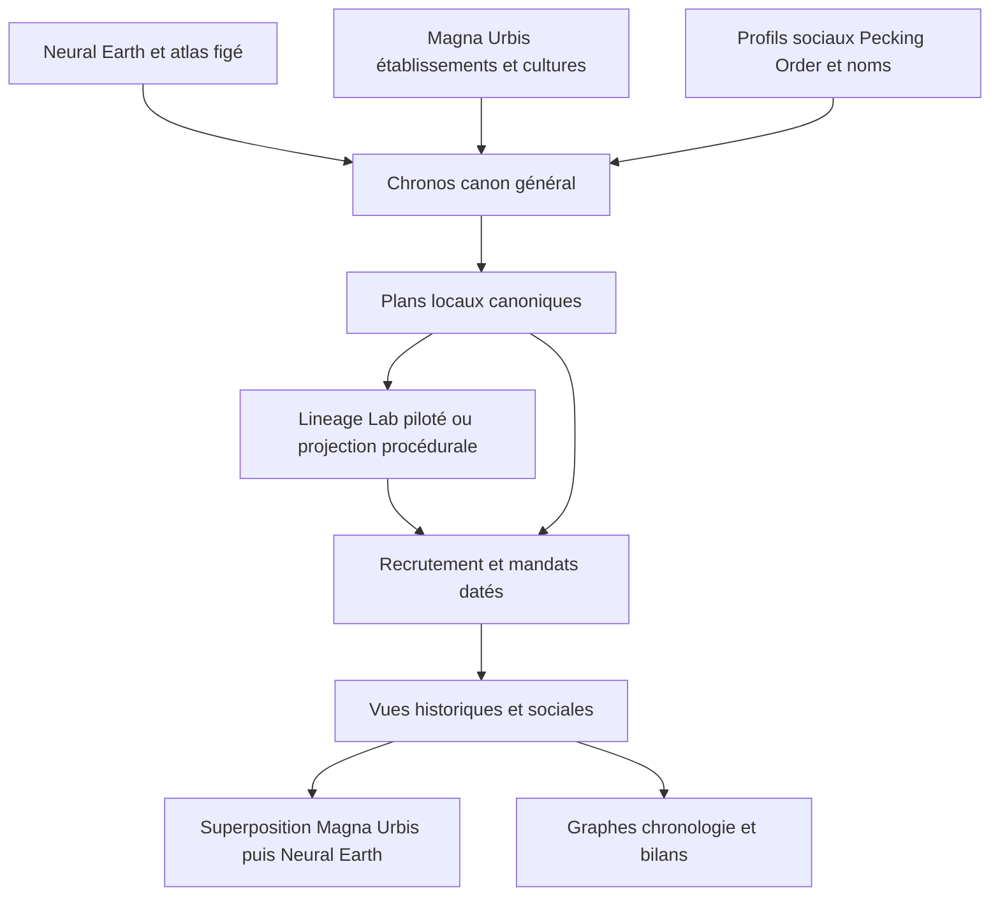

# Chronos social v2

Spécification de conception pour l’implémentation — 6 novembre 2026.

**Chronos génère une histoire sociale agrégée, puis matérialise à la demande des groupes, des personnes et leurs relations dans cette histoire.** Il pilote Lineage Lab pour les vies et les parentés qui nécessitent une simulation ; les autres éléments sont générés procéduralement. Les détails locaux peuvent s’écarter des proportions attendues au niveau supérieur. Les identités, les faits déjà définis et les contraintes explicites restent stables.

Ce document fixe les choix techniques proposés pour commencer le développement. Les décisions de produit issues des commentaires sont indiquées comme telles ; les paramètres initiaux sont des choix de worldbuilding modifiables, sans calibration historique revendiquée. **Aucun des nouveaux mécanismes décrits ici n’est encore implémenté.** Aucun temps de calcul n’a été mesuré pour ce design.

Fichiers du dossier : cette spécification ; [raccord des cultures](culture-bindings.v1.json) ; [schéma du plan démographique](population-plan.schema.json) ; [exemple de plan](village-population-plan.example.json). Les contrats sont préparés pour l’implémentation, pas déjà compris par les moteurs actuels.

## 1. Décisions et périmètre

### 1.1 Décisions de produit

1. L’émergence ascendante n’est pas un objectif requis. Le canon général fournit des causes, tendances, événements et ancrages ; le local les réalise et ajoute des événements de portée locale.
2. Les appartenances multiples sont centrales. Famille, foyer, amis, travail, culte, clientèle, voisinage et institutions peuvent se recouvrir.
3. Lineage Lab est un outil interne piloté par Chronos. La génération démographique reçoit les contraintes historiques avant d’établir les vies.
4. Le procédural assure la montée en échelle. On ne simule pas tous les habitants ni tous les groupes du monde chaque année.
5. Les proportions attendues sont le mode normal. Les quotas exacts sont disponibles pour les scénarios et les engagements qui le nécessitent.
6. Une région possède un voisinage et un extérieur simplifiés. L’ouverture d’une nouvelle zone ne change pas les identités des zones déjà définies.
7. Les styles de Magna Urbis sont regroupés en familles de paramètres historiques, avec variantes conservées.
8. Carte temporelle, chronologie, graphes interactifs et bilans font partie du premier prototype utilisable.
9. Personnes et organisations sont typées de « sans foi ni loi » à « saint », et une organisation se lit d’un coup d’œil comme mafia, entreprise lambda ou entreprise vertueuse. La légalité est relative à une juridiction et datée (§27).

### 1.2 Première livraison attendue

Une région contenant deux domaines démographiques disjoints, environ vingt établissements légers, un siècle d’histoire, plusieurs cultures et un extérieur agrégé. On peut demander le maire d’un village en 1360, voir ses familles et affiliations, naviguer en 1340 puis 1380 et retrouver les mêmes faits. Le détail de tous les habitants n’est jamais exigé pour afficher la région.

Le prototype couvre familles et foyers, cercles d’amis, ateliers et fermes, associations de métier, communautés religieuses, administrations locales et factions. Les guerres, épidémies, migrations et changements de contrôle constituent les premiers processus généraux. Fondation, dissolution, recrutement, succession et scission sont les premières transitions sociales.

### 1.3 Limites assumées de la première livraison

- Pas de simulation politique exhaustive individu par individu, de moteur de dialogue ou de génération littéraire des faits.
- Pas de réécriture Rust préalable de Lineage Lab. Le passage à Rust est décidé à terme (D12 du suivi), après S5 et sans date : il sera livré comme nouveau fournisseur versionné, sous le même contrat, avec de nouveaux canons.
- Pas de généalogie individuelle complète pour chaque habitant sur plusieurs millénaires.
- Les vies et unions du noyau sont simulées. Les unions et filiations de l’arrière-plan sont des projections approximatives ; ses ménages peuvent migrer dans le domaine grâce au registre prévu au §8.7. Noyau et arrière-plan n’échangent pas de conjoints dans S0–S5. Les mariages avec des individus extérieurs et le suivi exact entre domaines sont exclus avant le lot S7.
- La projection démographique hybride garde ses limites explicites de profondeur et de biologie. Un profil non pris en charge produit une erreur de capacité dans S0–S5 ; le fournisseur démographique entièrement procédural sera livré en S8. La couche d’attributs sociaux procéduraux est, elle, requise dès S4.

## 2. Architecture et autorités



Le graphe de dépendances va du général vers le détail. Un mandat personnel peut dépendre de la démographie locale ; une guerre générale ne dépend pas de la personne que l’utilisateur vient de demander. Dans S0–S5, un événement général cite un office ou un collectif, jamais la vie encore inconnue d’une personne. Les offices supérieurs possèdent un `home_domain` ; leur titulaire est résolu après la démographie, sans modifier les dates du canon. La mort d’un roi ne peut donc pas déclencher rétroactivement une guerre déjà générée.

En S6, `CanonActor` permettra les personnes indispensables : `actor_id`, `home_domain`, vie imposée ou contraintes de vie, parentés nécessaires et `person_slot`. Le plan les transmettra dans `fixed_people`. Une `SlotBinding {slot_id, person_id, plan_fingerprint, proof}` sera publiée une fois et validée. `fixed_people` inclura la mort imposée lorsque le canon exige un décès précis. Les simples `HybridAnchor` actuels ne satisfont pas ce contrat.

| Responsabilité | Autorité |
|---|---|
| Géométrie, coordonnées, cellules et voisinages physiques | Neural Earth ou fournisseur d’atlas figé explicitement identifié |
| Géométrie urbaine, placement détaillé et routes | Magna Urbis dans son hôte spatial |
| Événements généraux, relations collectives, institutions concrètes, mandats | Chronos |
| Vies et parentés simulées d’un domaine | Lineage Lab sur un plan Chronos immuable |
| Personnes projetées et familles procédurales | Fournisseur déclaré, versionné, soumis au même contrat |
| Fonctions et formes de titres | Pecking Order ; Chronos interprète seulement des règles opérationnelles connues |
| Chaînes de noms | Pools Namebench figés ; attribution stable par identifiant |
| Cache, orchestration Python, fichiers et HTTP | `chronos-app` |
| Présentation et disposition des graphes | Navigateur, sans autorité sur les faits |

`chronos-core` reste pur, sans E/S ni horloge. Il produit les plans et consomme des résultats sérialisés. `chronos-app` appelle un worker Python de Lineage Lab, puis demande au noyau de valider et d’assembler le résultat. Le worker est interne au produit, sans service réseau obligatoire ni démarrage manuel de son interface.

La topologie spatiale vient d’un contrat `HistoryAtlas` : `cell_id`, `parent_id`, `neighbors`, `area`, `bounds`, `coordinate_frame`, `settlement_summary`. Chronos n’invente pas un second système géographique multirésolution. **Un LOD d’affichage Neural Earth exprime un pas d’échantillonnage ; il ne faut pas le traiter implicitement comme la largeur d’une région.**

### 2.1 Entrées minimales et bootstrap

`WorldSpecV2` contient obligatoirement `world_seed`, `timeline`, `atlas_ref`, références des packs culturels/institutionnels/de noms, `population_provider`, `domain_policy`, paramètres des processus et liste des contraintes auteur. Chaque référence est une empreinte de contenu vérifiée par l’hôte.

L’atlas de S0–S5 est une fixture régionale complète, exportée ou virtuelle et figée. Il fournit :

- cellules et régions, relations parent/enfant, voisins, surfaces et référentiel ;
- `SettlementAnchor` : ID, cellule, coordonnées métriques entières, fondation, population initiale, capacité datée, population attendue maximale, épisodes culturels et poids d’activité ;
- `MobilityEdge` : ID, extrémités, intervalle, modes autorisés et jours de trajet entiers ;
- `ExternalContact` : ID et propriétaire, extrémités, voie d’accès, profils et population extérieure attendue ;
- les catalogues de sites candidats sur la période, sans géométrie urbaine détaillée.

Le bootstrap valide ces entrées, initialise les collectifs et les comptes, crée les ports, puis fige la partition des domaines. Le bootstrap ne tue aucune personne encore inexistante : il inscrit les chocs effectifs à `start_year` comme opérations initiales du plan. Le fournisseur construit ses fondateurs pré-choc, appelle `apply_initial_program` une fois avant le premier recensement et publie le delta initial explicite. Ces opérations ne sont pas répétées à l’année suivante. Un choc limité à `start_year` n’agit au bootstrap que par sa surmortalité ; ses effets de fécondité et de capacité, ou un multiplicateur de mortalité inférieur à 1, n’ont pas d’année simulée où s’exercer et sont publiés comme effets sans conséquence dans le delta initial. Cette extension intégrée est obligatoire en S3. Les dates de fondateurs peuvent être antérieures à la couverture ; leur passé inconnu n’est pas inventé.

S0–S5 utilisent une situation initiale fournie. Les trois scénarios de maturité P1, le peuplement planétaire paresseux et les nouvelles géométries de villes ne sont pas des dépendances cachées de cette livraison. Ils pourront remplacer le fournisseur d’atlas par le même contrat.

## 3. Quatre niveaux de calcul

| Niveau | Contenu conservé | Déclenchement |
|---|---|---|
| Général | Agrégats régionaux, grands collectifs, événements, contacts, ancrages | Création du canon |
| Région | Épisodes des sites, organisations collectives, exposition aux événements | Première demande de cette région canonique |
| Domaine démographique | Cohortes, noyau simulé, registre de résidence et table bornée des slots candidats | Première demande nécessitant des personnes dans ce domaine |
| Personne et petit groupe | Liens, membres, biographie, détail familial borné | Demande explicite ou rôle à résoudre |

Une requête utilisateur est convertie en dépendances canoniques avant tout tirage. Le rectangle affiché, le nombre de pixels, le niveau de zoom et l’ordre des clics ne font partie d’aucune clé historique.

### 3.1 Domaine démographique

Dans S0–S5, un domaine est inclus dans une région et contient des sites entiers disjoints. Il utilise un seul `demography_society_id`, commun à l’horizon du plan ; les profils biologiques peuvent varier. Les paramètres sociaux démographiques de plusieurs cultures incompatibles ne sont pas fusionnés implicitement. Les différences de groupes, institutions et attributs sociaux restent possibles par site.

Partition fixée au bootstrap : grouper les sites par `(region_id, demography_society_id)`, puis trier par `(cell_id, site_id)` en octets UTF-8. Utiliser **next-fit** : ajouter au domaine courant tant qu’il respecte les plafonds de 32 sites et 20 000 habitants attendus maximaux ; sinon le fermer et ouvrir le suivant, sans remplir à nouveau un domaine antérieur. Ainsi 15 000, 15 000, 5 000 donne deux domaines de 15 000 puis 20 000. Un site dont le maximum dépasse 20 000 est refusé dans ce prototype. `domain_id` contient région, profil et ordinal de partition. Les frontières politiques ne jouent aucun rôle.

Une grande ville à sous-domaines demande une extension d’index de population et de `home_domain` des offices ; elle est reportée à S8. La première livraison ne prétend pas la gérer. La partition et la liste des candidats ne changent pas à la consultation.

Le voisinage extérieur entre comme contexte agrégé, sans habitants simulés en double dans des halos recouvrants et sans appel récursif à la généalogie voisine.

### 3.2 Temps canonique

Le monde possède une période `[start_year, end_year)`. Les processus généraux lents évaluent des blocs fixes de dix ans, alignés sur l’origine du calendrier par division entière euclidienne, y compris avant l’an zéro. Les crises et le détail démographique sont annuels. Une requête ne découpe pas de nouveaux blocs.

Les états annuels sont des états à une frontière datée, après les transitions effectives à cette date. Une vie est `[birth_year, death_year)` ; un mandat et une relation utilisent aussi des intervalles semi-ouverts. Pour un décès effectif en 1356, la personne n’est plus éligible dans l’état daté de 1356.

Une naissance et un décès la même année restent enregistrables : à cette résolution, l’intervalle de vie observable peut être vide. La personne n’est jamais candidate à un rôle cette année-là. Un décès absent ne signifie pas une immortalité : la couverture du fournisseur borne les faits connus.

Un plan local est défini pour toute la période du canon. La première version calcule son domaine sur cet horizon fixe et le met en cache ; demander 1340 ou 1380 ne construit pas deux scénarios Lineage Lab différents. Les checkpoints pourront ensuite économiser du calcul sans changer les bornes, les IDs ou les distributions.

## 4. Identités déterministes et preuves

### 4.1 Adresses sémantiques

Les adresses sont des tuples de champs ASCII normalisés :

```text
world / owner_scope / entity_kind / origin_block / semantic_slot
world / population_domain / person_namespace / stable_provider_id
world / office_id / tenure_ordinal
world / event_owner / event_kind / origin_block / ordinal
```

Les IDs v2 sont **l’adresse complète**, encodée sans perte en base64url sans bourrage, préfixée par le type et un point (`event.Y2hy…`), caractère absent de l’alphabet base64url et sans ambiguïté de schéma dans une URL relative. Chaque objet possède une seule forme d’adresse : les champs d’un domaine ou d’un propriétaire sont toujours aplatis, et un champ littéral (`household`, `transfer`, `relation`, `group_slot`) n’admet que sa valeur. Encodage binaire : préfixe UTF-8 `chr2\0`, puis pour chaque champ sa longueur u32 little-endian et ses octets UTF-8. Les champs numériques sont des entiers décimaux normalisés. Leurs bornes maintiennent l’ID sous 4 096 caractères ; un dépassement est refusé. Aucun hash de 64 bits ne sert d’identité : il n’existe donc pas de collision historique cachée découverte seulement à la seconde visite.

Le namespace d’une personne inclut son domaine et son plan fournisseur. Les migrations ne changent jamais cette adresse. Les anciens IDs v1 restent opaques dans l’adaptateur v1.

Les adresses filles réutilisent les champs du préfixe sémantique, sans réencoder récursivement un ID parent complet comme champ. L’adresse d’une personne est aplatie en monde, domaine, algorithme fournisseur et ID local ; le manifeste mondial fixe son plan. Les objets persistants ne changent pas d’ID lorsque leur libellé ou résidence évolue.

Le mélangeur de [keys.rs](../../../crates/chronos-core/src/keys.rs) sert uniquement aux tirages indexés, derrière `random_semantics_v2`. Les sous-compteurs sont explicites. Pour un domaine :
`domain_seed = key(world_seed, ["population/domain-seed/v2", domain_id, provider_algorithm])`.
La graine décimale dérivée et `world_seed` figurent dans le plan. Les tirages uniformes entiers exacts utilisent le rejet. Les poids sont quantifiés et les réductions suivent l’ordre des IDs par octets UTF-8.

### 4.2 Empreintes et reproductibilité

SHA-256 sert aux empreintes des manifestes et paquets dans l’hôte, sans ajouter de dépendance au noyau. `plan_id` est une adresse, pas un hash ; `plan_fingerprint` est SHA-256 du plan canonique en excluant ses propres champs `plan_id` et `plan_fingerprint`. L’ID de plan contient l’identité du monde et le domaine ; le manifeste du monde fixe toutes ses politiques.

Dans toutes les adresses, `world` signifie le `canon_id`. Celui-ci vient du manifeste d’entrées normalisé, qui inclut explicitement configuration résolue, fournisseur, **runtime_fingerprint**, versions et empreintes des packs, jamais des événements qui contiennent déjà cet ID. Le manifeste exclut son propre identifiant du calcul. De même, `result_fingerprint` exclut son propre champ et les métriques non canoniques. L’hôte calcule ces empreintes avant de fournir les enveloppes au noyau pur.

Les objets à hacher n’admettent que entiers, chaînes, booléens, null, listes et objets. Sérialisation UTF-8 sans BOM ni espaces, clés d’objet triées par leurs octets UTF-8, chaînes échappant uniquement guillemets, barre oblique inverse et contrôles JSON, entiers décimaux sans exposant. Les listes sont triées par ID sauf celles explicitement ordonnées, comme les épisodes et registres. Les champs descriptifs et mesures de durée sont exclus de la projection canonique. Rust et Python partagent des vecteurs de référence. Les coordonnées du plan sont `x_mm` et `y_mm` entiers ; leur conversion en kilomètres flottants a lieu ensuite dans le worker.

`runtime_fingerprint` enregistre Python, NumPy, Numba, llvmlite, code fournisseur, backend, système, architecture, cible CPU JIT et nombre de threads. Première cible : CPU générique, un thread. Une autre combinaison est un autre runtime, à tester. Aucune identité bit à bit entre runtimes arbitraires n’est promise.

Les empreintes des sources externes portent sur les octets figés de leurs packs, sans resérialisation implicite de rasters ou de flottants v1. Les chemins absolus, caches, sessions et durées sont exclus. Un runtime différent ne rejoue pas ce canon : `ProviderVersionMismatch`. Les archives existantes restent consultables en mode archive seule ; les nouvelles zones sans archive exigent le runtime épinglé. Créer un monde sur un autre runtime produit un autre canon et d’autres IDs, explicitement. Le runtime n’inclut aucun identifiant personnel de machine.

### 4.3 Provenance et précision sont deux axes

```text
provenance.status = imported | derived | synthetic | unavailable
precision.mode   = expected | realized | exact
coverage         = aggregate | partial | complete
```

`CountMeasure = {value: entier|null, unit, precision, coverage, basis, at_year}`. `expected` désigne une prévision, `realized` un résultat effectivement construit, `exact` un résultat réalisé satisfaisant une contrainte explicite ; une contrainte future non vérifiée n’est pas encore une mesure exacte. `null` exprime une valeur inconnue.

Une liste de vingt membres matérialisés n’est pas un effectif total de vingt si sa couverture est partielle. `expected` est une valeur du modèle, pas une affirmation exacte qui devrait être réécrite quand un village est détaillé. Toute vue expose ces distinctions.

## 5. Modèle social

Les noms ci-dessous sont les types à implémenter ; ce bloc décrit leur contrat, pas du Rust déjà compilable.

```text
SocialEntity
  id, semantic_address, kind, archetype_id
  nature: person | organized_group | community | category | population
  agency: none | individual | delegated | governed
  owner_scope, existence: [start, end)
  culture_refs[], institution_ref?, provenance

EntityState
  entity_id, at_year
  lifecycle: active | dormant | dissolved
  member_count: CountMeasure
  cohesion_bps, legitimacy_bps, wealth_index, capabilities[]
  alignment: AlignmentAxes, conduct_tags[], visibility: open | covert
  goals[], assets[], footprint_refs[], institution_version

SocialRelation
  id, subject: ObjectRef, predicate, object: ObjectRef
  valid: [start, end), role_id?, weight_bps?, time_cost_bps?
  cause_event_id?, provenance, rule_id

ObjectRef
  entity | office | site | asset | person_slot | activity

PersonRecord
  entity_id, provider_ref, birth_year, death_year?
  parent_refs[], union_refs[], residence_episodes[]
  source: lineage_simulated | lineage_projected | procedural | author
  ancestry_profile, social_attribute_episodes[], coverage
  alignment_episodes[]
```

L’entité est commune, mais la charge personnelle et les structures internes des groupes restent typées séparément. Les propriétés de sites et actifs sont reliées au graphe sans prétendre que toute montagne est un acteur social.

### 5.1 Relations prises en charge

| Famille | Prédicats initiaux | Invariants |
|---|---|---|
| Structure | `component_of`, `member_of`, `affiliated_with`, `represents` | Composition stricte acyclique ; affiliations superposables |
| Famille | `parent_of`, `union_with`, `adopted_by` | Parenté cohérente avec le fournisseur ; adoption distincte du biologique |
| Affinités | `trusts`, `helps`, `rivals`, `shares_past_with` | Liens orientés ; réciprocité seulement si la règle le prévoit |
| Activité | `employed_by`, `apprentice_of`, `partners_with`, `supplies` | Disponibilité et éligibilité à la date |
| Pouvoir | `holds_office`, `governs`, `commands`, `protects`, `owes_allegiance_to` | Mandats et capacités valides |
| Économie | `owns`, `controls`, `claims`, `owes`, `trades_with` | Propriété distincte de l’usage et de la revendication |
| Histoire | `allied_with`, `in_conflict_with`, `successor_of`, `split_from`, `merged_into` | Causes et continuités explicites |
| Légalité | `LegalStanding` (§27.3), type daté distinct d’une relation libre | Toujours relative à une juridiction ; changement porté par un événement |

La similarité de culture, métier, proximité ou parenté est calculée à la demande. Un lien particulier d’amitié ou de dette est un fait généré et daté. Le voisinage du graphe est borné : aucun calcul global de toutes les paires de personnes.

### 5.2 Organisations et groupes informels

`GroupArchetype` définit fréquence par contexte, distribution des tailles, durée, règles de recrutement, offices, ressources, transitions et types de liens. Identifiant extensible de catalogue, sans nouvel enum Rust pour chaque guilde ou cercle.

Les foyers et familles proviennent des personnes ; ils ne sont pas tirés indépendamment une seconde fois. Les slots de groupes d’activité viennent des besoins économiques et effectifs attendus ; les effectifs réalisés déterminent leur remplissage, leurs vacances ou leur dormance. Les cercles informels viennent de contextes communs et d’affinités. Un membre d’un cercle ne devient pas automatiquement ami de tous les autres.

`friend_circles_per_1000_adults` est un **stock actif attendu**, pas un nombre de créations par bloc. Les durées initiales 1, 3, 5, 7, 9 ans équiprobables ont une moyenne de 5 ans. Pour un bloc de dix ans, le flux de créations vise `stock_attendu × 10 / 5`, arrondi stochastiquement avec une sous-clé dédiée. Le bootstrap crée le stock actif initial avec un âge compatible ; il n’attend pas cinq ans pour peupler le village en amis. Les paramètres des autres archétypes sont au §23.

Pour les groupes locaux non ancrés, chaque bloc d’origine possède un nombre de slots tiré à partir du profil culturel et de la population attendue. Chaque slot fixe naissance, taille attendue et dissolution. Une demande en 1370 peut retrouver un groupe fondé en 1320 sans tirer son existence dans la fenêtre demandée. Les fondations, scissions et fusions ne recyclent jamais l’ancien identifiant.

Les effectifs attendus et les listes réellement affectées sont deux mesures distinctes. Une dissolution ferme les relations actives ; une scission transfère des membres sans créer de population.

## 6. Cultures et institutions

### 6.1 Raccord explicite

Le [fichier de correspondance](culture-bindings.v1.json) inventorie **79 styles** du catalogue natif Magna Urbis lu pour cette conception, regroupés en **21 familles de paramètres**. Le nombre décrit ce fichier local, pas une API supposée stable. Son empreinte source et les 79 raccords sont enregistrés.

Chaque style garde son `variant_id` et ses particularités. Une famille met en commun des réglages de génération ; elle ne déclare pas que les cultures réelles ou fantastiques correspondantes seraient historiquement identiques. Les variantes peuvent réviser tous les paramètres.

Exemples : les réseaux marchands regroupent des valeurs communes pour les communes et ports ; `merfolk-tidal` conserve des contraintes d’accès aquatique et de marée ; `great-zimbabwe` conserve son style d’enceintes en pierre dans une famille de cours et communautés de concessions. Ni ces styles ni leurs regroupements ne déterminent automatiquement une ascendance biologique.

Ordre de résolution des paramètres : valeurs du moteur → famille historique → variante → institutions locales → contexte du site → contraintes d’auteur. Les listes sont fusionnées par identifiant, les champs scalaires remplacés ; aucune concaténation implicite de pondérations. Après résolution, poids positifs normalisés et références validées.

### 6.2 Paramètres exécutables à fournir au lot S1

`HistoricalCultureProfile` résout les distributions de taille des foyers, transmission des activités, poids des archétypes, recrutement, institutions, influence et transitions. Le §23 et les dictionnaires du fichier JSON fixent les valeurs initiales et leurs unités. Les champs descriptifs ne sont pas exécutés. Le profil social démographique de Lineage Lab reste unique par domaine dans S0–S5 ; sa différenciation au sein d’un domaine relève de S8.

Le fichier de raccord fournit des valeurs initiales communes et trois variations numériques par famille : bonus de recrutement familial, poids des associations formelles et multiplicateur de mobilité. Les activités se transmettent avec un poids initial de 8 000 points de base, le statut avec 9 000 ; les cercles d’amis visent 80 groupes par mille adultes, de trois à douze membres. Ce sont des réglages de départ, à évaluer dans les bilans. Le nombre de slots professionnels vient des travailleurs **attendus** de l’activité divisés par la taille moyenne ; les personnes réalisées remplissent ces slots, sans seconde allocation indépendante de toute la population.

Un foyer est défini par la co-résidence et les règles de résidence. Une maison ou un lignage est défini par `KinshipProfile`. Le champ historique `family` de Lineage Lab ne devient pas, par défaut, une preuve que toutes les cultures doivent organiser leurs maisons selon la filiation paternelle.

La biologie (`AncestryProfile`), l’organisation familiale (`KinshipProfile`), le culte, la citoyenneté et le nommage restent séparés. Les profils non biparentaux sont fournis par un générateur adapté ou signalés incompatibles avec le fournisseur Lineage Lab choisi. Aucun effet social n’est déduit du seul mot « elfe », « géant » ou « myconide ».

### 6.3 Pecking Order

On importe son catalogue figé de rôles, titres, pouvoirs, niveaux et instances collectives. Le raccord culturel précise un thème et sa couverture : 41 des 79 styles sont actuellement reconnus par ID ou alias ; les 38 autres utilisent explicitement `generic` jusqu’à l’ajout de leur lexique. Ce repli ne remplace pas leur profil social. Aucun titre spécifique non disponible n’est présenté comme importé. Chronos construit des organisations réelles et mappe chaque règle opérationnelle à un identifiant fermé : `hereditary`, `seniority`, `appointment`, `weighted_election`, `collective_body`. Une description textuelle de pouvoir ne déclenche pas une action.

Un office collectif n’a pas de titulaire individuel ; sa composition peut être détaillée séparément. Un office individuel sans candidat peut être vacant. La légitimité, le contrôle effectif et la prétention à une charge sont distincts.

## 7. Histoire générale et effets locaux

### 7.1 Progression agrégée

Le canon général avance régions et collectifs saillants sur les blocs fixes. Un bloc partiel de début ou de fin conserve la clé du bloc complet ; seuls ses effets dans la période du monde sont retenus. Le bootstrap fournit l’état de départ, sans tirer une histoire antérieure dans la fenêtre de la requête.

État minimal : populations de base par région et culture, capacités, richesse indicielle, cohésion, contrôle des sites, contacts, conflits actifs et cooldowns. La population de base suit annuellement `Pbase(Y+1) = max(0, Pbase(Y) + increment_croissance)`, avec un reste signé : `n = reste + Pbase × growth_effective_ppm`, `increment = div_euclid(n, 1 000 000)`, puis `reste = rem_euclid(n, 1 000 000)`. Les petites populations et la croissance négative ne sont donc pas figées par arrondi. Pour un taux positif, `growth_effective_ppm = floor(growth_ppm × max(0, capacity−Pbase) / max(1,capacity))` ; pour un taux négatif, le taux est conservé. À population nulle, remettre le reste à zéro. Les migrations sont exclues de la base et ajoutées aux prévisions séparées. Les prévisions après crise sont stockées séparément ; elles ne deviennent pas les marqueurs de base transmis aux villages.

| Processus S2 | Unité et défaut de démarrage | Transition |
|---|---|---|
| Croissance de base | 3 000 ppm/an, modifiable | Trajectoire hors chocs, bornée par capacité pour la croissance positive |
| Guerre | 500 bps par paire politique adjacente et décennie libre | Début daté, durée tirée de 5 à 20 ans ; acteurs collectifs, routes et contrats locaux |
| Épidémie | 500 bps par région et décennie, cooldown de 10 ans | Événement-cadre, exposition et gravité locale, sans mort individuelle à la racine |
| Migration générale | Propension par contact et contexte, réglée dans les ports | Flux attendu, non transfert nominatif exact |
| Contrôle politique | À la paix, tirage par site contesté | Relation de contrôle datée, avec le traité comme cause |

Les dates internes et durées possèdent des sous-clés fixes. Une guerre déjà active interdit une nouvelle guerre de la même paire dans le bloc. Une contagion interrégionale éventuelle passe par un contact de propriétaire unique ; elle n’est pas tirée séparément de ses deux côtés.

Les pressions alimentaires, richesse, institutions et relations modulent les probabilités par coefficients quantifiés de profil. Le prototype utilise les valeurs de la table lorsque ces pressions ne sont pas renseignées. Il n’exige ni optimiseur de buts ni économie complète. Les changements sociaux postérieurs à la démographie ne peuvent pas réinjecter une crise dans son plan déjà exécuté : les faits locaux qui modifient les vies sont planifiés avant le fournisseur à partir du contexte attendu ; les autres transformations locales suivent sa réalisation.

Les ressources initiales sont des indices et des comptes limités. Les futurs stocks naturels viendront de Neural Earth ; les transferts déjà réalisés entre comptes restent exactement équilibrés.

### 7.2 Contrat d’impact

```text
ImpactContract
  id, parent_event_id, owner_scope, valid
  target: sites | people | cohorts | organizations | assets
  selector, eligibility_time
  mode: probability | exact_count | exact_fraction | fixed_target
  probability_bps? | count? | fraction? | target_ref?
  exposure_model: independent_target_v1
  severity_profile, timing_profile, channel, cause
```

Mode normal `probability` : chaque cible canonique éligible tire une fois son exposition. L’intensité dépend d’une clé séparée. Une guerre « 25 % des villages » fournit `probability_bps = 2500`. Elle ne promet pas une somme de destructions exacte. Le résultat est partagé par toutes les vues du village. Dans S0–S5, un impact mortel est compilé en aléas démographiques locaux, jamais en une liste de personnes tuées à la racine. Les quotas exacts mortels sur personnes ou cohortes attendent S6 ; S0 ne garantit l’exact que sur les cibles connues non démographiques, comme les sites.

Mode exact : résoudre d’abord le catalogue complet des candidats du propriétaire. Calculer K avec une règle d’arrondi inscrite au contrat, puis choisir les K plus petites priorités déterministes, départagées par ID. Aucun classement n’est effectué sur la seule liste visible. Première version : refus explicite si le catalogue dépasse le budget exact ; l’allocation hiérarchique est une optimisation ultérieure qui doit conserver le même contrat.

Une probabilité d’exposition ne se réapplique pas à chaque année de la guerre. Le profil temporel fixe les épisodes locaux, chacun avec son sous-slot. Les contraintes de trajet bornent leurs dates.

### 7.3 Effets, causalité et états annuels

Phases effectives : 0 bootstrap ; 10 contexte et chocs ; 20 naissances ; 30 décès ; 35 divorces et unions ; 40 résidences ; 50 institutions et vacances ; 55 cohésion et scission ; 60 affectations ; 70 autres relations ; 80 publication d’état. L’ordre naissance/décès suit le fournisseur intégré épinglé. Chronos ne rejoue pas une seconde mortalité après lui.

Une cause doit avoir une année antérieure, une phase antérieure la même année, ou un rang topologique inférieur dans sa phase. Le rang est construit par tri topologique du graphe causal intraphase ; les IDs ne départagent que les nœuds déjà disponibles. Un cycle est refusé. Cela remplace l’exigence v1 « année de cause strictement antérieure ».

L’état v2 daté Y est post-transition. L’état d’ouverture v1 et la formule `P1356` de sa démo gardent leur ancienne signification dans l’adaptateur v1 : aucune conversion silencieuse. Une naissance et un décès au même Y n’offrent aucun intervalle d’éligibilité.

### 7.4 Écart entre attendu et réalisé

`population_baseline` est hors chocs. `population_expected_after_impacts` est une prévision générale, distincte de la réalisation d’un domaine. Ouvrir un domaine ne réécrit ni ces prévisions ni les autres domaines.

Le bilan **par domaine** ferme exactement : `P(Y) = P(Y−1) + naissances − décès + entrées − sorties`. Les flux extérieurs statistiques n’impliquent pas une conservation mondiale réalisée entre domaines indépendants. Simulés, projetés et acteurs de liaison sont des sous-ensembles disjoints ; les affiliations ne s’additionnent pas à P.

Les `baseline_markers` sont uniquement attendus et hors chocs, sans `source_event_id`. Les chocs sont la seule source des effets démographiques de crise. Un village épargné ne reçoit pas une trajectoire diminuée issue de la moyenne régionale.

Le régulateur intégré est **par site et sur l’arrière-plan** : le noyau est simulé sans régulateur global de cible, puis sa série annuelle réelle entre dans le calcul du résidu. Les paramètres standalone `target_population` et plancher initial sont désactivés pour ne pas compenser artificiellement la crise. L’interpolation des marqueurs de base est linéaire ; elle n’anticipe aucune crise.

Pendant un choc et jusqu’à `end_year + recovery_years`, aucune correction de fécondité vers une cible n’est appliquée. À la fin de cette période, fixer `rebase = population_réelle / population_de_base` au moyen d’un ratio entier ; la nouvelle trajectoire guide suit les pentes de base multipliées par ce ratio, sans rattrapage instantané. Les chevauchements prolongent le gel jusqu’à la dernière fin de récupération. Toute récupération supplémentaire est une politique datée explicite. Le régulateur reste borné et ne crée jamais des adultes pour égaler un marqueur. Le §25.3 définit le décalage permanent lié aux transferts et la tolérance, afin qu’une migration ne soit pas annulée par la correction de fécondité.

### 7.5 Compilation des gravités

Le sélecteur d’exposition est tiré une fois par événement et cible ; le profil annuel ne retire pas une deuxième fois le même forfait. `additional_mortality_bps` est une probabilité **annuelle**, appliquée aux éligibles de chaque année active, pas une perte totale sur l’épisode.

| Profil initial | Effets annuels intégrés | Durée et récupération |
|---|---|---|
| `plague.low` | Mortalité supplémentaire 300 bps ; fécondité × 900 000 ppm | 2 ans, récupération 3 ans |
| `plague.medium` | Mortalité supplémentaire 800 bps ; fécondité × 700 000 ppm | 3 ans, récupération 8 ans |
| `plague.high` | Mortalité supplémentaire 1 500 bps ; fécondité × 500 000 ppm | 3 ans, récupération 12 ans |
| `war.ruin` | Mortalité supplémentaire 100 bps ; capacité × 400 000 ppm ; fécondité × 700 000 ppm | Choc 1 an, récupération 10 ans ; déplacements par programme séparé |
| `harvest.bad` | Capacité × 700 000 ppm ; fécondité × 850 000 ppm | 2 ans, récupération 5 ans |

`ruin` produit aussi un épisode matériel d’endommagement ; il ne signifie pas que toute la population meurt. Une arrivée militaire s’observe au plus tôt à `début + ceil(travel_days/365)`, convention annuelle conservatrice. Le type d’impact et sa base de comptage sont toujours affichés.

La composition initiale des chocs est `independent_survival_v1` : multiplicateurs en ppm dans l’ordre des IDs, puis `p_total = 1 − (1 − p_base_modifiée) × produit(1 − p_supplémentaire)`. Aucun autre modèle de corrélation des mortalités n’est accepté avant une version supplémentaire. Un multiplicateur `f` agit en risque cumulatif : `p_base_modifiée = 1 − (1 − p_base)^f`, sémantique de `mortality_factor` et `fertility_factor` dans Lineage Lab, ce qui garde une probabilité valide.

## 8. Pilotage de Lineage Lab

### 8.1 Plan autonome et capacités

Le [schéma JSON](population-plan.schema.json) contient les profils résolus **en ligne**, sites et épisodes, trajectoires de base, chocs, programme historique, besoins de rôles, personnes fixées, ports et budgets. Le worker n’importe pas le dépôt Chronos.

Les paramètres de profils sont des cartes d’entiers normalisés selon le §24, traduites par l’adaptateur vers les modèles validés de Lineage Lab. La version de ces dictionnaires et les valeurs par défaut sont épinglées ; un paramètre inconnu est refusé. Le manifeste fournisseur conserve la configuration appliquée complète. Aucun flottant n’entre dans le plan canonique.

| Champ ou fonction | Premier lot | Capacité requise |
|---|---|---|
| Profils, marqueurs de base, chocs souples, sites et résidence projetée | S3 | `historical_soft_v1` |
| Demandes de rôles ordinaires | S3–S4 | `candidate_slots_v1` |
| Personnes imposées, protection, mort imposée, contraintes exactes | S6 | `conditional_people_v1`, `synchronized_exact_v1` |
| Ports statistiques | S3 | `statistical_reservoir_v1` |
| Ponts nominatifs entre domaines | S7 | `committed_bridge_v1` |
| Démographie entièrement procédurale, profils sociaux mixtes par site | S8 | Fournisseur/extension déclarés |

`prepare(plan)` contrôle schéma, références, dates, unités, somme positive des poids, budgets et capacités ; il refuse les champs dont le lot n’est pas implémenté. `materialize(plan_id)` produit des tables canoniques bornées ; `query` sert seulement l’inspection complémentaire et n’est pas appelé depuis les fonctions pures de recrutement.

Le schéma accepte les lots futurs pour préparer le contrat, mais l’exemple ne requiert que S3. Il est une fixture de forme : les empreintes `example` sont remplacées par les packs préparés avant exécution. Les intervalles `[a,b)` deviennent `start_year=a, end_year=b−1` pour les événements standalone à fin inclusive. Un checkpoint en `world.end_year` peut être technique ; les requêtes publiques excluent cette borne.

### 8.2 Résultat et frontière du noyau pur

`materialize` exporte un `CandidateTable` en colonnes pour **tous les slots ayant résidé dans le domaine pendant l’horizon** : ID d’origine, source, naissance, décès ou borne inconnue, épisodes de résidence, unions et liens familiaux projetés disponibles, clé de famille d’origine et attributs déjà établis du noyau. Les autres habitants d’un réservoir extérieur ne sont pas développés.

`VerifiedPopulation` contient cette table, son index de résidences, les courbes de comptes, les registres de mouvements/naissances, les limites de parenté, l’empreinte du plan et la preuve de validation. La couche procédurale de statut/activité est dans `chronos-core`, après réception de cette table ; Python ne filtre pas des candidats sur des attributs sociaux qu’il ne possède pas.

Le développement de slots est linéaire dans le nombre de vies représentées **du domaine consulté**, borné par `max_candidate_slots = 250 000`. Il ne crée pas d’objets narratifs complets : il matérialise les vies projetées et tient un registre chronologique par slot ou ménage pour les résidences et les risques. Cette composante locale n’est donc pas présentée comme un calcul purement agrégé sans parcours de slots. Cela étend le mode intégré, sans modifier la promesse standalone qui ne développe pas l’arrière-plan lors de sa construction. Le coût doit être mesuré. La sélection entièrement paresseuse par permutations est une optimisation S8, à sémantique égale ou avec une nouvelle version.

Les informations parentales sont limitées à la couverture et à la profondeur garanties. Les longues maisons héréditaires utilisent le noyau simulé. Aucun appel Python adaptatif ne se cache dans `build_social_packet`.

### 8.3 Adaptations dans Lineage Lab

| Source | Adaptation intégrée, standalone inchangé |
|---|---|
| `config.py` | Profils résolus, épisodes, marqueurs hors chocs, programme et budgets |
| `engine.py` | Programme historique souple, régulateur global désactivé ; ménages du noyau, `founder_assignment`, `move_households` et trajets `mobility_edges` intégrés ; pas synchronisé ajouté en S6 |
| `hybrid_engine.py` | Programme identique sur noyau/cohortes ; collecte annuelle du noyau pour le régulateur résiduel par site |
| `cohorts.py` | Identité d’origine, résidence distribuée, naissances après migration et export borné des slots |
| Nouveau `cohort_residence.py` | Registres de ménages, mouvements, arrivées et sorties extérieures |
| `regulation.py` ou module intégré séparé | Régulateur résiduel par site, suspension et reprise après crise |
| `projection.py` | IDs d’origine stables, familles réciproques, version intégrée distincte |
| `chronos_bridge.py` | JSONL, validation et traduction sans import du dépôt Chronos |

Le moteur complet accepte déjà des facteurs de crise ; l’arrière-plan actuel **ne suit pas les migrations individuelles**. Le registre du §8.7 est donc une extension obligatoire de S3, pas une capacité supposée acquise.

Les naissances/décès et capacités sont calculés une fois. Les opérations exactes sur personnes de S6 utilisent un noyau et des cohortes avancés en pas annuel synchronisé ; elles ne s’appuient pas sur le `run_core` actuel qui exécute d’abord toute la vie du noyau.

### 8.4 Noyau et complément procédural

Part cible initiale 5 %, plafond 10 % et limites absolues. Le nombre de fondateurs du noyau est `floor(Pinitial × part)` ; 0 ou 1 devient 0. Un noyau vide ou éteint est un résultat libre valide : les rôles ordinaires utilisent les projections ou restent vacants ; les maisons héréditaires peuvent s’éteindre. Les ancrages requis de S6 échouent si aucune solution n’est trouvée.

Le plafond vivant se mesure chaque année sur `core_vivant / (core_vivant + background_vivant)` ; le plafond historique sur les personnes nées ou fondatrices cumulées des deux composantes. Les réservoirs non résidents sont exclus. Un dépassement de noyau invalide sa variante avant publication ; le §25.4 fixe les variantes suivantes. Aucun membre de famille n’est amputé et aucun dépassement de mémoire ne déclenche un repli. S3 mesure taux d’échec et extinction sur une liste de seeds, avant de relever ou régler ces budgets.

Pour les statuts, prendre `résidu_i = max(0, cible_i − noyau_i)`, puis normaliser les résidus sur le nombre réel de slots d’arrière-plan. Si tous sont nuls, utiliser les poids de base et signaler l’écart. Un noyau déjà trop riche en élites produit un écart visible, jamais une masse négative. Les bilans utilisent les masses de tous les slots, pas l’échantillon affiché.

La clé familiale projetée est `(origin_cohort_id, parental_pair_ordinal)`, exportée par le fournisseur. Son latent d’affinité est tiré directement à partir de cette clé, sans récurrence infinie vers les ancêtres. Les personnes ont des écarts individuels stables. Cette corrélation approximative n’est pas une transmission généalogique exacte sur des siècles. Les lignages longs et offices héréditaires durables sont réservés au noyau ; aucune union noyau/arrière-plan n’est annoncée dans cette version.

Le fournisseur démographique `procedural` reste une extension S8, alors que cette couche d’attributs est livrée en S4. Une panne Python n’entraîne aucun basculement automatique de fournisseur. Le noyau général reste consultable ; la demande personnelle nécessitant Python retourne une erreur explicite.

### 8.5 Personnes fixées et exactitude en S6

Le canon ne lit jamais une vie locale pour dater un événement général. `fixed_people` injecte au contraire un acteur déjà contraint dans le noyau, avec son ID canonique, sa vie, ses parents connus et sa résidence. Ses effectifs sont retirés de la population à répartir pour éviter tout double compte. Une protection ou mort imposée est une opération typée, pas un texte.

Les contraintes démographiques exactes sont limitées à un domaine. Pour une contrainte supérieure, l’auteur doit fournir une préallocation par domaine ; aucun catalogue postérieur à la simulation ne remonte dans la racine. Une cible exacte de population est une **assertion** après des opérations explicites de décès ou de transfert, jamais une permission d’inventer des adultes.

Le programme déclare phase, base de comptage et caractère additionnel ou substitutif. La sélection concerne les présents éligibles du noyau et des cohortes avancés ensemble. Si K victimes n’existent pas, `ExactImpactInfeasible`.

Les essais sont ordonnés et bornés : politique libre du §25.4 sur quatre variantes prévues, au plus huit pour un scénario à noyau requis. Publier le premier essai complet satisfaisant toutes ses contraintes. Une requête ultérieure ne demande jamais de nouveaux essais. La méthode ne garantit pas de trouver toute solution mathématiquement possible.

### 8.6 Branches mortes et archives

La première version ne supprime pas de personnes historiques pendant le calcul. La vue peut masquer une branche sans intérêt. Un compactage futur conserve ancêtres requis, contrôles de parenté, faits et références extérieures ; il ne renumérote aucun slot. Les archives démographiques validées sont distinctes des caches et restent conservées lorsqu’elles ne sont plus rejouables.

### 8.7 Résidence et migration de l’arrière-plan

Une `OriginCohortId` ne change jamais. La résidence est un registre séparé :
`ResidenceTransfer {transfer_id, household_id, origin_slots, from_site, to_site_or_port, effective_year}`.
Les courbes de comptes sont indexées par cohorte d’origine **et résidence actuelle**. Départ d’un site et arrivée à l’autre sont les deux projections du même transfert.

Dans S3, l’unité de mobilité projetée est le ménage co-résident : ménage défini par les épisodes du §25.2, y compris célibataires, veufs et adultes autonomes. Les unités sortantes sont choisies par priorités déterministes parmi les éligibles. Les décès ne sont pas des sorties et une sortie extérieure n’est pas un décès. L’état `departed_external` ferme la résidence locale ; il ne fixe pas une mort inconnue.

Une arrivée extérieure crée une cohorte d’origine d’arrivée `(domain, arrival_year, ancestry, birth_year, arrival_ordinal)`, avec parents antérieurs inconnus. Aucun habitant nominal d’un réservoir n’est présenté comme un résident réel du voisin.

Les naissances après migration utilisent la résidence actuelle de la mère. `BirthAllocation` enregistre le couple d’origine et les ordinaux de ses enfants dans la cohorte de naissance du site courant ; les index inverses donnent les mêmes parents/enfants. On n’utilise pas le lieu d’origine comme résidence perpétuelle. C’est une extension explicite des allocations actuelles de `cohorts.py`.

La première version peut développer le registre de ménages dans la limite du domaine ; elle ne matérialise pas tous les ménages du monde. Le nombre réel de personnes déplacées est enregistré et identique aux deux extrémités. Un objectif souple exprimé en ménages peut donc produire un nombre variable de personnes. La mobilité projetée indépendante d’un individu hors de son ménage relève d’une extension ultérieure.

## 9. Recrutement déterministe

### 9.1 Contraintes et préférences

Chaque `RecruitmentRequest` déclare groupe, rôle, période, effectif, coût de temps, critère d’exclusivité et politique de pénurie. Les contraintes dures filtrent les vivants présents, l’âge, les restrictions institutionnelles et la capacité disponible. Les critères souples pondèrent compétence, activité familiale, statut, proximité, affinités et liens historiques.

La famille est une préférence ou une unité candidate quand l’archétype le demande. Elle ne devient pas l’unité exclusive de tout recrutement. Les cultures peuvent autoriser, décourager ou interdire certains recrutements par une règle explicite.

### 9.2 Paquet social chronologique

Un `SocialPacket` est construit **pour un domaine sur tout l’horizon**, depuis la fondation de ses institutions. Il contient l’état initial et les deltas annuels. `build_social_packet(region_plan, verified_population)` est pur et ne reçoit pas un « epoch » indépendant.

Chaque année : fermer les engagements expirés, décès et dissolutions ; appliquer les changements institutionnels connus ; conserver les mandats encore valides ; résoudre les vacances ; conserver les autres engagements compatibles ; remplir les places restantes. Les offices passent avant les emplois renouvelables, puis les affiliations et liens informels. Une élection peut fermer un engagement professionnel marqué `preemptible`, en produisant l’événement correspondant ; elle ne rompt pas silencieusement un contrat protégé.

Les demandes d’une phase sont triées par priorité institutionnelle explicite puis ID par octets UTF-8. Les clés de sélection contiennent `(request_id, effective_year, vacancy_ordinal, draw_ordinal)`. Pour un mandat, `tenure_ordinal` est le compteur chronologique de cette charge, jamais le rang d’une requête utilisateur. Une vacance sans candidat est réexaminée au plus une fois par an.

### 9.3 Sélection pondérée et coûts

1. Construire toutes les demandes du domaine, pas seulement celle affichée.
2. Filtrer tous les slots candidats de `VerifiedPopulation` sur vie, résidence, âge, règles et disponibilité.
3. Calculer les poids entiers du §23 ; tirer sans remise par sommes cumulées dans l’ordre des IDs, avec sous-compteurs indexés.
4. Débiter disponibilité et exclusivités ; conserver les places non pourvues. Une demande requise n’est acceptée qu’en S6.
5. Enregistrer les intervalles d’appartenance et preuves de sélection. Les années suivantes ne redessinent pas tous les effectifs : seuls départs, échéances, recrutements et changements prévus modifient ces intervalles.

10 000 points de base représentent une disponibilité totale annuelle. Le profil d’âge fixe la capacité ; les adhésions sans coût de travail ne consomment pas une place d’emploi. Les engagements simultanés ne dépassent pas la capacité déclarée. Le recrutement glouton assume ses priorités et ne promet pas un optimum global.

### 9.4 Grands groupes et recouvrements

S4 utilise la table de slots bornée des domaines ouverts ; la racine ne crée pas toutes les arêtes d’une organisation mondiale. Celle-ci conserve des contingents attendus par région, puis les listes de membres sont projetées et paginées.

Un `OverlapProfile` fixe les dépendances entre couches. Exemple initial de worldbuilding : cible marchande 2 000 bps ; appartenance au culte A de 8 000 bps chez les marchands et 5 500 chez les autres, soit une marge attendue de 6 000 bps si la première cible est atteinte. Un sélecteur Bernoulli à 5 000 bps choisit **soit** le latent familial uniforme partagé, **soit** l’uniforme individuel indépendant. Il ne calcule jamais leur moyenne. L’uniformité marginale est conservée et les membres d’une famille sont corrélés. Les deux composantes viennent de clés stables ; la clé familiale est celle du §8.4. Les résultats sont attendus, pas des intersections exactes garanties.

Les groupes professionnels consomment les capacités de temps ; les affiliations souples peuvent se recouvrir. Une intersection affichée est calculée sur les mêmes slots, ou explicitement marquée attendue. Le parcours entièrement paresseux des grands ensembles est un lot S8, sans promesse de coût sous-linéaire pour S4.

### 9.5 Checkpoints futurs

Un checkpoint social est un état complet accompagné de l’empreinte du paquet précédent. Calculer jusqu’à 1380 à partir du même plan fixe ou calculer tout puis projeter avant 1380 doit donner les mêmes mandats. Étendre la période du monde ou changer son plan constitue en revanche un nouveau canon et peut changer ses faits.

## 10. Offices et exemple du maire

```text
OfficeDefinition
  office_id, organization_id, role_key, title_profile
  collective, seats, appointment_rule
  requirements, term_policy, concurrent_holding_policy

Tenure
  tenure_id, office_id, person_id?, valid
  mode: effective | claimed | regent | vacant
  selection_proof, cause_event_id
```

Un mandat est résolu depuis la fondation de l’office ou un checkpoint canonique complet. On ne choisit pas à nouveau un maire à chaque année demandée. Les échéances, décès, destitutions et vacances déterminent les transitions successives.

Pour une élection, le premier modèle est une sélection pondérée parmi les candidats éligibles, avec popularité/compétence/réseaux agrégés. Il ne simule pas les bulletins de tous les habitants. Pour l’hérédité, le moteur applique la règle de succession versionnée aux liens familiaux exposés ; un enfant du titulaire n’est pas automatiquement son successeur.

**Requête `maire(village_X, 1360)` :**

1. Retrouver le site, son domaine et l’organisation municipale dans les plans canoniques.
2. Résoudre les événements locaux hérités et les institutions sur l’horizon complet du plan fixe.
3. Construire ou recharger le même `PopulationPlan` complet, indépendamment de 1360.
4. Lire les personnes éligibles et parentés dans `VerifiedPopulation`, sans appel adaptatif au worker depuis le noyau.
5. Résoudre la suite canonique des mandats, puis prendre celui qui couvre 1360.
6. Retourner personne, titre, période du mandat, affiliations demandées et explication de la sélection.

La même requête après la consultation de 1340, 1380 ou du village voisin donne le même résultat. Si l’office est collectif ou vacant, la réponse le dit ; elle n’invente pas une personne de remplacement.

## 11. Influence dans l’espace et dans le temps

`InfluenceFootprint` distingue présence de membres, recrutement, économie, culture, religion, coercition (`military`), mémoire (`memory`) et juridiction. Une juridiction est une relation explicite ; elle ne se déduit pas d’un score élevé d’influence culturelle.

Pour les canaux diffus, les sources sont des sièges, communautés, actifs ou contacts identifiés. Le poids est calculé depuis la force source, une atténuation par temps de trajet et une persistance temporelle, en entiers quantifiés. Les contributions sont triées par ID et plafonnées selon le canal.

Chaque profil fixe `travel_budget_days`, `persistence_years`, `decay_bps_per_year` et `max_sources`. Valeurs initiales communes de calcul : au plus 32 sources retenues par cellule et canal, par contribution décroissante puis ID. Les paramètres de portée viennent du profil de transport et du canal, pas d’un cercle euclidien universel. Le temps de trajet impose la première frontière annuelle où une influence peut être observée ; l’arrondi est conservateur et documenté dans le contrat de route.

Une empreinte dérivée n’entraîne pas le chargement de tous les membres du groupe. Pour une organisation mondiale, la racine fournit des relais agrégés. Les relais locaux se détaillent sans faire remonter de nouvelles décisions dans l’histoire générale.

Les effets du passé se distinguent : présence actuelle, souvenir, grief et trace matérielle ont des durées différentes. La dissolution d’un groupe ne fait pas disparaître automatiquement son influence mémorielle.

## 12. Monde ouvert et frontières

### 12.1 Contexte à trois niveaux

Chaque domaine reçoit ses sites détaillables, les contacts et routes d’un halo agrégé, puis des réservoirs extérieurs. Le halo est sélectionné par temps de trajet et pertinence des contacts, avec un plafond fixe du plan. Il n’appelle pas récursivement les simulations démographiques voisines.

Le monde régional et le monde planétaire réutilisent les mêmes identités géographiques et les mêmes plans de domaine lorsqu’ils partagent le même manifeste mondial. Une caméra plus large ouvre davantage de domaines ; elle ne remplace jamais deux petits scénarios par une nouvelle grosse simulation Lineage Lab.

Un monde créé sans atlas mondial possède un `external_context_id` synthétique. L’élargissement de son contexte est une modification explicite du canon si les hypothèses changent. Aucune fusion automatique de mondes indépendants n’est promise.

### 12.2 Contrat statistique initial

Un port déclare site d’attache, contact et profil extérieur résolu, périodes de validité et épisodes de taux. Les taux initiaux sont annuels en bps, avec `unit = household` et `rate_basis = resident_households_year_opening`. La population extérieure attendue est descriptive : elle n’est pas la base implicite du taux.

Pour chaque direction et année, accumuler `reste + ménages_projetés_du_site_d’attache_à_ouverture × taux_bps` ; nombre demandé = quotient entier par 10 000, nouveau reste = reste modulo 10 000. Le reste initial est zéro. Cela évite qu’un taux inférieur à un ménage annuel disparaisse par arrondi. Choisir ensuite des ménages disponibles ou des ménages entrants synthétiques ; enregistrer le nombre **réel de personnes** de chaque ménage. Une pénurie sortante est diagnostiquée, sans mortalité ou création de personnes pour la masquer.

Les réservoirs sont ouverts et non conservatifs à l’échelle mondiale. Chaque domaine ferme son propre bilan avec ses entrées/sorties. Les deux côtés d’un contact partagent un flux attendu et ses IDs, sans prétendre transférer les mêmes individus en mode `statistical_reservoir`. Les proxies ont un namespace distinct et ne comptent pas parmi les résidents réels du voisin ; les vues déclarent `reconciled: false`.

Les entrants ordinaires sont des ménages déjà constitués, avec passé extérieur inconnu. Les mariages de résidents avec des individus extérieurs ne sont pas pris en charge avant une extension de liaison ; le multiplicateur de mariages extérieurs est donc nul dans S0–S5. Les unions locales du noyau et les ménages projetés gardent leurs règles internes.

Le halo n’appelle jamais la démographie voisine. `max_halo_contacts` borne le nombre de contacts les plus pertinents, triés par temps de trajet puis ID ; le voisinage conserve les autres contacts sous forme de résumé.

### 12.3 Liaison exacte optionnelle

Le mode `committed_bridge` est nécessaire pour suivre un noble, un héros ou une famille nommée entre domaines. Il n’utilise pas deux tirages indépendants. Un `BridgePlan`, détenu par le propriétaire commun des contacts, réserve avant les simulations : IDs des personnes, profils initiaux, liens familiaux nécessaires, itinéraire et dates de passage.

Les personnes de liaison sont comptées dans un registre séparé des cohortes résidentes ordinaires. À chaque date, elles ont un seul propriétaire de résidence ; les autres domaines possèdent des références. Leur programme de vie et de déplacement est calculé une fois, avec les crises rencontrées sur l’itinéraire. Les workers locaux les reçoivent comme faits fixes et ne les simulent pas une deuxième fois.

La première implémentation de ce mode autorise un groupe familial fermé, sans nouvelle union avec les noyaux locaux. Une telle union exige ensuite un domaine de parenté commun ou une extension coordonnée, avec des tests spécifiques. Le worker doit refuser cette opération tant qu’elle n’est pas prise en charge. Cette restriction évite une dépendance cyclique masquée entre deux généalogies.

Les transferts exacts débitent et créditent les deux registres au même `TransferId`. Une capacité incompatible est une erreur avant publication, jamais un plafonnement différent à chaque extrémité.

## 13. Protocole du worker et pannes

Transport proposé : processus enfant local, JSONL sur stdin/stdout, une enveloppe par ligne ; logs sur stderr. `Command` reçoit une liste d’arguments, jamais une commande shell construite par concaténation. Le chemin de l’interpréteur et la version installée sont configurés dans l’hôte.

```json
{"protocol":"chronos-lineage-1","request_id":"req-17","method":"materialize","plan_id":"pop/demo/domain-0/v1","payload_ref":"plan-sha256"}
```

`prepare` transmet le plan complet ; `materialize` réfère à cette même empreinte. Une réponse contient `request_id`, `ok`, `plan_id`, `result_fingerprint`, résultat ou erreur structurée. `request_id` ne participe à aucun tirage. Le résultat volumineux est un fichier JSON canonique UTF-8 `population-result-json-1` dans un répertoire temporaire propre au job. L’enveloppe JSONL porte `result_ref {relative_path, file_sha256, bytes, format}`. L’hôte vérifie que le chemin résolu reste dans ce répertoire, puis taille et empreinte avant de lire le fichier. Le worker publie le fichier atomiquement ; les durées restent dans les métriques de l’enveloppe, hors du fichier canonique. Les blocs binaires sont reportés à S8.

Un worker n’exécute qu’un job démographique à la fois. L’hôte peut lancer plusieurs workers isolés. Chaque job réinitialise ses états aléatoires ; A puis B et B puis A doivent produire les mêmes résultats. Un mode référence en processus neuf par plan permet de tester cette isolation.

Une panne ou un délai dépassé laisse le job en échec, sans résultat partiel canonique. Le redémarrage rejoue le même plan. Les limites déterministes (`max_core_living`, `max_core_historical`, `max_cohorts`, `max_attempts`) produisent des erreurs typées ; un délai d’exécution ne choisit jamais un autre scénario.

Erreurs minimales : `ProviderUnavailable`, `ProviderVersionMismatch`, `UnsupportedCapability`, `PopulationConstraintsUnsatisfied`, `ExactImpactInfeasible`, `BoundaryInfeasible`, `InvalidPopulationResult`, `CoreBudgetExceeded`, `BudgetExceeded`, `CanonicalDependencyCycle`. Elles incluent propriétaire, date, contrainte et identifiant de plan. `CoreBudgetExceeded` est distinct d’un dépassement de mémoire, de slots ou d’une panne fournisseur ; seul ce diagnostic active les variantes de noyau explicitement prévues au §25.4.

## 14. API du noyau et de l’application

### 14.1 Fonctions pures

```text
build_canon(config, atlas, catalogues, author_constraints) -> GeneralCanon
plan_region(canon, region_id) -> RegionPlan
plan_population(canon, region_plan, domain_id) -> PopulationPlan
validate_population(plan, provider_result) -> VerifiedPopulation
build_social_packet(region_plan, verified_population) -> SocialPacket
resolve_office(full_horizon_social_packet, office_id, at_year) -> OfficeView
project_view(canon, materialized_packets, query) -> HistoryView
```

Un résultat fournisseur ne devient pas valide parce qu’il porte une empreinte. `validate_population` vérifie références, couverture, chronologie, dédoublement, contraintes requises et bilan. Les listes de faits sont triées de façon stable avant sérialisation.

Une requête étroite peut demander la résolution du paquet d’affectations de son domaine pour assurer les contraintes communes. Elle ne déclenche pas la résolution de tous les domaines du monde. `project_view` n’invente jamais des faits pour combler un paquet manquant.

### 14.2 HTTP v2

Les routes actuelles restent disponibles pour le prototype v1. Les nouvelles routes sont isolées sous `/api/v2`. Les IDs v2 en base64url sont sûrs comme segments ; les IDs legacy ou lisibles de fixtures sont percent-encodés intégralement, puis décodés une seule fois après découpage du chemin :

| Route | Contrat |
|---|---|
| `POST /worlds` | Configuration, références de packs et contraintes → canon général et capacités |
| `POST /worlds/{canon}/query` | Zone ou IDs, année/période, couches, détail, pagination → vue ou job |
| `GET /jobs/{id}` | État, progression non canonique, résultat ou erreur |
| `GET /worlds/{canon}/entities/{id}` | Fiche datée, identifiants des paquets nécessaires |
| `POST /worlds/{canon}/graph` | Sous-graphe temporel filtré, sans charger un graphe mondial |
| `GET /worlds/{canon}/explain/{fact_id}` | Dépendances, source et règle de génération |
| `POST /worlds/{canon}/branch` | S6 seulement : contraintes d’auteur → nouveau canon ; avant ce lot, erreur de capacité |
| `GET /worlds/{canon}/export` | Manifeste canonique et, sur option, paquets déjà matérialisés |

Une demande non prête retourne `202` avec `job_id` et liste des dépendances à calculer. Les requêtes simultanées du même paquet partagent un job. Les pages de résultats ont un curseur stable, les limites appliquées et un indicateur `complete` ; une troncature graphique n’est jamais présentée comme une population complète.

Exemple :

```json
{
  "scope": {"site_id": "site/demo/a"},
  "at_year": 1360,
  "include": ["offices", "organizations", "people"],
  "detail": "local",
  "limits": {"people": 50, "relations": 200}
}
```

Les limites de cette requête plafonnent la réponse, pas la population générée ni la sélection du maire. Une annulation de navigation peut interrompre un job non publié ; le relancer redonne les mêmes faits.

### 14.3 Format de vue

`HistoryView` expose : `canon_id`, `view_fingerprint`, période et zone appliquées, entités/relations/événements demandés, mesures attendues et réalisées, couverture, provenance, limites et curseurs. Les personnes du fournisseur portent leur `source` et les bornes de généalogie disponibles.

Les sorties cartographiques référencent les cellules, sites et géométries de l’atlas. La carte de Chronos n’est pas un générateur alternatif de villes.

## 15. Datavisualisation et navigation

### 15.1 État partagé

La date, la période, la sélection, les filtres et la caméra sont un état commun aux vues. Sélectionner une guilde dans le graphe montre ses implantations sur la carte et sa durée dans la chronologie. Une URL conserve les IDs et la date. Le graphe peut rester ouvert pendant le changement d’année sans perdre le centre de lecture.

### 15.2 Carte de l’hôte spatial

Première intégration : superposition dans l’atelier Chronos sur la géométrie exportée de Magna Urbis. Le même `HistoricalOverlay` sera consommable par son viewer puis Neural Earth : `coordinate_frame`, année, sites, cellules, polygones ou lignes référencés, canal d’influence, valeur, précision et légende.

La sélection n’est pas seulement un État : elle peut être une famille propriétaire, un ordre religieux, un réseau marchand ou un groupe mobile. Les canaux se filtrent séparément. Le contexte extérieur est visible avec une représentation distincte ; les proxies ne sont pas dessinés comme des villes connues à une position inventée.

### 15.3 Graphes interactifs

Choix proposé : [Cytoscape.js](https://js.cytoscape.org/), embarqué localement en version figée dans `web/vendor`, avec sa licence et son empreinte. Il fournit un graphe interactif et des mises en page sans imposer de framework à l’interface actuelle. Aucun CDN à l’exécution.

Deux modes : graphe social centré sur une entité et graphe de parenté. Le premier autorise les nœuds de groupe, personnes et offices, avec arêtes typées et orientées ; le second affiche les unions et filiations sans confondre conjoint et parent. Un nœud peut être développé, regroupé, épinglé ou réduit à son résumé.

Limites initiales de réponse : 300 nœuds et 1 000 arêtes, avec compteur des liens non affichés et chargement explicite. Les filtres portent sur la couche, la date, la profondeur, le type et la force du lien. Les relations parallèles restent distinctes. Un changement de disposition n’entre pas dans le canon ; les positions graphiques épinglées sont des préférences de vue.

Une liste accessible accompagne le graphe : navigation clavier, recherche par nom et type, inspection sans survol obligatoire. Le dessin du graphe n’est pas la seule façon de consulter une relation.

### 15.4 Chronologie et bilans

La chronologie affiche existence des groupes, mandats, changements d’affiliation et événements. La sélection d’une transition montre état avant/après et cause. Les périodes calmes restent lisibles.

Les bilans comparent attendu et réalisé : population, âge, statut, activité, familles, tailles des groupes, postes vacants, recouvrements et flux extérieurs. Ils montrent les écarts plutôt que de forcer artificiellement les résultats à la cible. Les distributions sur plusieurs seeds sont comparables. La future commande `chronos-app v2 sample --config demo-v2.json --seeds 1..100 --out diagnostics/` exportera mesures agrégées et versions ; elle relève de S5 et ne remplace pas les tests d’invariants. Une bande d’incertitude n’est affichée que si le modèle l’a effectivement calculée.

Le bouton d’explication d’un fait affiche une phrase lisible, puis le détail : règle, source, domaine, date, contraintes et poids de sélection pertinents. Un choix de maire peut expliquer l’éligibilité et le classement ; il ne nécessite pas d’exposer des milliers de candidats à chaque affichage.

## 16. Stockage, cache et édition

### 16.1 Organisation

```text
worlds/<canon>/
  manifest.json
  canon.json
  packs/<fingerprint>.json
  regions/<region-plan-id>.json
  populations/<plan-id>/manifest.json
  populations/<plan-id>/provider-archive
  social/<packet-id>.json
  indexes/
```

Dans l’implémentation, les IDs opaques sont encodés ou remplacés par une empreinte vérifiée pour former un nom de fichier. Les entrées utilisateur ne deviennent pas des chemins relatifs arbitraires.

Les paquets sont immuables et publiés atomiquement après validation. La clé de cache inclut canon, propriétaire, versions, empreintes des dépendances et niveau de détail s’il modifie le type de projection. Une politique d’éviction ne retire que des caches de vues et des index reconstructibles. Les tables de population et archives validées sont des données autoritatives distinctes ; si le runtime nécessaire a disparu ou si le rejeu n’est pas garanti, elles ne sont jamais évincées automatiquement.

Une base SQLite pour les index et archives peut être utilisée dans l’hôte ; elle n’est pas une dépendance du noyau. La première livraison peut garder un index en mémoire et des paquets JSON tant que les limites sont respectées. Les archives natives Lineage Lab restent sous l’autorité de son adaptateur.

### 16.2 Export et import

`export --canon-only` produit un paquet déterministe indépendant des zones visitées. `export --with-materialized` ajoute les paquets déjà calculés, triés par ID : deux exports contenant un détail différent peuvent différer en taille sans décrire deux mondes différents.

L’import rejoue et valide le canon général. Un paquet démographique importé est contrôlé structurellement et par empreinte ; le mode de vérification stricte rejoue son fournisseur avec le runtime requis. Sans ce runtime, le paquet peut être consulté comme archive non rejouée, mais n’est pas présenté comme une vérification de déterminisme réussie. Les états de validation sont conservés dans les métadonnées de l’hôte, hors des faits.

### 16.3 Édition

Un changement d’événement, de culture, de profil démographique ou de contrainte de personnage crée une branche. Les caches dépendants sont invalidés. Le premier moteur peut rejouer tout le canon ; l’invalidation fine est une optimisation ultérieure.

Un enrichissement narratif qui ne change aucun fait possède un stockage séparé. Une demande auteur « ce personnage survit à la peste » est une contrainte de génération ; elle n’est pas un texte décoratif ajouté à une vie déjà incompatible.

## 17. Budgets et paramètres initiaux

Ces valeurs sont des limites de départ et des objectifs de mesure, pas des performances constatées.

| Paramètre | Valeur initiale |
|---|---:|
| Pas général lent | 10 ans |
| Pas local et démographique | 1 an |
| Population attendue maximale par domaine de démonstration | 20 000 |
| Nombre maximal de sites par domaine de démonstration | 32 |
| Slots candidats historiques maximaux par domaine | 250 000 |
| Taille maximale du résultat démographique JSON | 512 Mio |
| Contacts explicites maximaux du halo | 16 |
| Part visée de noyau simulé | 5 % des fondateurs du domaine |
| Part maximale du noyau vivant et historique | 10 %, avec plafonds absolus également contrôlés |
| Profondeur d’arrière-plan initiale | 2 générations ascendantes et 5 descendantes |
| Essais par plan libre / scénario contraint | 3 variantes de noyau puis 1 projection / au plus 8 |
| Nœuds / arêtes d’une réponse graphique | 300 / 1 000 |
| Sources d’influence par cellule et canal | 32 |
| Candidats pour une allocation exacte exhaustive | 100 000 |

Le §3.1 fixe la partition de S0–S5. Un site dépassant 20 000 habitants attendus maximaux est refusé dans cette tranche ; ses sous-domaines sont une extension S8. Modifier les budgets ou la partition crée un nouveau manifeste.

Un budget de mémoire, de slots ou de taille dépassé produit `BudgetExceeded`. Un plafond du noyau produit `CoreBudgetExceeded` et suit exclusivement la politique prédéclarée du §25.4. On ne réduit pas en cours de calcul la part simulée pour faire rentrer un résultat. Le mode et les budgets sont visibles avant le lancement.

Complexité de S0–S5 : racine proportionnelle aux cellules, blocs et collectifs saillants ; première matérialisation démographique proportionnelle aux cohortes, noyau et slots historiques du domaine borné ; affectations dépendant aussi des demandes annuelles et candidats. Le détail d’un individu lit ensuite ces tables. Aucune fonction racine ne parcourt les habitants du monde. Le calcul paresseux sans développement exhaustif des slots est un objectif S8, pas une propriété déjà promise.

Les mesures séparent préparation de l’atlas, canon général, JIT froid, génération démographique, affectation sociale, requêtes chaudes, stockage et rendu. Publier temps, mémoire, cardinalités, seed, versions et matériel. Aucun objectif de « planète en quelques secondes » ne constitue un critère validé avant cette campagne.

## 18. Invariants et validation

### 18.1 Invariants bloquants

1. Même monde, mêmes plans et runtime : même projection canonique après accès direct, parcours inverse, changement de fenêtre, éviction et redémarrage.
2. Une personne a une identité unique ; toutes ses références et relations utilisent cette identité. Un nom n’est jamais une clé.
3. Une personne appartient à plusieurs groupes sans être plusieurs habitants. Les bilans démographiques réalisés ferment exactement **par domaine** ; les frontières statistiques ne promettent pas de conservation nominative mondiale.
4. Aucun rôle hors de la vie ou de la couverture observée ; aucun office personnel effectif singleton avec deux titulaires simultanés hors institution l’autorisant.
5. Composition stricte acyclique ; parenté réciproque ; relations datées dans l’existence des entités, sauf mémoire posthume explicitement typée.
6. Aucun fait local ne modifie un ancêtre général. Aucun rechargement ne change un recrutement déjà défini.
7. Un impact exact atteint son compte ou échoue ; un impact probabiliste n’est jamais testé comme un quota exact.
8. Pas de double mortalité ni double application d’un même événement fournisseur.
9. Une interface ne convertit pas une estimation ou une liste partielle en total réalisé complet.
10. Aucun repli fournisseur déclenché par l’ordre des requêtes, un délai ou la présence du cache.

### 18.2 Tests métamorphiques obligatoires

| Test | Comparaison |
|---|---|
| `mayor_is_stable_across_query_orders` | Village A puis B, B puis A, année 1380 puis 1340 |
| `direct_lookup_matches_refined_lookup` | Maire direct contre navigation monde → région → village |
| `overlapping_windows_agree` | Intersection de 1300–1400 et 1350–1370 |
| `worker_job_order_is_irrelevant` | Worker réutilisé A→B, B→A et processus neufs |
| `cold_and_warm_population_match` | Cache froid, chaud, supprimé et archive rouverte |
| `crisis_is_applied_once` | Épidémie présente dans canon et plan ; mortalité appliquée une fois |
| `marker_does_not_anticipate_shock` | Même trajectoire avant crise avec ou sans choc futur |
| `regulator_does_not_cancel_crisis` | Régulateur inactif pendant choc et récupération, guide rebasé ensuite |
| `spared_village_keeps_baseline_target` | Village non exposé conservant sa trajectoire hors choc |
| `background_migrant_keeps_id_and_closes_balance` | Ménage projeté A→B, mêmes IDs, comptes et parentés après déplacement |
| `truncated_horizon_preserves_earlier_tenures` | Préfixe d’exécution du même plan contre projection du paquet complet |
| `death_closes_tenure_at_boundary` | Mort du maire et ouverture de vacance à la même date |
| `affiliations_do_not_add_people` | Famille + guilde + culte + amis ; population inchangée |
| `family_links_survive_projection_order` | Parents d’abord ou enfants d’abord, même graphe |
| `exact_impact_uses_full_candidate_set` | K cibles, même résultat quelle que soit la pagination |
| `world_extent_does_not_reseed_domains` | Petite fenêtre puis grande fenêtre dans le même manifeste |
| `statistical_ports_are_not_named_transfers` | Proxies hors comptes des résidents du voisin |
| `bridge_person_is_not_duplicated` | Deux domaines, un `TransferId`, une résidence active |
| `unsupported_reproduction_is_explicit` | Profil non pris en charge : erreur ou fournisseur préconfiguré |
| `culture_catalogue_has_total_mapping` | Chaque style source a exactement un raccord valide |

### 18.3 Qualité statistique

Sur une fixture d’impacts indépendants (`exposure_model = independent_target_v1`), tester la fréquence et les intensités sur une liste de seeds enregistrée, avec tolérance définie avant le test. Une extension corrélée aura son propre contrat et ses propres tests ; elle n’est pas implicite dans le scalar `probability_bps` initial.

Pour le monde social : mesurer tailles des groupes, degrés de relations, recouvrements, postes vacants, mobilité, distributions d’activités et écart aux marqueurs. La revue porte sur tendances et contre-exemples, pas sur une prétendue validation universelle de l’histoire humaine. Les différences entre familles culturelles doivent être visibles dans les distributions, sans rendre toutes les variantes identiques.

### 18.4 Parcours utilisateur de recette

Ouvrir une région, sélectionner 1360, demander un maire, développer sa famille et ses appartenances, ouvrir un cercle d’amis, montrer les implantations d’une guilde, remonter à la cause d’une crise, passer en 1340 puis revenir. Recharger l’application et retrouver les mêmes IDs. Comparer attendu/réalisé. Agrandir la carte et vérifier les références extérieures. Exporter, rouvrir et vérifier les mêmes faits.

## 19. Découpage du code

Conserver deux crates au départ. Ajouter des modules au noyau, puis extraire seulement si la taille le justifie.

```text
crates/chronos-core/src/v2/
  ids.rs               adresses et clés versionnées
  atlas.rs             contrat spatial et domaines démographiques
  model.rs             entités relations mesures et événements
  catalog.rs           profils cultures et institutions
  general.rs           progression agrégée
  region.rs            plans locaux et contrats d’impact
  population.rs        plans et validation des résultats fournisseurs
  recruit.rs           affectations et budgets de temps
  offices.rs           institutions et mandats
  influence.rs         empreintes et mémoire
  query.rs             projections graphe et explications
  validate.rs          invariants v2

crates/chronos-app/src/v2/
  orchestrator.rs      résolution des dépendances et jobs
  lineage_worker.rs    protocole et processus Python
  store.rs             paquets index et publication
  server.rs            routes v2

lineage-lab/src/lineage_lab/
  chronos_bridge.py    adaptateur optionnel sans import du dépôt Chronos
  historical_program.py
  cohort_residence.py   origine stable résidence et naissances après migration

web/
  social-graph.js      Cytoscape et commandes accessibles
  social-timeline.js   groupes affiliations et mandats
  historical-overlay.js
  population-balance.js
  query-state.js
  vendor/
```

Les noms de fichiers sont proposés ; leurs responsabilités et les dépendances sont les contraintes à conserver. Les archétypes, profils et mappings sont des données versionnées. On ne recopie pas les moteurs Namebench, Lineage Lab, Pecking Order ou Magna Urbis dans Chronos.

## 20. Migration et ordre de développement

### 20.1 Compatibilité

Conserver le comportement actuel sous `chronos-history-1` et le schéma v1 pendant le développement. Introduire le schéma v2 et `chronos-social-2` séparément. Une projection de compatibilité peut afficher des faits v1 dans les nouvelles vues, mais ne prétend pas reconstruire les affiliations absentes.

Les anciennes archives Lineage Lab restent lisibles avec leur version. Le mode intégré possède un identifiant de projection distinct. Les fixtures v1 déjà préparées restent utilisables. Les anciens outils de préparation citent encore `../city_generator` dans leur configuration ; dans ce workspace `../magna-urbis` est le checkout courant. Leur relance exige un raccord de chemin préalable, indépendant de S0–S5 et sans appel à ces outils au runtime.

La future documentation doit distinguer clairement la génération v1 autonome actuelle et la v2 utilisant un runtime démographique local. La compilation WASM du noyau reste requise ; le navigateur seul ne lance pas Python. En S0–S5, un hôte WASM doit fournir une table de population déjà préparée par un hôte compatible ; le fournisseur démographique procédural autonome est prévu en S8.

### 20.2 Lots et preuves de sortie

| Lot | Travail livré | Dépendances | Preuve de sortie |
|---|---|---|---|
| S0 | Types v2, IDs, atlas minimal, impact probabiliste et exact, validations de plans | Aucune modification des moteurs voisins | Fixture pure : accès direct et par projection du même événement donnent les mêmes IDs, sans provider |
| S1 | Profils résolus, raccord des 79 styles, archétypes de groupes, besoins sociaux | S0 | Catalogue sans référence manquante ; distributions distinctes sur un générateur de fixture de catalogue, puis en intégration S4 |
| S2 | Canon général, régions, domaines figés, contexte extérieur et crises | S0–S1 | Deux domaines et un siècle ; ouvrir une zone n’altère pas l’autre |
| S3 | Worker, programmes souples, régulateur par site, registre de résidence et table de slots bornée | S0–S2 | Même démographie pour trois ordres de requêtes ; crise comptée une fois |
| S4 | Attributs procéduraux, recrutement, mandats, familles et amis | S1–S3 | Maire stable, affiliations multiples et bilan fermé |
| S5 | API v2, stockage, import/export et interface carte/graphe/bilans | Première tranche possible dès S1 ; finaliser après S4 | Parcours §18.4 exécuté et captures conservées |
| S6 | Quotas de scénario et personnes requises, branches de canon | S3–S5 | Contraintes satisfaites ou échec explicite ; version précédente inchangée |
| S7 | Liaisons exactes entre domaines pour acteurs nommés | S3–S6 | Famille fermée migrant entre deux domaines, sans double compte |
| S8 | Mesures, checkpoints, fournisseur démographique procédural, grands sites et sélection paresseuse | Première version fonctionnelle S0–S5 | Rapport chiffré froid/chaud ; invariants conservés |

**Première livraison utilisable : S0 à S5.** Le mode statistique des frontières et les limites de généalogie y sont visibles. S6 et S7 étendent les scénarios et les relations exactes ; ils ne doivent pas être annoncés comme présents dans S5.

S5 n’attend pas la fin pour commencer : après S1, les graphes et bilans utilisent des fixtures contractuelles clairement identifiées. Ils sont ensuite branchés sur les vrais paquets. Leur rôle est aussi de repérer les défauts de conception avant la montée en échelle.

Les commandes de vérification restent celles des dépôts. Chronos : `cargo test --workspace`, `cargo fmt --all -- --check`, `cargo clippy --workspace --all-targets -- -D warnings`, compilation du noyau pour `wasm32-unknown-unknown`. Lineage Lab modifié : `python -m pytest` et `ruff check src tests`. Ajouter les parcours navigateur aux vérifications de la tranche graphique. Les scénarios et versions utilisés dans les mesures sont archivés.

### 20.3 Définition de terminé pour chaque lot

Contrat et diagnostics documentés ; tests des invariants concernés passés ; provenance et précision visibles ; pas de nouveau tirage dépendant d’une requête ; exemples rejouables ; résultats et limites rapportés. Les performances annoncées comportent une mesure. Un lot qui ne peut produire qu’une projection partielle le déclare dans son API et sa recette.

## 21. Consigne de reprise pour l’implémentation

```text
Implémenter Chronos social v2 à partir de docs/design/chronos-social-v2/README.md.
Commencer par S0, puis livrer des tranches complètes jusqu’à S5.
Lire AGENTS.md, les commentaires du 6 novembre et les contrats du dossier.
Conserver le moteur v1 et ne pas modifier sa sémantique pendant cette migration.
Neural Earth fournit l’espace ; Chronos fournit l’histoire et pilote Lineage Lab.
Le noyau Rust reste pur. Appeler Python depuis chronos-app uniquement.
Les proportions sont statistiques par défaut ; l’exact est une option explicite.
Tous les faits dépendent de propriétaires et plans fixes, jamais du parcours des vues.
Garder séparés source, précision et couverture des données.
Ne pas simuler toute la population mondiale et ne pas réécrire Lineage Lab en Rust.
Éviter les appels récursifs entre démographies de domaines voisins.
Afficher les limites du mode statistical_reservoir et de la projection familiale.
Exécuter les tests de chaque dépôt modifié et les recettes de la tranche livrée.
Mettre à jour docs/suivi-implementation.md avec les preuves et les limites réelles.
```

## 22. Sources et arbitrages avec les documents précédents

Les deux documents annotés sont les sources des décisions de produit : [discussion initiale](../../discussion-groupes-sociaux.md), [retour et dernières remarques](../../retour-commentaires-groupes-sociaux.md).

La [conception v3](../../../conception_generateur_histoire_multiechelle_v3.md) reste une référence pour les identités collectives, relations datées, institutions, raffinement et invariance. Cette spécification révise trois exigences : les budgets ne sont plus tous exacts ; Lineage Lab est piloté plutôt que remplacé par une généalogie Rust ; la remontée causale individuelle n’est pas une condition de réussite.

Références de code inspectées : [moteur Chronos](../../../crates/chronos-core/src/lib.rs), [modèle actuel](../../../crates/chronos-core/src/model.rs), [méthode v1](../../methods/chronology.md), [interface actuelle](../../interface.md), [Lineage Lab](../../../../lineage-lab/src/lineage_lab/engine.py), [hybride](../../../../lineage-lab/src/lineage_lab/hybrid_engine.py), [cohortes](../../../../lineage-lab/src/lineage_lab/cohorts.py), [cultures Magna Urbis](../../../../magna-urbis/rust/crates/core/src/urban/catalogue.json), [Pecking Order](../../../../pecking-order/README.md).

L’[étude sociale AI RPG Generator](https://github.com/dunkean/AI_RPG_Generator/blob/main/worldbuilder_social_engine_study.md), ses [groupes procéduraux](https://github.com/dunkean/AI_RPG_Generator/blob/main/src/procedural/population.py) et son [recrutement](https://github.com/dunkean/AI_RPG_Generator/blob/main/src/procedural/employees.py) fondent la reprise des groupes informels et affinités de recrutement. Leurs mécanismes de seed, d’identité et de consommation de pools ne sont pas repris sans adaptation au contrat déterministe.

## 23. Dictionnaires et paramètres exécutables

Les dictionnaires du fichier culturel définissent chaque `common_group`, overlay, template institutionnel et template de parenté référencé. Les listes sont fusionnées par ID ; un retrait est explicite. Les pondérations sont remplacées, puis normalisées. Une référence absente est une erreur de catalogue S1.

### 23.1 Groupes et formation

| Classe | Slots et membres | Durée initiale |
|---|---|---|
| `household_view` | Vue des co-résidents du fournisseur, sans création d’habitants | Déduite des résidences |
| `lineage_view` | Vue des lignages du noyau ; arrière-plan limité à la famille proche | Déduite des personnes |
| `activity_unit` | Travailleurs attendus divisés par taille moyenne ; remplissage sur le réalisé | Moyenne 20 ans |
| `institution` | Une ancre unique par occupation de site ; corps collectif et offices distincts | Jusqu’à un événement explicite de fin ou succession |
| `association` | Stock actif 2 par mille adultes, multiplié par poids formel / 50 | Moyenne 30 ans |
| `community` | Stock actif 2 par mille adultes, minimum un pour un site actif | Moyenne 50 ans |
| `friend_circle` | Stock actif 80 par mille adultes | Distribution de durée du JSON, moyenne 5 ans |

La taille moyenne des unités d’activité est 3 travailleurs pour l’agriculture, 5 pour l’artisanat, 7 pour le commerce et 4 pour les services. Ces unités se **partagent** le besoin de leur activité ; on ne recrée pas tout le besoin pour chaque archétype favorisé. `common_groups` pondère le choix du type éligible, pas un multiplicateur du nombre de travailleurs. Les foyers et familles restent des vues, sans coût d’emploi supplémentaire tant qu’aucun rôle de travail n’est attribué.

Pour les stocks non familiaux et **hors institutions ancrées**, le nombre de créations d’un bloc est le stock attendu multiplié par sa durée et divisé par la durée moyenne de vie. Arrondi stochastique par clé fixe. Les naissances sont réparties sur les années du bloc avec des clés propres. Les moyennes de 20, 30 et 50 ans utilisent d’abord une durée constante ; les cercles utilisent la distribution explicite. Les stocks initiaux sont créés au bootstrap avec des âges uniformes admissibles. Ce choix simple est versionné, avant toute calibration.

Le nombre d’adultes attendu vient du résumé d’âge fourni ; défaut de fixture 6 000 bps d’adultes. Les slots sont fixés sur l’attendu ; l’affectation réellement possible peut produire des places vacantes ou groupes dormants. Une croissance réalisée ne crée pas de slots supplémentaires en fonction d’un clic.

### 23.2 Poids de recrutement

Tous les `fit` suivants sont des scores 0–1 000. `activity_fit` vaut 1 000 si l’activité correspond, sinon zéro ; `kin_fit` est 1 000 pour une affinité familiale ciblée, sinon zéro ; `status_fit` est le score de préférence du profil, sans remplacer un filtre dur. `distance_fit = floor(1000 × travel_scale_days / (travel_scale_days + travel_days))`, avec `travel_scale_days = 30` par défaut. Un trajet interdit exclut le candidat.

`weight = 1000 + 3×skill_fit + 2×activity_fit + status_fit + distance_fit + floor(kin_recruitment_bonus×kin_fit/1000) + network_fit + alignment_fit`, avec `alignment_fit` défini au §27.5.

Le bonus familial est un score additif 0–1 000, pas une probabilité. Le poids formel 0–100 règle le stock d’associations relativement à 50. Le multiplicateur de mobilité est en ppm ; il est résolu dans le profil social du domaine pour S3, pas appliqué implicitement par site à un moteur qui ne le prend pas en charge.

Les compétences et affinités manquantes sont des attributs procéduraux du noyau Rust, fonction de la famille d’origine, de l’individu et de ses épisodes d’activité. Aucun attribut déjà établi du noyau Lineage Lab n’est réécrit. Les seuils d’héritage de 8 000/9 000 bps concernent cette corrélation familiale, non une preuve d’identité de profession de tous les descendants.

### 23.3 Institutions et overlays

Les templates du JSON choisissent un mode initial parmi `collective_body`, `appointment` et `seniority`. Un office personnel générique exige 25–80 ans, un mandat de cinq ans et 2 500 bps de temps ; une institution peut explicitement remplacer ces valeurs et la règle. Le nombre de sièges collectifs visé est 7 à partir de 70 adultes attendus, 3 à partir de 20, sinon 1. Le corps reste collectif même si un nombre réduit de membres est disponible.

Les overlays marqués `spatial_or_material_tag` sont transmis à l’hôte spatial et ne changent pas une loi sociale par magie. Les overlays rituels ou magiques activent des archétypes optionnels, avec les mêmes règles de densité ; ils n’ajoutent aucun pouvoir biologique non déclaré. `reproduction_profile_required` impose un profil d’ascendance explicite, pas une reproduction fongique déduite du style architectural.

Les organisations seront nommées par le pack de nommage de Namebench, proposé et non encore livré : une grammaire et un lexique figés que Chronos évalue lui-même avec ses tirages à clés, selon le `kind` porté par `name_profile`, le `mu_culture_id` et des faits du monde. Le filtre `tone` reçoit une seule fois, à la création du nom, la `ConductClass` de fondation ; un changement de classe ne renomme pas l’organisation. Le canon stocke `name_tree`, pas le texte ; l’empreinte `generation` du pack entre dans le manifeste du monde et l’empreinte `rendering` n’y entre pas. Le profil de noms est résolu par la variante dans le pack Namebench figé. Si un pool manque, S1 prépare un repli déterministe déclaré `synthetic` ; le titre générique et le nom personnel ne sont jamais pris pour une identité.

## 24. Sémantique du plan démographique et du résultat

### 24.1 Profils autonomes

`resolved_profiles.society` a le schéma `chronos-lineage-society-1`, dérivé des champs `Society` actuels ; les ascendances biparentales utilisent les champs `Demography` actuels. Les dictionnaires autorisés sont figés dans l’adaptateur et partagés par des fixtures de référence, sans import de code Chronos.

Conversions normatives : suffixe `_bps` = probabilité divisée par 10 000 ; `_ppm` = facteur ou coefficient divisé par 1 000 000 ; `_mm` = longueur convertie en kilomètres par division par 1 000 000 ; `_years` = nombre entier d’années. Le suffixe est retiré pour obtenir le champ standalone correspondant. Les champs nus (âge, nombre d’essais d’appariement, profondeur, `residence`) gardent leur valeur. Les flottants n’apparaissent qu’après cette conversion dans le runtime Python épinglé.

Les champs reconnus sont exactement ceux de l’exemple complet pour ces deux schémas, plus les patchs datés explicitement ajoutés par une future version. Les valeurs biologiques et sociales du défaut provider sont figées dans son empreinte ; le manifeste conserve toutes les valeurs appliquées. Les paramètres inconnus sont refusés même si la forme JSON autorise un dictionnaire de paramètres.

`status_weights` est ordonné via `social_classes.provider_rank`, rangs distincts contigus depuis zéro. Les clés sont des IDs, pas leurs libellés. Dans la fixture, `commoner/skilled/notable/elite` sont les rangs 0/1/2/3. Les activités sont `agriculture/craft/trade/services` ; des catalogues peuvent en ajouter sous une autre empreinte. Une liste de filtre de rôle vide signifie « aucune restriction sur cet attribut », jamais « aucun candidat ».

`history_culture_id` a la syntaxe `history_family_id/variant_id`, vérifiée contre le raccord. Les styles de la fixture démographique partagent le même profil social ; le démonstrateur multiculturel possède deux plans de domaine. Les pondérations d’ascendance/culture sont explicites ; elles ne changent pas rétroactivement l’ascendance des adultes quand une occupation change.

### 24.2 Épisodes et programme

Les épisodes d’occupation ne se chevauchent pas et couvrent la période résidente de chaque site. S3 gère actifs/ruinés avec capacité datée ; la fondation future d’un site et l’abandon imposé avant qu’il soit effectivement vide requièrent `dynamic_settlements_v1`, extension S8. Un abandon ne tue pas silencieusement les résidents. Les IDs de crise sont de la provenance opaque pour le worker ; leur existence dans le canon est validée par Chronos avant l’appel.

Un choc fourni est **déjà exposé au niveau local**. Le worker ne retire pas un deuxième tirage d’exposition. Les sites sont explicitement non vides dans sa liste ; aucune liste vide ne signifie implicitement « tout le monde ».

`move_households` déplace au plus le nombre de ménages disponibles dans le mode souple, et enregistre la réalisation. `protect_person`, `force_death` et `admit_people` nécessitent S6 et réfèrent à `fixed_people` ; les admissions sont préparées dans le plan, pas ajoutées pour réparer un total à la fin. `bridge_plan_id` est nul pour un port statistique et obligatoire pour un pont engagé.

Les contraintes `population_at_date` sont des assertions en phase 80 après les opérations explicites. Les contraintes de décès sont en phase 30, avec base et mode additionnel ou remplacement déclarés. Le remplacement désactive les aléas de mortalité normale sur son ensemble avant la sélection, sans annuler une obligation biologique dure ; un conflit est refusé. Ces modes restent conditionnés aux capacités S6.

`regulation` configure le contrôleur résiduel, ses bornes de fécondité et sa réponse, avec suspension pendant les chocs et leur récupération. Il n’exprime aucun plancher permanent égal à la population initiale.

### 24.3 Résultat fournisseur minimal

`PopulationResult` porte : `plan_id`, `plan_fingerprint`, `provider_manifest`, `result_fingerprint`, période, tables de candidats et de parentés, index de résidences, `HouseholdEpisode[]`, `UnionAllocation[]`, recensements annuels, transferts, allocations de naissance et diagnostics. Le format S3 est le fichier JSON canonique du §13 ; les blocs binaires éventuels sont une extension S8. Les métriques de durée sont hors de la projection canonique.

`CandidateTable` est triée par ID d’origine ; chaque référence parentale vise une ligne ou une référence extérieure bornée et typée. Les tables de résidence sont triées par personne puis date, sans deux résidences effectives simultanées. Les décès, sorties et pertes de couverture sont des états différents. Les comptes sont recomputables à partir des tables dans le budget du domaine.

Le noyau vérifie ces invariants avant d’attacher les attributs sociaux ou de choisir un maire. Un worker ne peut se contenter d’annoncer que son résultat est valide. Aucun résultat partiel échoué n’est présenté comme un paquet complet.

## 25. Règles opérationnelles complémentaires

Ces règles font partie du contrat normatif et lèvent les ambiguïtés relevées dans la deuxième revue. Les capacités absentes restent explicitement reportées aux lots indiqués.

### 25.1 Adresses et catalogues complets

Adresses complémentaires, encodées sans perte comme au §4 :

```text
world / owner / group_slot / archetype / origin_block / ordinal
world / domain / household / origin_union_or_singleton / creation_year
world / owner / relation / predicate / subject_address / object_address / start_year / ordinal
world / owner / transfer / origin / destination / effective_year / ordinal
```

Les préfixes communs des adresses d’extrémités sont factorisés, sans concaténation récursive d’IDs encodés. Une relation garde son ID lorsque son poids évolue dans des épisodes ; un changement de type ou un nouveau lien après rupture possède un nouvel ordinal.

Les douze `base_archetype_ids` sont toujours disponibles : ferme, atelier, commerce, services, cercle d’amis, communauté religieuse, faction, voisinage, institution locale, association de métier, réseau criminel et œuvre charitable (ces deux derniers ajoutés par le §27.6). Leur disponibilité ne garantit pas leur présence dans chaque village. `common_groups` ajoute un bonus de poids ×2 aux types éligibles ; il ne définit pas la liste exclusive des types possibles. Les overlays optionnels disposent d’archétypes nommés existants.

Chaque `activity_unit` déclare ses `activity_ids`. Pour toute activité de poids non nul, le profil résolu doit offrir au moins un type compatible ; sinon S1 refuse le catalogue. Les classes de génération promises au §1.2 doivent également avoir leur type de base. Les densités communes, part attendue d’adultes, participation au travail et échelle de trajet sont des champs explicites du JSON.

Les institutions de site ne suivent **jamais** le flux aléatoire stock/durée : un site actif ou ruiné possède une ancre municipale continue depuis sa fondation. Sa fermeture, réforme ou succession exige un événement explicite, avec fermeture des anciens offices et `successor_of` si nécessaire. Une fin de mandat ne dissout pas le conseil. L’abandon effectif du site ferme l’institution locale ; une institution en exil est un autre épisode explicitement prévu.

### 25.2 Ménages, migrations et décès

Le résultat exporte `HouseholdEpisode {household_id, member_slots, site_id, valid, formation_reason}`. À chaque état, tout résident vivant appartient à **exactement un** ménage résident ; ce n’est ni sa famille biologique entière ni sa maison sociale.

Règles du modèle initial :

1. Un couple co-résident possède un ménage ancré sur son union. Le décès d’un conjoint conserve l’ID du ménage du survivant tant qu’il reste actif.
2. Un adulte non en couple possède un ménage individuel ; un enfant atteignant `dependent_age` sans union quitte son ancien ménage pour un ménage individuel daté. Les unions ultérieures ferment les épisodes individuels et créent le ménage de l’union.
3. Les dépendants rejoignent le ménage de leur parent ou gardien vivant co-résident ; en cas de choix multiple, priorité au gardien déjà déclaré, puis à l’ID minimal. Aucun parent biologique n’est inventé.
4. Sans gardien connu, le dépendant est rattaché à une unité collective de prise en charge de la communauté, marquée `synthetic_care`, sans adoption biologique implicite.
5. Une séparation, nouvelle union, majorité, décès ou migration ferme les épisodes concernés à la date effective. Les ménages sans résident sont clos. Les foyers élargis sont des groupes de plusieurs ménages, pas un second comptage des résidents.

À chaque année : naissances en phase 20, décès en phase 30 **dans la résidence précédant les déplacements de phase 40**, mise à jour des ménages survivants, puis migrations et nouveaux épisodes. Les nouveau-nés sont dans la résidence effective de leur mère à la phase de naissance.

Pour chaque cohorte d’origine et résidence, calculer le nombre de décès de ses présents éligibles. Choisir ensuite parmi ces seuls slots par une permutation indexée sur `(origin_cohort_id, site_id, sex, mortality_rule_version)`, en sautant les morts ou absents. Le rang est stable dans la cohorte/résidence ; le parcours est chronologique. Aucun décès de A ne peut être imputé à un résident de B, même s’ils ont la même cohorte d’origine. Une migration modifie les aléas futurs, sans changer l’ID ni les faits passés.

Le registre de résidence et de ménages est séquentiel et borné au domaine ; il ne prétend pas éviter tout travail par slot. Le noyau simulé garde ses faits de vie et mouvements autoritatifs. Les ménages projetés restent soumis aux approximations familiales déclarées : une union sans remariage dans le modèle initial et profondeur bornée.

### 25.3 Mobilité et régulation

La mobilité ordinaire du noyau vient des règles Lineage Lab intégrées. Celle de l’arrière-plan utilise le même taux social de domaine et les multiplicateurs historiques/culturels résolus, appliqués aux ménages éligibles. Elle produit des `ResidenceTransfer` annuels : base de ménages à l’ouverture de l’année, reste entier par site, puis tirage des ménages disponibles.

Les destinations locales actives accessibles sont pondérées par `max(0,capacity−population_réelle) / (1+travel_days)`, en poids entiers normalisés. À poids total nul, aucun déplacement ordinaire n’est effectué ; la demande non servie est diagnostiquée. Les opérations programmées passent avant les ports puis la mobilité ordinaire, chaque ménage au plus une fois par phase. Les compteurs de reste fractionnaire sont conservés ; une demande non servie ne devient pas une dette infinie.

Pour `move_households`, le compilateur préalloue au noyau une part entière bornée par la part fondatrice attendue. Le noyau rapporte son mouvement réel ; l’arrière-plan traite le solde non négatif jusqu’au total demandé. Cela permet le calcul préalable du noyau sans dépendre d’une simulation voisine. Les ports statistiques de S3 concernent seulement l’arrière-plan ; leurs taux sont rapportés aux ménages projetés du **site d’attache** à l’ouverture, et leurs entrées sont des ménages déjà formés. Aucun mariage extérieur n’est simulé.

Les marqueurs de base sont hors **tous** les flux migratoires. Le contrôleur conserve un cumul signé `M_site(Y)` des mouvements réalisés, noyau et arrière-plan, et un repère `M_ref`. Son guide est `G(Y)=q×baseline(Y)+M_site(Y)−M_ref`. Une arrivée augmente donc le guide et une sortie le diminue ; elles ne sont pas effacées par une baisse ou hausse de fécondité contraire.

À la fin d’une récupération de crise, fixer `q=P_réelle/baseline` et `M_ref=M_site` à cette date : les flux antérieurs sont incorporés une fois au nouveau niveau. Baseline nulle donne un guide égal au réalisé, jusqu’à un prochain marqueur positif ou un apport explicite. Le paramètre `tolerance_bps`, interpolé entre marqueurs, est une zone morte relative : si `abs(P−G)/max(1,G) ≤ tolerance/10000`, multiplicateur de correction 1. Sinon le correcteur proportionnel borné utilise le gain `1/response_years`. Ni crise ni transfert n’est appliqué deux fois.

### 25.4 Politique déterministe du noyau

`core_policy=free_try3_then_projected` définit **avant génération** trois essais de noyau à la part cible, avec graines indexées 0, 1, 2. Si leur seule incompatibilité est `CoreBudgetExceeded`, un quatrième essai du même fournisseur hybride utilise une part de noyau nulle et une population entièrement projetée. Le manifeste résultat déclare cette variante et ses limites de lignages. La politique ne dépend pas d’un délai, d’une requête ou de la mémoire disponible.

Un échec de mémoire, de nombre de slots, de capacité biologique ou du fournisseur n’active pas ce mécanisme. Le noyau éteint mais conforme au budget est un résultat valide, pas un motif pour réessayer. Les identités ne sont publiées qu’après sélection de la première variante valide ; les variantes précédentes restent des tentatives non publiées.

`required_core` interdit la variante sans noyau ; c’est la politique requise dès qu’un acteur imposé ou un rôle requis a besoin d’un lignage. Elle autorise au plus huit essais déclarés puis un échec explicite. Les poids `core_status_weights` sont fournis en ligne, distincts des poids de la population entière.

Les `role_demands` ordinaires sont des besoins de planification et de validation ; le worker ne choisit pas le maire. Le planificateur a déjà résolu les poids du noyau à partir de tous les besoins connus. Après simulation, seul le noyau Rust attribue les charges sur la table complète. Le profil de parenté inline précise majorité, ménage et portée des lignages ; il doit être compatible avec le profil social du domaine.

### 25.5 Disponibilité et sélection des charges

Défaut de fixture : participation professionnelle de 7 500 bps des adultes, par tirage personnel stable. Capacité annuelle : 0 avant 18 ans, 10 000 bps de 18 à 65 ans, 5 000 de 66 à 80 ans, zéro ensuite. Ce profil est remplaçable explicitement pour une autre biologie ; participer à une charge civique ne requiert pas d’avoir tiré un emploi économique.

Tous les emplois de base sont `preemptible=true`. Pour une charge prioritaire, la disponibilité potentielle ignore ces emplois renouvelables, mais conserve les engagements protégés. Si la personne est choisie, les emplois préemptés sont fermés et tracés avant d’ajouter son mandat. Le recrutement économique ultérieur respecte le temps restant.

Compétence manquante : `min(1000, skill_initial + 20×années_dans_activité)`, où `skill_initial` est un entier uniforme stable de 0 à 300, par personne/activité. Le score réseau vaut `min(1000,100×liens_pertinents)`, calculé sur confiance, entraide et affiliations au groupe **dans l’état de l’année précédente** ; zéro pour une fondation. Il n’utilise pas les recrutements encore en cours de la même année.

`appointment` et `weighted_election` utilisent le tirage pondéré du §23, proxy institutionnel déclaré sans bulletin individuel ni nomination personnelle récursive. `seniority` choisit le candidat éligible le plus âgé, puis départage les égalités avec les mêmes poids. À échéance, une nouvelle sélection peut reconduire le titulaire sous un nouveau `tenure_ordinal`. Une charge municipale exige la résidence au site ; départ, décès, perte d’éligibilité, dissolution ou destitution ferment son mandat avant le remplacement annuel.

### 25.6 Tests complémentaires et portée de livraison

Ajouter : `base_archetypes_cover_all_positive_activities`, `every_resident_has_one_household`, `split_cohort_deaths_stay_in_exposed_site`, `displacement_is_not_cancelled_by_regulator`, `ordinary_projected_migration_uses_cultural_rate`, `free_core_policy_is_query_independent`, `departure_closes_local_tenure`, `latent_selector_preserves_margins`, `anchored_institution_has_no_random_gaps`, `initial_shock_is_applied_before_first_census`.

S8 regroupe grandes villes, atlas/peuplement plus paresseux, fournisseur démographique procédural, profils sociaux démographiques mixtes, nouveaux sites dynamiques, sélection paresseuse, checkpoints et formats binaires éventuels. Aucun de ces éléments ne constitue une capacité implicite de S5. Le plafond de slots limite aussi l’horizon pratique d’un domaine : le siècle de recette est la première cible, sans promesse de village détaillable sur 2 500 ans avant les optimisations mesurées.

## 26. Fermeture des contrats avant transmission

### 26.1 Graphe de mobilité autonome

Le plan contient `mobility_edges[]` : identifiant, sites d’origine et destination, validité, jours de trajet entiers, sens et mode. Le worker construit les plus courts trajets sur ce graphe, sans accès à l’atlas externe. Une liste vide signifie des sites isolés, pas un droit à recréer des routes euclidiennes.

L’adaptateur utilise ces coûts pour la mobilité projetée et les voisinages intégrés du noyau. Pour les paramètres legacy exprimés en kilomètres, la distance de compatibilité est `travel_days × 25 km`, vitesse conventionnelle du profil initial ; elle n’invente pas de liaison absente. Les coordonnées ne servent pas à contourner une route interdite.

### 26.2 Fondateurs et unions projetées

Au bootstrap, après la création des couples fondateurs adultes et avant les mouvements, chaque dépendant fondateur sans gardien est affecté par clé stable à un ménage compatible du même site et de la même composante noyau/arrière-plan. La compatibilité exige un adulte dont l’âge peut supporter l’écart parent-enfant du profil. Traiter les dépendants par priorité stable ; choisir le ménage compatible le moins chargé, départagé par clé, avec le plafond `founder_foster_children_limit` du profil de parenté inline, initialement six dépendants accueillis. Le compilateur copie le défaut culturel dans ce champ obligatoire ; le worker ne consulte pas le catalogue.

Ce lien est `founder_assignment`, un gardien déclaré, **sans filiation biologique inventée**. Il est exporté dans les épisodes et consulté par le déplacement des ménages du noyau comme de l’arrière-plan. Seuls les dépendants sans solution admissible rejoignent `synthetic_care`. Le bootstrap ne transforme donc pas automatiquement toute la jeunesse initiale en orphelins collectifs.

Le modèle projeté S3 conserve ses paires potentielles stables. Une paire n’est **pas** encore une union : elle ne s’active que si les deux adultes sont vivants, éligibles et co-résidents à la phase 35. Une paire séparée avant sa formation ne produit aucune naissance et n’est pas réappariée automatiquement. Si elle se retrouve plus tard, elle peut former son unique union ; sinon les personnes restent célibataires dans ce modèle. Les couples déjà formés migrent ensemble, et le décès clôt l’union sans remariage projeté.

Le résultat exporte `UnionAllocation {union_id, partner_slots, valid, site_at_formation, source}`. Les naissances projetées n’utilisent que les paires réellement actives, à partir de l’année suivant leur formation ; `BirthAllocation` fournit ensuite les filiations réciproques. Il est interdit de conserver des naissances issues de paires qui ne se sont pas formées. Mesurer le taux de paires non formées par séparation et l’effet sur la fécondité ; le régulateur ne crée aucune union ni naissance hors d’une paire active. Il peut modifier la fécondité des seules paires actives dans les bornes du plan ; l’écart de fécondité lié aux séparations reste mesuré et publié. Le réappariement local plus riche est une extension S8.

### 26.3 Résolution des profils sociaux démographiques

Le fichier culturel contient les 21 `demography_society_templates` référencés par ses raccords, avec paramètres complets, poids de statut et poids du noyau. La variante puis les contraintes explicites peuvent les surcharger avant partitionnement. Les paramètres inconnus restent refusés. Le taux social de migration des templates inclut déjà le facteur culturel de mobilité : taux de base de 100 bps multiplié une fois par ce facteur. Le worker ne réapplique pas ce même facteur ; seuls les modificateurs historiques datés encore distincts interviennent ensuite.

Après résolution, `demography_society_id = "society/" + SHA256(canonical({schema_id, parameters, status_weights, core_status_weights}))` ; l’ID descriptif du template et le champ `id` du profil résolu n’entrent pas dans cette empreinte. L’exemple utilise le résultat calculé de cette formule, pas un alias non relié au catalogue.

`history_culture_id`, au niveau du site, désigne la variante principale sous la forme `famille/variante`. Les clés des `occupation_episodes[].culture_weights` sont les `mu_culture_id` (variantes sources) du raccord ; chaque clé se résout indépendamment vers sa famille et son template avec ses surcharges. S0–S5 exigent le même profil résolu pour toutes les variantes de poids non nul de tous les épisodes du site, pour sa variante principale et pour tous les sites du domaine. Une variante ou un changement culturel qui exigerait un profil différent est refusé avec une erreur de capacité jusqu’à S8, sans repartition dépendant de l’année consultée. Des cultures différentes peuvent partager un profil effectivement identique ; leurs groupes, institutions et noms restent distincts.

Les `kinship_profile_id` réfèrent aux profils inline validés ; ces derniers doivent être compatibles avec la majorité et le modèle de ménage du profil social. Les IDs de rôles sont des besoins de planification, non des instructions à sélectionner un titulaire dans le worker.

### 26.4 Conversion des effets et chronologie

| Champ du programme intégré | Champ d’événement Lineage Lab | Conversion |
|---|---|---|
| `additional_mortality_bps` | `extra_mortality` | / 10 000 |
| `mortality_multiplier_ppm` | `mortality_factor` | / 1 000 000 |
| `fertility_multiplier_ppm` | `fertility_factor` | / 1 000 000 |
| `migration_multiplier_ppm` | `migration_factor` | / 1 000 000 |
| `capacity_multiplier_ppm` | `capacity_factor` | / 1 000 000 |

La règle de retrait des suffixes du §24.1 concerne les profils, pas ces noms d’effets particuliers. Le programme intégré conserve sa logique de composition, appliquée une fois.

Après les décès de phase 30 viennent divorces et unions en phase 35, puis ménages et mouvements de phase 40. Le rebase après récupération est en phase 80, **après** les transferts de la date : le nouveau q et le repère M incluent donc le déplacement de 1365 de l’exemple. La correction de fécondité redémarre à l’année suivante ; elle reste suspendue jusqu’à ce rebase inclus. Le contrôleur d’une année ne lit que l’état publié précédent.

Un office sans historique personnel antérieur est observé à partir de `max(fondation, world.start_year)`. Le premier titulaire ne crée pas une prétendue élection à la fondation de 1250 ; la preuve indique `initial_observed_binding`. Aucun titulaire n’est inventé avant la couverture.

### 26.5 Projection des marqueurs et paramètres de transition

Si des séries de base explicites sont fournies par site, elles couvrent toute la région et leur somme définit la base régionale d’entrée. Sinon, projeter la base régionale sur les sites candidats à l’année initiale, à chaque frontière décennale du calendrier et à la dernière année. Les poids sont la population initiale du site multipliée par le rapport de sa capacité potentielle hors choc à sa capacité initiale ; allocation entière par plus forts restes, départage par ID. Interpoler les marqueurs de base entre ces dates. Cette allocation ne contraint pas les populations réalisées et ne réinjecte aucun choc dans la base. Ni les dates des nœuds ni leurs poids ne dépendent de l’existence d’une crise future. Une série explicite auteur reste inchangée quand on retire un choc pour la recette comparative. L’exemple utilise des séries de base explicites sur une grille décennale ; aucun nœud n’est placé juste avant la peste.

Le JSON fournit les profils d’influence initiaux par canal. Présence et juridiction restent des faits explicites ; les autres canaux utilisent portée, persistance et décroissance déclarées, sans déduction biologique à partir d’un style.

La scission locale est un processus borné : groupe non familial d’au moins douze membres, cohésion sous 2 500 bps pendant trois ans, puis chance annuelle de 2 500 bps et cooldown de dix ans. Une scission transfère 40 % des membres sélectionnés vers un nouvel ID, ferme leurs anciens liens et conserve `split_from`. Familles, foyers, lignages et institutions ancrées sont exclus de ce déclencheur générique. Les valeurs sont des paramètres de worldbuilding, pas des mesures historiques.

Les seuils de sièges sont structurés dans le JSON : à partir de 0, 20 et 70 adultes attendus, respectivement 1, 3 et 7 sièges. Aucun texte libre de règle n’est exécuté.

Ajouter les recettes `mobility_plan_is_self_contained`, `founder_dependents_follow_declared_guardians`, `separated_potential_pairs_do_not_reproduce`, `society_profile_id_matches_resolved_parameters` et `recovery_rebase_includes_same_year_transfer`. Ces précisions ferment les contrats sans ajouter les capacités reportées à S6–S8.

### 26.6 Cohésion annuelle exécutable

Le JSON fournit `engine_defaults.cohesion_effects`. En phase 55 de Y, chaque groupe local existant à l’état publié Y−1 calcule une seule fois `C(Y)=clamp(C(Y−1)+Δ,0,10000)`. Un nouveau groupe garde sa cohésion initiale jusqu’à l’année suivante. Les institutions ancrées et groupes familiaux restent exclus du déclencheur générique de scission. Ces paramètres sont consommés par la couche sociale Rust ; ils ne sont ni un programme démographique ni une entrée cachée du worker Python. `split_rule_version` vaut `chronos-social-split-1`, constante du manifeste d’algorithme, indépendante de toute requête.

Pour chaque crise locale active en Y, compter parmi les membres vivants résidents publiés en Y−1 la part exposée à ses sites. Une part d’au moins 5 000 bps inflige −1 500 bps au groupe ; dédupliquer par `(group_id, source_event_id, Y)`, avec au plus trois crises comptées par an, retenues par `source_event_id` croissant selon l’ordre UTF-8. Une ou plusieurs charges obligatoires vacantes à l’état publié Y−1 ajoutent une seule pénalité de −400 bps. Sans crise applicable ni vacance obligatoire, la récupération annuelle est +200 bps. Elle ne s’ajoute pas une année pénalisée. Un groupe sans membre antérieur n’est pas exposé par ce calcul.

Le compteur des années consécutives sous le seuil est mis à jour après cette variation, puis la scission du §26.5 est évaluée sur cette valeur et les membres vivants encore présents en Y. Le tirage annuel appartient à `(group_id, Y, split_rule_version)`. Cooldown et compteur sont dans le paquet chronologique, jamais dans l’état du navigateur. Le delta, ses événements sources et le résultat sont publiés. Les valeurs sont des réglages initiaux, à mesurer en S4 ; elles ne garantissent pas qu’une crise scinde un groupe. Après une scission à Y, le nouveau groupe reçoit le `cohesion_mean_bps` de son template résolu (défaut 6 000), un compteur nul et le même cooldown que son groupe source. Le compteur du groupe source repart à zéro ; les deux groupes ont `next_split_year=Y+cooldown_years` et ne sont plus éligibles avant cette année.

Ajouter les recettes `cohesion_can_cross_split_threshold`, `cohesion_effect_is_applied_once_per_event_year`, `worker_receives_foster_limit` et `generated_baseline_nodes_are_independent_of_shocks`.

## 27. Alignement et légalité

Décision de produit du 6 novembre 2026, proposée ici et non implémentée. Le but est de typer personnes et organisations de « sans foi ni loi » à « saint », et de distinguer d’un coup d’œil une mafia, une entreprise lambda et une entreprise vertueuse. Toutes les valeurs numériques sont des réglages initiaux de worldbuilding, à évaluer dans les bilans.

### 27.1 Axes

`AlignmentAxes {morality_bps, lawfulness_bps}`, deux entiers signés de −10 000 à +10 000. `morality` va du prédateur au saint ; `lawfulness` va de la défiance de toute règle au respect scrupuleux. Ces axes décrivent une conduite, pas une nature : ils ne sont jamais tirés de `AncestryProfile`, et un mot comme « elfe » ou « orque » ne produit aucun alignement (§6.2). Une contrainte d’auteur peut les fixer explicitement.

### 27.2 Classe de conduite

`ConductClass` est la lecture principale. Elle est **dérivée** par une fonction pure des axes à la date demandée, jamais stockée ni tirée à part. La première règle vérifiée s’applique :

| Classe | Condition | Personne | Organisation |
|---|---|---|---|
| `lawless` | `morality ≤ −6000` et `lawfulness ≤ −3000` | Sans foi ni loi | Mafia |
| `crooked` | `morality ≤ −2500` | Véreux | Véreuse |
| `ordinary` | `morality < 2500` | Ordinaire | Lambda |
| `upright` | `morality < 7000` | Droit | Honnête |
| `saintly` | sinon | Saint | Vertueuse |

Les libellés « mafia » et « lambda » s’appliquent aux groupes organisés ; une catégorie ou une population n’a pas de classe de conduite. Les seuils sont dans `engine_defaults.alignment`.

### 27.3 Légalité

```text
LegalStanding
  id, subject: ObjectRef, jurisdiction: ObjectRef
  status: licit | tolerated | proscribed
  valid: [start, end), cause_event_id?, provenance, rule_id
```

Le sujet est une organisation, une activité ou une personne ; la juridiction est une institution ou un collectif gouvernant. Un même culte peut donc être licite ici et proscrit là, et un même groupe changer de statut quand le contrôle d’un site change. Tout changement après l’état initial cite un événement : `edict`, `charter`, `heresy_trial` ou `banishment`. Une personne `proscribed` dans une juridiction est hors-la-loi. L’absence de `LegalStanding` vaut `licit`.

**Légalité et conduite sont indépendantes.** Une entreprise licite peut être véreuse, une résistance proscrite peut être vertueuse. `visibility = covert` marque un groupe dont l’existence est cachée ; les façades légales d’un groupe criminel sont reportées après S5.

### 27.4 Valeurs culturelles

Chaque famille culturelle et chaque culte déclarent `value_profile` : des poids entiers de −1 000 à +1 000 sur un catalogue fermé de `conduct_tags` (`violence`, `extortion`, `usury`, `charity`, `sorcery`, `blasphemy`…). Les archétypes et les personnes portent ces tags. `conformity_bps(entité, culture)` se calcule à la demande. Les axes comparent entre cultures ; la conformité dit ce qu’une culture donnée en pense. Une sorcière peut être `upright` et mal vue.

Le statut initial d’un archétype dans une juridiction vient de la conformité à la culture de cette juridiction : au plus −5 000 donne `proscribed`, au plus −1 500 donne `tolerated`, sinon `licit`.

### 27.5 Génération et effets

- **Personnes.** Base culturelle, plus latent familial tiré sur la clé de famille du §8.4, plus écart individuel stable, sous la sous-clé `alignment/v1`. Chaque axe additionne trois tirages uniformes bornés afin que les extrêmes restent rares. Dans la première version, les axes d’une personne ne bougent qu’à travers un `alignment_episode` daté, causé par un événement explicite.
- **Organisations.** Base de l’archétype, plus base culturelle, plus écart stable par slot de groupe. Une entreprise ordinaire peut ainsi être lambda, honnête ou véreuse. Une scission tire les axes du nouveau groupe sous son propre ID.
- **Recrutement.** `alignment_fit = max(0, 1000 − floor((|Δmorality| + |Δlawfulness|) / 40))` entre la personne et le groupe.
- **Offices.** Une personne `proscribed` dans une juridiction, ou membre connu d’un groupe `proscribed` et non `covert`, n’est pas éligible aux offices de cette juridiction.
- **Conflits.** Une juridiction et un groupe `proscribed` non `covert` entretiennent une relation `in_conflict_with` datée.
- **Démographie.** Rien de ceci n’entre dans le plan ni dans le worker Python. Ces champs sont consommés par la couche sociale Rust, après la table de population.

Les axes et la conformité sont des entiers, sans flottant dans le canon. La provenance est `derived` pour les valeurs tirées, `synthetic` pour les bases par défaut.

### 27.6 Répartition par lot

| Lot | Apport |
|---|---|
| S0 | `AlignmentAxes`, `ConductClass` et sa fonction, `LegalStanding`, `visibility`, `conduct_tags`, `ObjectRef::Activity` |
| S1 | `engine_defaults.alignment`, `value_profile` par famille, bases par archétype, `base_criminal_network` et `base_charitable_order` (stock initial 1 par mille adultes chacun, durée moyenne 30 ans) |
| S2 | Statuts initiaux, événements `edict`, `charter`, `heresy_trial`, `banishment`, réévaluation au changement de contrôle |
| S4 | Axes des personnes et des groupes, `alignment_fit`, inéligibilité, conflits |
| S5 | Classe de conduite et statut légal dans l’inspecteur, filtres du graphe, canal cartographique `legality`, bilan des classes |

Ajouter les recettes `conduct_class_is_derived_from_axes`, `ancestry_never_sets_alignment`, `legal_standing_is_relative_to_jurisdiction`, `standing_change_cites_an_event`, `proscribed_person_cannot_hold_office`, `alignment_fit_is_query_independent` et `same_firm_archetype_yields_several_conduct_classes`.

## 28. Contrat d’exécution démographique de S3

Amendements issus de la conception de l’étape 2, proposés et non implémentés. En cas de conflit avec les §7.4, §8.4, §25.2, §25.3 ou §26.4, ce paragraphe prévaut.

### 28.1 Registre et noyau précalculé

Dans le mode intégré, le registre par slot et ménage fait autorité ; les comptes de cohortes en sont dérivés. Le mode standalone reste inchangé. Une cohorte d’origine est scellée avant la définition de ses permutations, et une arrivée crée une nouvelle cohorte. Les références internes sont des rangs de table ; les IDs publics restent des adresses sémantiques.

Le noyau peut rester précalculé. Ses choix de fécondité et de mouvement ne dépendent que de son propre état et des entrées fixes du plan. Il émet une bande d’événements datés par phase, avec les transferts réels de ménages et leurs identifiants d’opération. Les poids de destination du §25.3, fondés sur la population réalisée combinée, ne s’appliquent qu’à la mobilité projetée. L’arrière-plan ne consomme que les événements effectifs à la date courante, et son contrôleur ne lit jamais la population de clôture du noyau pour l’année en cours. Pour une opération demandant `H` ménages, la demande d’arrière-plan est `max(0, H − ménages_déplacés_par_le_noyau)`.

### 28.2 Mortalité

Les univers de permutation sont les cohortes d’origine et sexes scellés. **L’ordre annuel de sélection des décès inclut l’année dans sa clé**, sous une nouvelle `mortality_rule_version`. Avec un rang fixe à vie, les résidents installés auraient déjà épuisé les rangs faibles d’un site, et les nouveaux venus y subiraient une surmortalité à risque égal. L’identité stable d’un slot n’exige pas une priorité de décès à vie.

Le quota de chaque groupe homogène se calcule sur le compte des présents, avec un arrondi stochastique indexé par groupe et année. Une mortalité maternelle vise les mères réelles, pas les femmes de leur cohorte.

### 28.3 Ménages

Fermer un épisode de ménage ne ferme pas forcément son identité. À chaque transition, la partition de destination complète est calculée puis appliquée d’un bloc : retrait des décès et fin des unions, conservation de l’ID du ménage du survivant, divorces, majorités et nouvelles unions, puis rattachement de chaque dépendant au gardien déclaré, sinon au parent co-résident d’ID minimal, sinon à `synthetic_care`. Un ménage vide n’est clos qu’après la réaffectation de ses dépendants.

Un transfert fige la liste des membres et la déplace d’un bloc ; le ménage garde son ID. Les déménagements de mariage et les ménages entrants comptent comme déjà déplacés pour la phase 40. Les unités `synthetic_care` sont immobiles dans S3. Une paire projetée n’a qu’une union dans sa vie : divorce ou décès la ferment définitivement.

La clé familiale d’origine identifie l’allocation de la paire parentale, indépendamment du site et de la cohorte de naissance de l’enfant. Une arrivée compte dans le budget historique de slots. Une personne partie a une couverture bornée et un décès inconnu, sans date inventée.

### 28.4 Régulateur par site

Les effets d’un choc couvrent `[start_year, end_year)`. `rebase_year = end_year + recovery_years`, et le contrôleur est suspendu jusqu’à cette année incluse : l’exemple rebase en phase 80 de 1365 et reprend en 1366. Une récupération nulle inclut donc la borne de fin. Les chocs nouveaux sont traités avant de tester la fin de récupération, ce qui gère les chevauchements.

Les calculs utilisent des rationnels exacts ; le multiplicateur est quantifié une seule fois en ppm. Le guide est `G = max(0, q × baseline(Y−1) + M − M_ref)`, sur l’état publié précédent, et l’erreur est `(G − noyau) − arrière-plan`. Seules les probabilités de naissance projetées éligibles sont corrigées. Une baseline nulle met le contrôleur en mode neutre ; la première baseline positive ancre `q` en phase 80 et la correction commence l’année suivante, car un apport ne peut définir `P/0`. Saturation, noyau au-dessus du guide et absence de paire éligible sont publiés. Le contrôleur ne garantit aucune cible.

### 28.5 Fécondité

Le mode intégré remplace les ouvertures périodiques de `Cohorts.bounds` par une éligibilité fondée sur la dernière naissance réussie. Les deux composantes doivent tendre vers `p / (1 + (s − 1) × p)` naissances par paire et par an. Retirer seulement la multiplication par l’espacement, ou substituer ce taux stationnaire, ne reproduit ni le délai après une crise ni la formation des unions.

Mesurer ensuite la reproduction nette sans régulateur, les trajectoires sur un siècle et l’extinction du noyau, sur la liste de seeds enregistrée. Si un template vise le remplacement, il est recalibré et versionné pour les deux composantes ; le petit noyau n’a pas à suivre une cible, et le régulateur ne doit pas être seul à maintenir une population voulue stable.
